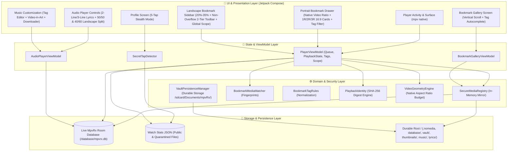
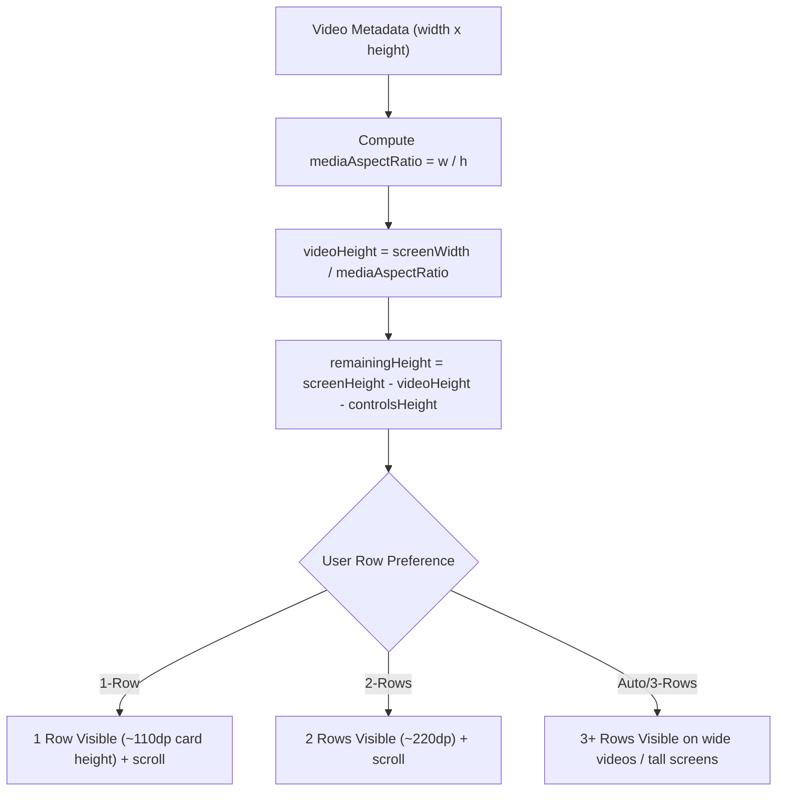
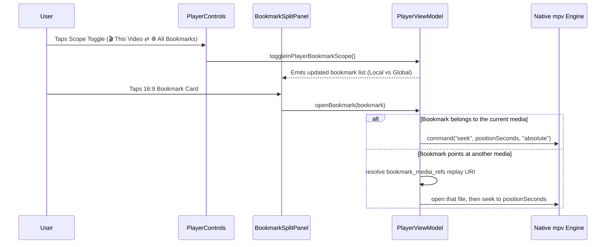
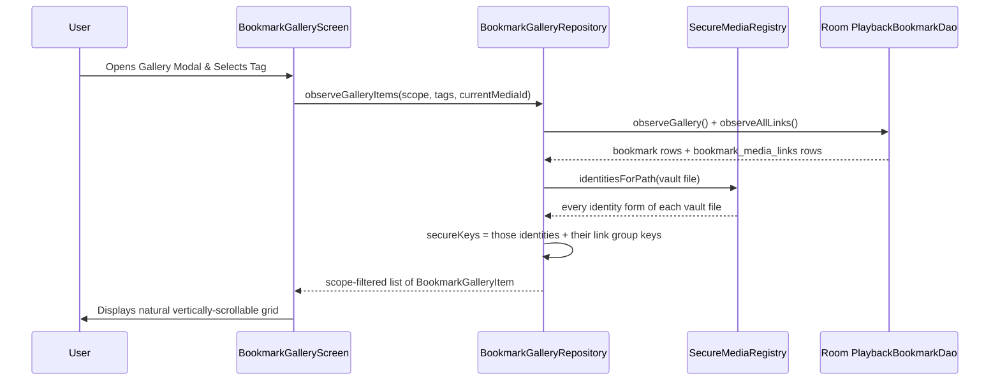
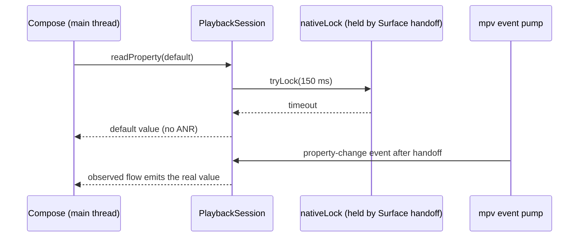
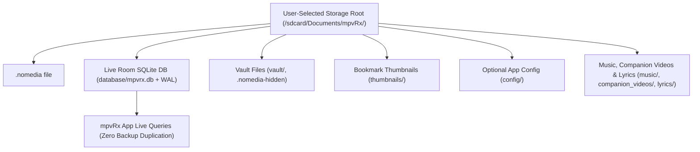
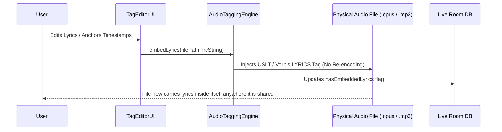
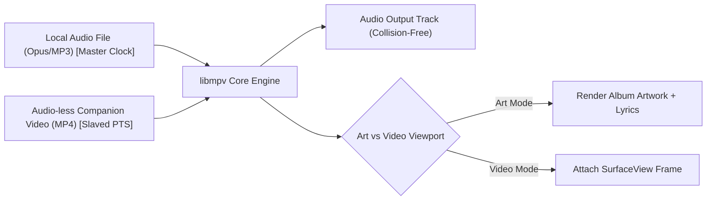

# System Architecture (`ARCHITECTURE.md`)
> **1-Line Summary:** Visual system architecture, subsystem mechanics, and integration recipes for mpvRx Android media player.

## 1. High-Level Visual System Map

---

## 2. Tech Stack & Why We Chose It

| Layer | Tool / Library | Plain-English Reason Why |
| --- | --- | --- |
| Playback Core | `libmpv` (C/C++ via JNI) | Unmatched format compatibility, hardware decoding, subtitle formatting, custom shader pipelines, and audio-video track switching. |
| UI Framework | Android Jetpack Compose + Material 3 | Declarative, reactive UI that effortlessly animates split panels, adaptive grids, and dual-orientation layouts. |
| Dependency Injection | Koin | Lightweight Kotlin-native DI with zero reflection overhead and immediate startup speeds. |
| Persistence | AndroidX Room (SQLite) + AtomicFile | Robust schema migrations for bookmarks/tags/music and atomic file writes for JSON statistics snapshots. |
| Media ID Hash | Java `MessageDigest` (SHA-256) | Generates collision-resistant stable identifiers for media across URI schemes and filesystem paths. |
| Durable Storage | `/sdcard/Documents/mpvRx/` (with `.nomedia`) | Hosts the live Room database, vault media and bookmark thumbnails outside app-private storage, so uninstalling or clearing the app cannot delete them. The PIN hash stays app-private on purpose and is re-created after a reinstall. |

---

## 3. Core Subsystems & Engineering Tricks

### [SUBSYSTEM: Dynamic-Portrait-Video-And-Bookmark-Drawer] | Aliases: portrait native ratio, dynamic rows, portrait tag filter
> **1-Line Summary:** Computes portrait video height dynamically based on native media aspect ratio, dedicates remaining vertical space to 16:9 bookmark cards (1, 2, or 3+ rows), caps columns at 2 or 3, and embeds a tag filter button in the portrait toolbar.
* **How It Works (Plain English):**
  * **Native Video Aspect Ratio:** In `PlayerControls.kt`, the video height is no longer hardcoded to 16:9 or a fixed percentage. It is calculated as `containerWidth / mediaAspectRatio`. A standard 16:9 video uses `width * 9 / 16`; an ultra-wide 21:9 video uses `width * 9 / 21`, immediately freeing extra vertical space.
  * **Dynamic Row Capacity:** The remaining height (`containerHeight - videoHeight - toolbarHeight`) is evaluated. Depending on the user's row preference (`1 Row`, `2 Rows`, `Auto-Fit`), the drawer displays 1, 2, or 3+ visible rows of cards without awkward clipping.
  * **Columns Selector:** Strictly restricted to 2 or 3 columns (`2 Cols` ⇄ `3 Cols`).
  * **Tag Filter in Portrait:** The portrait drawer toolbar includes a `🏷️ Filter` button that triggers the tag selection dialog overlay directly in portrait mode.
* **Data Flow Diagram:**

* **Code Anchors (Grep Targets):**
  * `app/src/main/java/app/gyrolet/mpvrx/ui/player/controls/PlayerControls.kt` -> `BookmarkSplitPanel`
  * `app/src/main/java/app/gyrolet/mpvrx/ui/player/controls/components/BookmarkListContent.kt` -> `BookmarkGridCard`, `BookmarkListContent`

---

### [SUBSYSTEM: Landscape-Sidebar-With-Global-Scope-Toggle] | Aliases: landscape sidebar, 20-35 width, non-overflow toolbar, global scope toggle
> **1-Line Summary:** Landscape bookmark sidebar maintaining 20% to 35% width steps with a non-overflow 2-tier toolbar, floating tag overlay, and a `Video ⇄ Global` scope toggle shared with the Chapters sheet and the full gallery.
* **How It Works (Plain English):**
  * **Width Menu:** Cycles across 20%, 25%, 30%, and 35%.
  * **Non-Overflow 2-Tier Toolbar:**
    * *Tier 1 (Action Icons):* 4 compact icon buttons with tooltips (`🏷️ Filter`, `⊞ Add`, `↗ Gallery`, `✕ Close`).
    * *Tier 2 (Toggle Chips):* Compact chips (`Scope: 🎬/🌐`, `25%`, `1 Col`). Uses short labels and compact paddings to prevent wrapping or overflowing at 20% width.
  * **In-Player Scope Toggle:** Tapping `🎬 This Video ⇄ 🌐 All Bookmarks` triggers `PlayerViewModel.toggleInPlayerBookmarkScope()`. The state lives in `PlayerViewModel`, so the portrait drawer, Chapters sheet and full-window gallery all show the same slice instead of keeping private copies that reset when a panel leaves composition.
  * **Floating Tag Filter Popup:** Opens a centered translucent overlay over the video without stopping playback.
* **Data Flow Diagram:**

* **Code Anchors (Grep Targets):**
  * `app/src/main/java/app/gyrolet/mpvrx/ui/player/controls/components/BookmarkListContent.kt` -> `BookmarkListContent`

---

### [SUBSYSTEM: Natural-Scroll-Gallery] | Aliases: bookmark gallery, vertical scroll grid, tag filter
> **1-Line Summary:** Fullscreen modal browsing all library bookmarks with natural vertical scrolling (`LazyVerticalGrid`), `This video` / `All videos` / `Secure videos` scope, autocomplete tag search, and orientation column caps (max 3 portrait, max 4 landscape).
* **How It Works (Plain English):** Smooth vertical `LazyVerticalGrid`. Top area provides a search bar with clickable autocomplete tag pills directly underneath. Columns are capped at 3 in portrait and 4 in landscape. Cards are 16:9 with gradient labels.
  * **Scope:** `All videos` and `Secure videos` are always offered; when the caller passes `currentMediaId`, `This video` joins them. The player's bookmark button opens the gallery with the current media id and, for protected playback, `secureOnly = true`.
  * **Secure classification:** `BookmarkGalleryRepository` treats a bookmark as secure when **any** identity form of a vault file matches, or when the bookmark's `mediaId` belongs to the link group of a secure id. Comparing only the row's stored `mediaId` let a file moved into the vault keep its old public key, so the bookmark stayed public and vanished from secure.
* **Data Flow Diagram:**

* **Code Anchors (Grep Targets):**
  * `app/src/main/java/app/gyrolet/mpvrx/ui/bookmarks/BookmarkGalleryScreen.kt` -> `BookmarkGalleryScreen`, `resolveColumnCount`, `onlyCurrentVideo`, `currentMediaId`
  * `app/src/main/java/app/gyrolet/mpvrx/domain/bookmark/BookmarkGalleryRepository.kt` -> `secureIds`, `secureKeys`, `observeAllLinks`
  * `app/src/main/java/app/gyrolet/mpvrx/database/dao/PlaybackBookmarkDao.kt` -> `observeAllLinks`

---

### [SUBSYSTEM: Bounded-UI-Thread-Native-Reads] | Aliases: playback ANR, mpv_get_property freeze, surface handoff lock, 150ms lock timeout
> **1-Line Summary:** Composition may ask libmpv for properties at any moment, so every UI-thread native read gives up after 150 ms and returns its caller's default instead of blocking on the session-wide lock during a Surface handoff.
* **How It Works (Plain English):**
  * `PlaybackSession` guards native mpv calls with a single `ReentrantLock`. A Surface attach/detach can hold that lock inside libmpv for longer than a frame, while Compose re-reads a property during recomposition.
  * All property reads flow through one helper: on the main looper it uses `nativeLock.tryLock(150 ms)`, and on failure returns the supplied default (0/false/empty) rather than waiting. Off the main thread it still takes a blocking lock, because worker correctness matters more than latency there.
  * The default is a *stale-but-safe* value, not an error: the observed-property flows emit the real value as soon as the event pump resumes, so the next recomposition corrects the UI.
  * Registering an observed property never waits at all — a zero-timeout `tryLock` failure is deferred to the pump, which registers it off the UI thread.
  * Surface attachment flags are `@Volatile`, so the UI thread can check them without taking the native lock.
* **Data Flow Diagram:**

* **Code Anchors (Grep Targets):**
  * `app/src/main/java/app/gyrolet/mpvrx/ui/player/PlaybackSession.kt` -> `UI_NATIVE_READ_TIMEOUT_MS`, `tryLock`, `registerObserved`
  * `app/src/main/java/app/gyrolet/mpvrx/ui/player/PlaybackSession.kt` -> `attachedSurfaceOwner`, `attachedSurfaceWidth` (`@Volatile`)

---

### [SUBSYSTEM: Music-Player-Lyrics-And-Split-Landscape] | Aliases: 2-line lyrics, 3-line lyrics, landscape 50-50 split, landscape 40-60 split
> **1-Line Summary:** Multi-line synchronized lyrics in portrait (2-line default, 3-line option) with dynamic artwork scaling, and configurable artwork vs lyrics split in landscape (`50/50`, `40/60`, `60/40`).
* **How It Works (Plain English):**
  * **Portrait Mode:** 2-line mode scales album artwork to 144dp; 3-line mode scales artwork to 112dp. Ensures transport controls and seekbars are never clipped or pushed off screen.
  * **Landscape Mode:** A split selector allows the user to allocate screen width between album artwork (or music video) and scrolling lyrics (`50/50` equal balance, `40/60` lyrics priority, `60/40` artwork priority).
  * **Customization Suite:** Details in [`docs/MUSIC_PLAYER_CUSTOMIZATION.md`](file:///c:/Users/kazir/Documents/Agentic Harness/mpvRx/docs/MUSIC_PLAYER_CUSTOMIZATION.md).
* **Code Anchors (Grep Targets):**
  * `app/src/main/java/app/gyrolet/mpvrx/ui/player/controls/AudioPlayerControls.kt` -> `AudioPlayerControls`

---

### [SUBSYSTEM: Zero-Leak-Secure-Sandbox-And-Vault-Persistence] | Aliases: persistent vault, survive uninstall, secure media registry
> **1-Line Summary:** Quarantines private media from history, stats and the public bookmark slice, prompts with the app-owned Secure Folder PIN (never the phone lock screen), and keeps vault media on durable storage under `Documents/mpvRx/vault/`.
* **How It Works (Plain English):**
  * `SecureMediaRegistry` caches private paths in memory and exposes `identitiesForPath()`, which returns all three identity forms (local path, `forUri(path)` and `forUri("file://…")`). History and stats query `isProtectedReference()` synchronously; the bookmark gallery compares the whole link group so a moved file cannot straddle the two slices.
  * Starting any private URI routes through `SecureUnlockActivity`, whose playback gate renders the app's own PIN entry (`SecurePinPrompt`) and verifies `SecureFolderPreferences.verifyPin()`. It never calls `BiometricPrompt` with `DEVICE_CREDENTIAL`, so the phone's pattern/password cannot appear on the way from the vault to the player.
  * `SecureFolderSession` records one unlock for the app session: entering the folder satisfies the playback gate, and `App.onActivityStopped` clears the token when the app is backgrounded.
  * Vault files live in `<DurableRoot>/vault/`, thumbnails in `<DurableRoot>/thumbnails/`, and the live database in `<DurableRoot>/database/`. A `.nomedia` marker blocks the Android media scanner from indexing the root.
  * The PIN salt/hash is deliberately app-private, so it does **not** survive uninstall. After a reinstall the durable database, vault and thumbnails are already on disk, and the user sets a new PIN to re-open the vault.
* **Code Anchors (Grep Targets):**
  * `app/src/main/java/app/gyrolet/mpvrx/domain/secure/SecureMediaRegistry.kt` -> `isProtectedReference`, `identitiesForPath`
  * `app/src/main/java/app/gyrolet/mpvrx/domain/secure/SecureFolderSession.kt` -> `markUnlocked`
  * `app/src/main/java/app/gyrolet/mpvrx/ui/securefolder/SecureUnlockActivity.kt` -> `SecurePinPrompt`, `launch`
  * `app/src/main/java/app/gyrolet/mpvrx/ui/securefolder/SecureFolderGateScreen.kt` -> `showBiometricPrompt` (`BIOMETRIC_STRONG` only)
  * `app/src/main/java/app/gyrolet/mpvrx/database/repository/SecureFolderRepository.kt` -> `secureDir`

---

### [SUBSYSTEM: Zero-Bloat-Single-Folder-Direct-Hosting-Engine] | Aliases: single folder storage, zero bloat, live room db external, no duplicate backups
> **1-Line Summary:** Points the live Room SQLite database instance directly to `<UserRoot>/database/mpvrx.db` alongside the secure vault, thumbnails, config, and media, eliminating duplicate backup file bloat.
* **How It Works (Plain English):**
  * Android apps typically put their SQLite database in internal private storage (`/data/data/...`) and require an export/backup mechanism to survive uninstall.
  * In mpvRx, the user picks a primary directory (e.g., `/sdcard/Documents/mpvRx/`). Using `Room.databaseBuilder(context, AppDatabase::class.java, File(userRoot, "database/mpvrx.db").absolutePath)`, the **live SQLite database runs directly from that external directory**.
  * Vault files, thumbnails, configurations, music, companion videos, and `.lrc` lyrics are colocated under `<UserRoot>/`.
  * **Result:** Zero duplicate backup files, zero storage bloat, zero danger of stale backups. Reinstalling mpvRx and pointing to this folder instantly restores 100% of state.
* **Data Flow Diagram:**

* **Code Anchors (Grep Targets):**
  * `app/src/main/java/app/gyrolet/mpvrx/di/DatabaseModule.kt` -> `databaseBuilder(... databasePath.absolutePath)`
  * `app/src/main/java/app/gyrolet/mpvrx/domain/storage/DurableStorageManager.kt` -> `durableRoot`, `databaseFile`, `vaultDirectory`, `thumbnailsDirectory`, `prepare`, `copyMediaDirectories`
  * `app/src/main/java/app/gyrolet/mpvrx/App.kt` -> `migrateDurableStorage` (copies legacy media, then rebases Room paths before switching new writes to the durable root)

---

### [SUBSYSTEM: Musicolet-Style-Metadata-And-Lyrics-Tag-Injector] | Aliases: musicolet style, embed lyrics into audio, id3 uslt tag, vorbis comment lyrics
> **1-Line Summary:** Directly injects synchronized LRC and unsynced plain text lyrics into audio container tags (`USLT`, `LYRICS`, `©lyr`) and updates metadata without re-encoding audio bytes.
* **How It Works (Plain English):**
  * Reads the physical audio container structure (MP3 ID3v2 header, FLAC/Vorbis comment block, MP4 atom box).
  * Writes the LRC-formatted text block directly into the audio tag:
    * **MP3:** Injects `USLT` (Unsynchronised Lyric/Text) and `SYLT` (Synchronised Lyric/Text) frames.
    * **FLAC / OGG / Opus:** Injects `LYRICS` and `UNSYNCEDLYRICS` Vorbis comment fields.
    * **M4A / MP4:** Injects `©lyr` atom.
  * Execution takes less than 30ms and touches only header bytes, leaving audio streams unaltered and bit-perfect.
* **Data Flow Diagram:**

* **Code Anchors (Grep Targets):**
  * `app/src/main/java/app/gyrolet/mpvrx/domain/metadata/AudioTaggingEngine.kt` -> `embedLyricsIntoAudioFile`, `extractEmbeddedLyrics`

---

### [SUBSYSTEM: Audio-less-Companion-Video-And-libmpv-Lockstep-Engine] | Aliases: audioless video, collision free sync, libmpv lockstep, video in artwork
> **1-Line Summary:** Synchronizes pure video streams with local high-fidelity audio, attaching/detaching the video surface without audio restart, collision, or timestamp drift.
* **How It Works (Plain English):**
  * When local audio already exists, yt-dlp extracts the video-only stream (`bestvideo[ext=mp4]`), saving ~60% bandwidth.
  * `libmpv` is instructed to mount the audio file as the primary master clock and slaves the companion video stream to the exact audio presentation timestamp (PTS).
  * Toggling between **Art** and **Video** attaches the Android `SurfaceView` to the existing mpv instance without stopping or reloading the audio stream.
  * When downloading a full video with audio, a smart prompt offers to delete redundant old audio files and unify playback.
* **Data Flow Diagram:**

* **Code Anchors (Grep Targets):**
  * `app/src/main/java/app/gyrolet/mpvrx/ui/player/PlayerViewModel.kt` -> `attachCompanionVideo`, `toggleArtworkVideoSurface`
  * `app/src/main/java/app/gyrolet/mpvrx/domain/download/CompanionVideoDownloader.kt` -> `downloadAudiolessStream`

---

### [SUBSYSTEM: Single-Point-Anchor-Lyric-Offset-Calibrator] | Aliases: 1-point lyric sync, anchor line to playhead, uniform offset shift
> **1-Line Summary:** Offsets an entire song's synchronized lyrics in a single tap by anchoring any selected lyric line to the active playhead, persisting changes to both disk and embedded tags.
* **How It Works (Plain English):**
  * Lyric files often have intro delays or slight differences across album/MV versions.
  * User selects a lyric line (e.g. line at timestamp $T_{\text{lyric}}$) and listens to the track.
  * At the exact second the line is vocalized, user taps "Anchor to Current Time" ($T_{\text{current}}$).
  * Calculates $\Delta t = T_{\text{current}} - T_{\text{lyric}}$.
  * Iterates through all lines in the LRC dataset and applies: $T'_{\text{line}} = \max(0, T_{\text{line}} + \Delta t)$.
  * Immediately writes updated lyrics to `<UserRoot>/lyrics/[Title].lrc` and embeds into audio container metadata.
* **Code Anchors (Grep Targets):**
  * `app/src/main/java/app/gyrolet/mpvrx/domain/lyrics/LyricsOffsetCalibrator.kt` -> `anchorLineToPlayhead`, `shiftAllTimestamps`

---

## 4. Verification & Health Checks

### [VERIFY: Cloud-And-Unit-TestSuite] | Aliases: test commands, gradle check, unit tests
> **1-Line Summary:** GitHub Actions is the only verification path; local Gradle builds and unit tests are not part of this project's workflow.
* **CI Build:** `.github/workflows/build.yml` runs the JVM unit tests and builds the standard release APK on every push to `master`.
* **Tag-Triggered Release Pipeline:** Push annotated git tag `vX.Y.Z` to trigger `.github/workflows/release.yml`, which re-validates the tag against `versionName` and `CHANGELOG.md`, builds and signs the APK, and publishes the GitHub Release asset.
* **Reading results:** `gh` in this checkout defaults to the `upstream` remote (`Riteshp2001/mpvRx`), not `origin`, so always pass `--repo Mostakim2005/mpvRx` to `gh run list` / `gh run view` / `gh release view`.
* **Caveat:** `build.yml` cancels the in-progress run for the same ref, so wait for a run to finish before pushing again; a cancelled run proves nothing.

---

## 5. Recipes: How to Add New Things Safely

* **Dual-Orientation Preview Rule:**
  * When generating UI previews or mocks, ALWAYS generate separate Portrait and Landscape versions with their dedicated proportions and controls.
