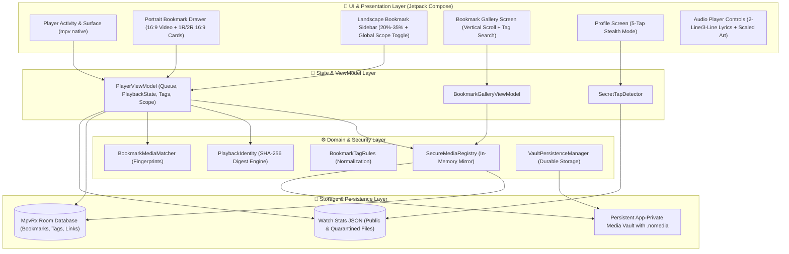
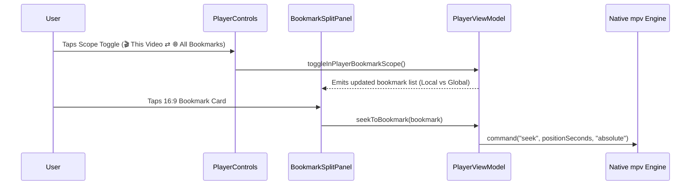
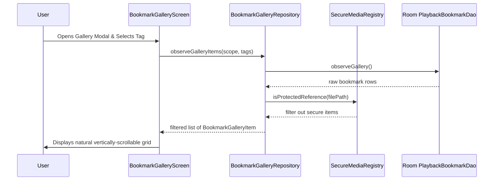

# System Architecture (`ARCHITECTURE.md`)
> **1-Line Summary:** Visual system architecture, subsystem mechanics, and integration recipes for mpvRx Android media player.

## 1. High-Level Visual System Map

---

## 2. Tech Stack & Why We Chose It

| Layer | Tool / Library | Plain-English Reason Why |
| --- | --- | --- |
| Playback Core | `libmpv` (C/C++ via JNI) | Unmatched format compatibility, hardware decoding, subtitle formatting, and custom shader pipelines. |
| UI Framework | Android Jetpack Compose + Material 3 | Declarative, reactive UI that effortlessly animates split panels, adaptive grids, and dual-orientation layouts. |
| Dependency Injection | Koin | Lightweight Kotlin-native DI with zero reflection overhead and immediate startup speeds. |
| Persistence | AndroidX Room (SQLite) + AtomicFile | Robust schema migrations for bookmarks/tags and atomic file writes for JSON statistics snapshots. |
| Media ID Hash | Java `MessageDigest` (SHA-256) | Generates collision-resistant stable identifiers for media across URI schemes and filesystem paths. |

---

## 3. Core Subsystems & Engineering Tricks

### [SUBSYSTEM: Dual-Orientation-In-Player-Bookmarks] | Aliases: portrait 16:9 drawer, landscape sidebar, in-player scope toggle
> **1-Line Summary:** Provides orientation-tailored bookmark interfaces: dynamic 16:9 video + 1R/2R 16:9 cards in portrait, and 20%-35% sidebar + in-drawer scope toggle in landscape.
* **How It Works (Plain English):**
  * **In Portrait:** Video height is calculated dynamically as `containerWidth * 9 / 16` so video stays at exact 16:9 without black borders. The remaining screen height is dedicated to the bookmark drawer. User can select 2 or 3 columns and toggle between 1 visible row or 2 visible rows of 16:9 cards.
  * **In Landscape:** Width cycles across 20%, 25%, 30%, and 35%. A dedicated toggle button in the 2-tier toolbar switches between displaying bookmarks from *This Video* and *All Videos (Global)* directly inside the player drawer.
* **Data Flow Diagram:**

* **Code Anchors (Grep Targets):**
  * `app/src/main/java/app/gyrolet/mpvrx/ui/player/controls/PlayerControls.kt` -> `BookmarkSplitPanel`
  * `app/src/main/java/app/gyrolet/mpvrx/ui/player/controls/components/BookmarkListContent.kt` -> `BookmarkGridCard`

### [SUBSYSTEM: Natural-Scroll-Gallery] | Aliases: bookmark gallery, vertical scroll grid, tag filter
> **1-Line Summary:** Fullscreen modal browsing all library bookmarks with natural vertical scrolling (`LazyVerticalGrid`), autocomplete tag search, and orientation column caps (max 3 portrait, max 4 landscape).
* **How It Works (Plain English):** Replaces the flawed two-row horizontal strip design with a clean vertical `LazyVerticalGrid`. Top area provides a padded search bar with clickable autocomplete tag pills directly underneath. Columns are capped at 3 in portrait and 4 in landscape. Cards are 16:9 with gradient labels.
* **Data Flow Diagram:**

* **Code Anchors (Grep Targets):**
  * `app/src/main/java/app/gyrolet/mpvrx/ui/bookmarks/BookmarkGalleryScreen.kt` -> `BookmarkGalleryScreen`, `resolveColumnCount`

### [SUBSYSTEM: Music-Player-Lyrics-And-Dynamic-Artwork] | Aliases: 2-line lyrics, 3-line lyrics, 144dp art, lyrics slider
> **1-Line Summary:** Multi-line lyrics engine with dynamic artwork scaling (144dp for 2-line, 112dp for 3-line) to eliminate transport button crowding.
* **How It Works (Plain English):** In `AudioPlayerControls.kt`, lyrics mode determines album art size:
  * 1-Line Mode: 176dp x 176dp artwork.
  * 2-Line Mode (Default): 144dp x 144dp artwork.
  * 3-Line Mode: 112dp x 112dp artwork.
  Lyrics text size is adjustable via a slider from 11sp to 20sp in preferences.
* **Code Anchors (Grep Targets):**
  * `app/src/main/java/app/gyrolet/mpvrx/ui/player/controls/AudioPlayerControls.kt` -> `AudioPlayerControls`

### [SUBSYSTEM: Zero-Leak-Secure-Sandbox-And-Vault-Persistence] | Aliases: secure media registry, quarantined stats, vault persistence
> **1-Line Summary:** Synchronous in-memory security registry and biometric gate that isolates private media from history, public stats, and unauthenticated intent playback, backed by durable storage.
* **How It Works (Plain English):** `SecureMediaRegistry` caches private file paths and playback identities in memory. Room Flow observers (`RecentlyPlayedRepository`, `WatchStatsRepository`) query `isProtectedReference()` synchronously. Starting any private URI routes through `SecureUnlockActivity`. On Profile, `SecretTapDetector` requires 5 rapid taps on the "mpvRx" wordmark to reveal secret stats. Vault files and databases are stored in durable app-external storage with `.nomedia` so they survive app uninstall.
* **Code Anchors (Grep Targets):**
  * `app/src/main/java/app/gyrolet/mpvrx/domain/secure/SecureMediaRegistry.kt` -> `isProtectedReference`
  * `app/src/main/java/app/gyrolet/mpvrx/ui/securefolder/SecureUnlockActivity.kt` -> `launch`
  * `app/src/main/java/app/gyrolet/mpvrx/ui/securefolder/SecretTapDetector.kt` -> `SecretTapDetector`

---

## 4. Verification & Health Checks

### [VERIFY: Cloud-And-Unit-TestSuite] | Aliases: test commands, gradle check, unit tests
> **1-Line Summary:** Standard commands and CI pipelines for verifying logic and building release APKs.
* **Local Unit Tests:** `./gradlew test` (or `./gradlew testStandardReleaseUnitTest --tests app.gyrolet.mpvrx.ui.player.PlaybackIdentityTest`)
* **Tag-Triggered Release Pipeline:** Push annotated git tag `vX.Y.Z` to trigger `.github/workflows/release.yml`.

---

## 5. Recipes: How to Add New Things Safely

* **Dual-Orientation Preview Rule:**
  * When generating UI previews or mocks, ALWAYS generate separate Portrait and Landscape versions with their dedicated proportions and controls.
