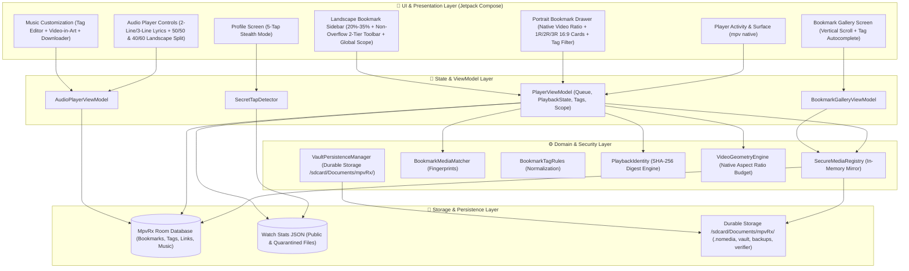
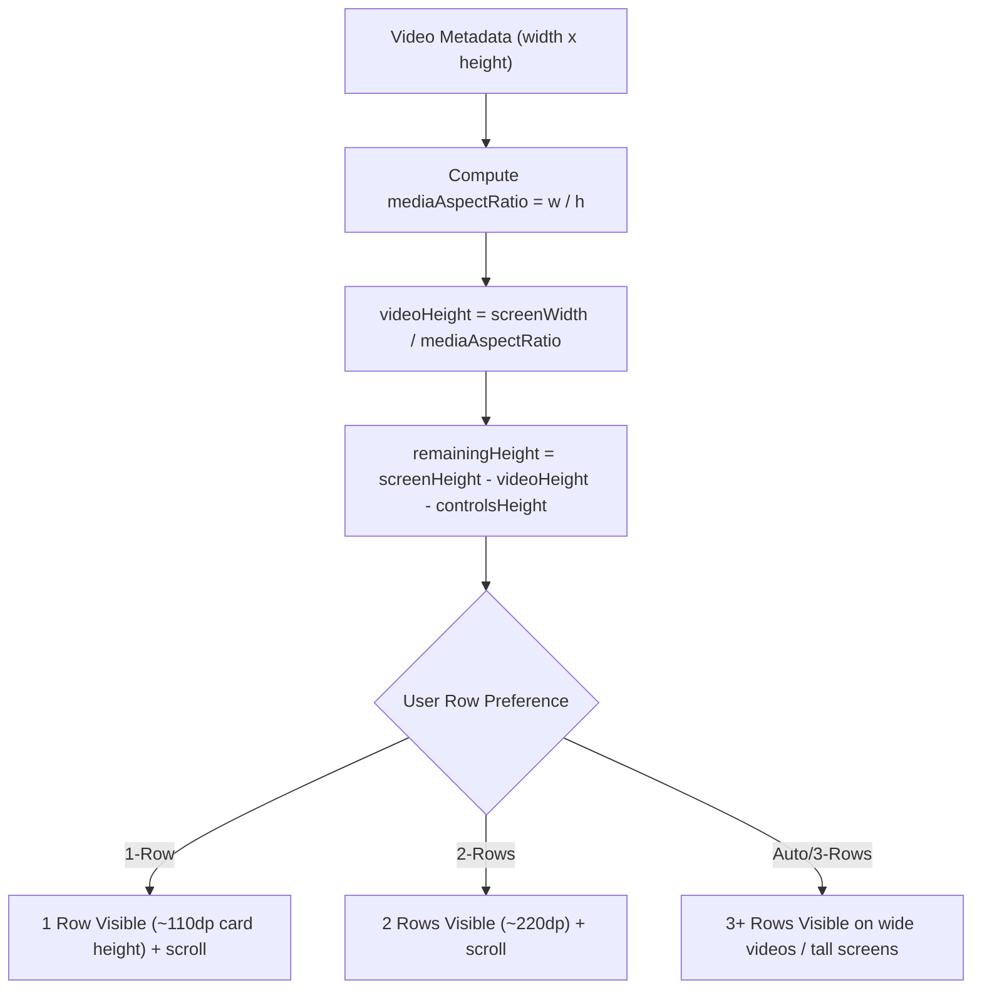
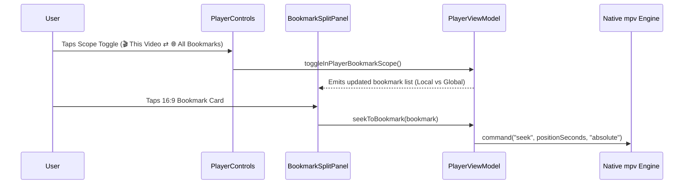
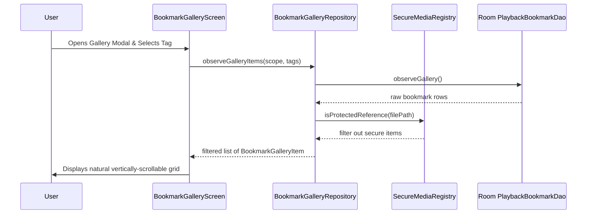

# System Architecture (`ARCHITECTURE.md`)
> **1-Line Summary:** Visual system architecture, subsystem mechanics, and integration recipes for mpvRx Android media player.

## 1. High-Level Visual System Map

---

## 2. Tech Stack & Why We Chose It

| Layer | Tool / Library | Plain-English Reason Why |
| --- | --- | --- |
| Playback Core | `libmpv` (C/C++ via JNI) | Unmatched format compatibility, hardware decoding, subtitle formatting, custom shader pipelines, and audio-video track switching. |
| UI Framework | Android Jetpack Compose + Material 3 | Declarative, reactive UI that effortlessly animates split panels, adaptive grids, and dual-orientation layouts. |
| Dependency Injection | Koin | Lightweight Kotlin-native DI with zero reflection overhead and immediate startup speeds. |
| Persistence | AndroidX Room (SQLite) + AtomicFile | Robust schema migrations for bookmarks/tags/music and atomic file writes for JSON statistics snapshots. |
| Media ID Hash | Java `MessageDigest` (SHA-256) | Generates collision-resistant stable identifiers for media across URI schemes and filesystem paths. |
| Persistent Vault | `/sdcard/Documents/mpvRx/` (with `.nomedia`) | Ensures private media, bookmark thumbnails, database backups, and PIN credentials survive app uninstallation. |

---

## 3. Core Subsystems & Engineering Tricks

### [SUBSYSTEM: Dynamic-Portrait-Video-And-Bookmark-Drawer] | Aliases: portrait native ratio, dynamic rows, portrait tag filter
> **1-Line Summary:** Computes portrait video height dynamically based on native media aspect ratio, dedicates remaining vertical space to 16:9 bookmark cards (1, 2, or 3+ rows), caps columns at 2 or 3, and embeds a tag filter button in the portrait toolbar.
* **How It Works (Plain English):**
  * **Native Video Aspect Ratio:** In `PlayerControls.kt`, the video height is no longer hardcoded to 16:9 or a fixed percentage. It is calculated as `containerWidth / mediaAspectRatio`. A standard 16:9 video uses `width * 9 / 16`; an ultra-wide 21:9 video uses `width * 9 / 21`, immediately freeing extra vertical space.
  * **Dynamic Row Capacity:** The remaining height (`containerHeight - videoHeight - toolbarHeight`) is evaluated. Depending on the user's row preference (`1 Row`, `2 Rows`, `Auto-Fit`), the drawer displays 1, 2, or 3+ visible rows of cards without awkward clipping.
  * **Columns Selector:** Strictly restricted to 2 or 3 columns (`2 Cols` ⇄ `3 Cols`).
  * **Tag Filter in Portrait:** The portrait drawer toolbar includes a `🏷️ Filter` button that triggers the tag selection dialog overlay directly in portrait mode.
* **Data Flow Diagram:**

* **Code Anchors (Grep Targets):**
  * `app/src/main/java/app/gyrolet/mpvrx/ui/player/controls/PlayerControls.kt` -> `BookmarkSplitPanel`
  * `app/src/main/java/app/gyrolet/mpvrx/ui/player/controls/components/BookmarkListContent.kt` -> `BookmarkGridCard`, `BookmarkListContent`

---

### [SUBSYSTEM: Landscape-Sidebar-With-Global-Scope-Toggle] | Aliases: landscape sidebar, 20-35 width, non-overflow toolbar, global scope toggle
> **1-Line Summary:** Landscape bookmark sidebar maintaining 20% to 35% width steps with a non-overflow 2-tier toolbar, floating tag overlay, and an in-drawer toggle between this video's bookmarks and all library bookmarks.
* **How It Works (Plain English):**
  * **Width Menu:** Cycles across 20%, 25%, 30%, and 35%.
  * **Non-Overflow 2-Tier Toolbar:**
    * *Tier 1 (Action Icons):* 4 compact icon buttons with tooltips (`🏷️ Filter`, `⊞ Add`, `↗ Gallery`, `✕ Close`).
    * *Tier 2 (Toggle Chips):* Compact chips (`Scope: 🎬/🌐`, `25%`, `1 Col`). Uses short labels and compact paddings to prevent wrapping or overflowing at 20% width.
  * **In-Player Scope Toggle:** Tapping `🎬 This Video ⇄ 🌐 All Bookmarks` triggers `PlayerViewModel.toggleInPlayerBookmarkScope()`, switching the drawer between the current video's timestamps and all library bookmarks.
  * **Floating Tag Filter Popup:** Opens a centered translucent overlay over the video without stopping playback.
* **Data Flow Diagram:**

* **Code Anchors (Grep Targets):**
  * `app/src/main/java/app/gyrolet/mpvrx/ui/player/controls/components/BookmarkListContent.kt` -> `BookmarkListContent`

---

### [SUBSYSTEM: Natural-Scroll-Gallery] | Aliases: bookmark gallery, vertical scroll grid, tag filter
> **1-Line Summary:** Fullscreen modal browsing all library bookmarks with natural vertical scrolling (`LazyVerticalGrid`), autocomplete tag search, and orientation column caps (max 3 portrait, max 4 landscape).
* **How It Works (Plain English):** Smooth vertical `LazyVerticalGrid`. Top area provides a search bar with clickable autocomplete tag pills directly underneath. Columns are capped at 3 in portrait and 4 in landscape. Cards are 16:9 with gradient labels.
* **Data Flow Diagram:**

* **Code Anchors (Grep Targets):**
  * `app/src/main/java/app/gyrolet/mpvrx/ui/bookmarks/BookmarkGalleryScreen.kt` -> `BookmarkGalleryScreen`, `resolveColumnCount`

---

### [SUBSYSTEM: Music-Player-Lyrics-And-Split-Landscape] | Aliases: 2-line lyrics, 3-line lyrics, landscape 50-50 split, landscape 40-60 split
> **1-Line Summary:** Multi-line synchronized lyrics in portrait (2-line default, 3-line option) with dynamic artwork scaling, and configurable artwork vs lyrics split in landscape (`50/50`, `40/60`, `60/40`).
* **How It Works (Plain English):**
  * **Portrait Mode:** 2-line mode scales album artwork to 144dp; 3-line mode scales artwork to 112dp. Ensures transport controls and seekbars are never clipped or pushed off screen.
  * **Landscape Mode:** A split selector allows the user to allocate screen width between album artwork (or music video) and scrolling lyrics (`50/50` equal balance, `40/60` lyrics priority, `60/40` artwork priority).
  * **Customization Suite:** Details in [`docs/MUSIC_PLAYER_CUSTOMIZATION.md`](file:///c:/Users/kazir/Documents/Agentic Harness/mpvRx/docs/MUSIC_PLAYER_CUSTOMIZATION.md).
* **Code Anchors (Grep Targets):**
  * `app/src/main/java/app/gyrolet/mpvrx/ui/player/controls/AudioPlayerControls.kt` -> `AudioPlayerControls`

---

### [SUBSYSTEM: Zero-Leak-Secure-Sandbox-And-Vault-Persistence] | Aliases: persistent vault, survive uninstall, secure media registry
> **1-Line Summary:** Quarantines private media from history and stats, challenges using the Secure Folder PIN directly, and stores vault media, thumbnails, database backups, and PIN verifiers in persistent public storage (`/sdcard/Documents/mpvRx/` with `.nomedia`) to survive uninstallation.
* **How It Works (Plain English):**
  * `SecureMediaRegistry` caches private file paths in memory; history/stats repos query `isProtectedReference()` synchronously.
  * Starting any private URI routes through `SecureUnlockActivity` using the Secure Folder PIN (no device PIN double prompt).
  * All encrypted media, bookmark thumbnails, database snapshots, and salt/verifier credentials are stored under `/sdcard/Documents/mpvRx/`.
  * A `.nomedia` file blocks standard Android media scanner from discovering private files.
  * On app reinstallation, mpvRx detects the existing `/sdcard/Documents/mpvRx/` folder, authenticates using the existing PIN verifier, and restores the library seamlessly.
* **Code Anchors (Grep Targets):**
  * `app/src/main/java/app/gyrolet/mpvrx/domain/secure/SecureMediaRegistry.kt` -> `isProtectedReference`
  * `app/src/main/java/app/gyrolet/mpvrx/ui/securefolder/SecureUnlockActivity.kt` -> `launch`
  * `app/src/main/java/app/gyrolet/mpvrx/database/repository/SecureFolderRepository.kt` -> `SecureFolderRepository`

---

## 4. Verification & Health Checks

### [VERIFY: Cloud-And-Unit-TestSuite] | Aliases: test commands, gradle check, unit tests
> **1-Line Summary:** Standard commands and CI pipelines for verifying logic and building release APKs.
* **Local Unit Tests:** `./gradlew test` (or `./gradlew testStandardReleaseUnitTest --tests app.gyrolet.mpvrx.ui.player.PlaybackIdentityTest`)
* **Tag-Triggered Release Pipeline:** Push annotated git tag `vX.Y.Z` to trigger `.github/workflows/release.yml`.

---

## 5. Recipes: How to Add New Things Safely

* **Dual-Orientation Preview Rule:**
  * When generating UI previews or mocks, ALWAYS generate separate Portrait and Landscape versions with their dedicated proportions and controls.
