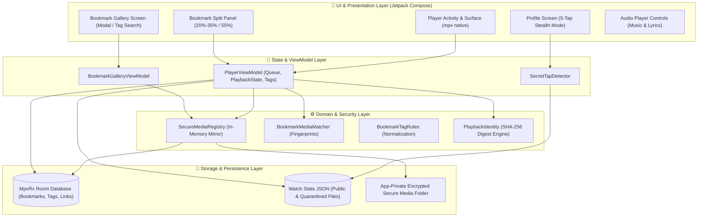
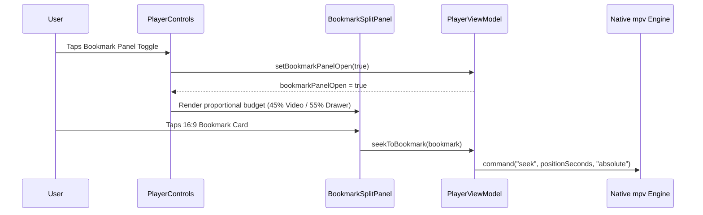
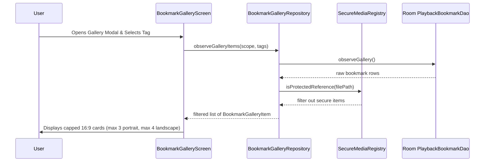
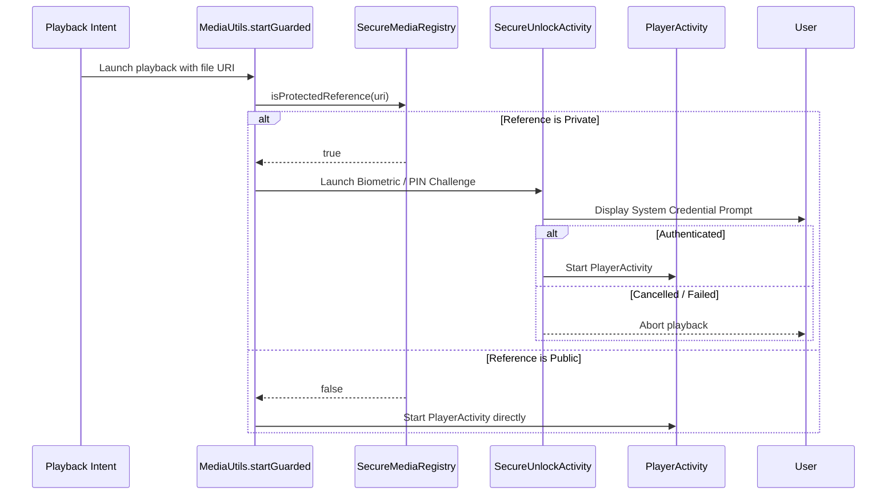

# System Architecture (`ARCHITECTURE.md`)
> **1-Line Summary:** Visual system architecture, subsystem mechanics, and integration recipes for mpvRx Android media player.

## 1. High-Level Visual System Map

---

## 2. Tech Stack & Why We Chose It

| Layer | Tool / Library | Plain-English Reason Why |
| --- | --- | --- |
| Playback Core | `libmpv` (C/C++ via JNI) | Unmatched format compatibility, hardware decoding, subtitle formatting, and custom shader pipelines. |
| UI Framework | Android Jetpack Compose + Material 3 | Declarative, reactive UI that effortlessly animates split panels, adaptive grids, and orientation changes. |
| Dependency Injection | Koin | Lightweight Kotlin-native DI with zero reflection overhead and immediate startup speeds. |
| Persistence | AndroidX Room (SQLite) + AtomicFile | Robust schema migrations for bookmarks/tags and atomic file writes for JSON statistics snapshots. |
| Media ID Hash | Java `MessageDigest` (SHA-256) | Generates collision-resistant stable identifiers for media across URI schemes and filesystem paths. |

---

## 3. Core Subsystems & Engineering Tricks

### [SUBSYSTEM: Dual-Orientation-Bookmark-Drawer] | Aliases: split panel, portrait drawer, landscape sidebar
> **1-Line Summary:** Calculates strict proportional screen budgets so video playback and 16:9 bookmark cards coexist with zero letterboxing or unwanted scrolling.
* **How It Works (Plain English):** In portrait mode, `PlayerControls` allocates exactly 45% screen height to video and 55% to the bookmark drawer. The drawer runs a 2-column grid whose card height is derived strictly from column width times 9/16, guaranteeing 16:9 cards without black side-bars. In landscape mode, the drawer width cycles through 20%, 25%, 30%, and 35%, leaving the rest for video.
* **Data Flow Diagram:**

* **Code Anchors (Grep Targets):**
  * `app/src/main/java/app/gyrolet/mpvrx/ui/player/controls/PlayerControls.kt` -> `BookmarkSplitPanel`
  * `app/src/main/java/app/gyrolet/mpvrx/ui/player/controls/components/BookmarkListContent.kt` -> `BookmarkGridCard`

### [SUBSYSTEM: Cross-Video-Tag-And-Gallery] | Aliases: bookmark tags, gallery repository, tag filter
> **1-Line Summary:** Links bookmarks across different videos via normalized tag entities and powers a full-screen searchable gallery with orientation-specific column caps.
* **How It Works (Plain English):** Tags are stored in Room (`BookmarkTagEntity`) and linked to bookmarks. `BookmarkGalleryRepository` combines gallery rows with `SecureFolderRepository.observeAll()` to strip secure media in normal mode. `BookmarkGalleryScreen` enforces a strict 3-column cap in portrait and 4-column cap in landscape with 34% controls and 33%/33% row heights.
* **Data Flow Diagram:**

* **Code Anchors (Grep Targets):**
  * `app/src/main/java/app/gyrolet/mpvrx/domain/bookmark/BookmarkGalleryRepository.kt` -> `observeGalleryItems`
  * `app/src/main/java/app/gyrolet/mpvrx/ui/bookmarks/BookmarkGalleryScreen.kt` -> `BookmarkGalleryScreen`, `resolveColumnCount`

### [SUBSYSTEM: Zero-Leak-Secure-Sandbox] | Aliases: secure media registry, quarantined stats, stealth mode
> **1-Line Summary:** Synchronous in-memory security registry and biometric gate that isolates private media from history, public stats, and unauthenticated intent playback.
* **How It Works (Plain English):** `SecureMediaRegistry` caches private file paths and playback identities in memory. Room Flow observers (`RecentlyPlayedRepository`, `WatchStatsRepository`) query `isProtectedReference()` synchronously. Starting any private URI routes through `SecureUnlockActivity`. On Profile, `SecretTapDetector` requires 5 rapid taps on the "mpvRx" wordmark to prompt biometric authentication and reveal secret stats.
* **Data Flow Diagram:**

* **Code Anchors (Grep Targets):**
  * `app/src/main/java/app/gyrolet/mpvrx/domain/secure/SecureMediaRegistry.kt` -> `isProtectedReference`
  * `app/src/main/java/app/gyrolet/mpvrx/ui/securefolder/SecureUnlockActivity.kt` -> `launch`
  * `app/src/main/java/app/gyrolet/mpvrx/ui/securefolder/SecretTapDetector.kt` -> `SecretTapDetector`

### [SUBSYSTEM: Playback-Identity-Engine] | Aliases: playback identity, path normalization, media digest
> **1-Line Summary:** Collision-resistant SHA-256 hashing engine converting local paths, network shares, and URIs into unified stable keys (`media:v2:...`).
* **How It Works (Plain English):** Pure string segment normalization resolves `.` and `..`, unifies slashes, strips `file://` prefixes, and leaves non-file URIs (`content:`, `media:`) intact without invoking `java.net.URI`. The result is prefixed with `local\0` and hashed with SHA-256.
* **Code Anchors (Grep Targets):**
  * `app/src/main/java/app/gyrolet/mpvrx/ui/player/PlaybackModels.kt` -> `PlaybackIdentity`, `normalizeLocalPath`

---

## 4. Verification & Health Checks

### [VERIFY: Cloud-And-Unit-TestSuite] | Aliases: test commands, gradle check, unit tests
> **1-Line Summary:** Standard commands and CI pipelines for verifying logic and building release APKs.
* **Local Unit Tests:** `./gradlew test` (or run specific suite: `./gradlew testStandardReleaseUnitTest --tests app.gyrolet.mpvrx.ui.player.PlaybackIdentityTest`)
* **Tag-Triggered Release Pipeline:** Push annotated git tag `vX.Y.Z` to trigger `.github/workflows/release.yml` for automated compilation, signing, and asset publishing.

---

## 5. Recipes: How to Add New Things Safely

* **To add a new Bookmark Panel Width:**
  1. Add the integer step (e.g., `40`) to `PANEL_WIDTH_STEPS` in `PlayerViewModel.kt`.
  2. Ensure minimum video width constraints are maintained in `PlayerControls.kt`.

* **To register a new sensitive media store:**
  1. Filter incoming rows using `runCatching { SecureMediaRegistry.isProtectedReference(path) }.getOrDefault(false)`.
  2. Mirror the store in `SecureFolderRepository.kt`.
