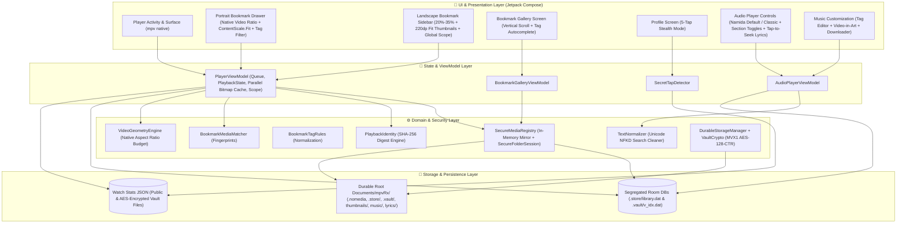
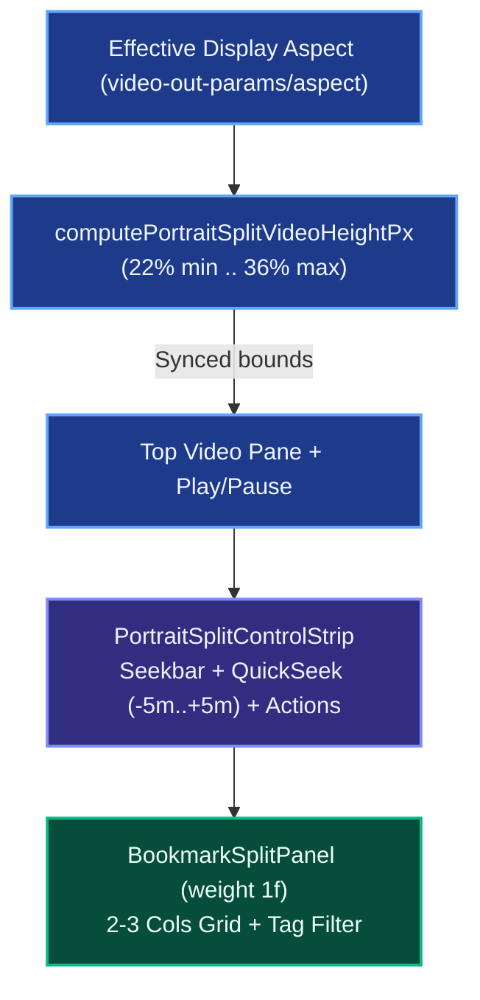
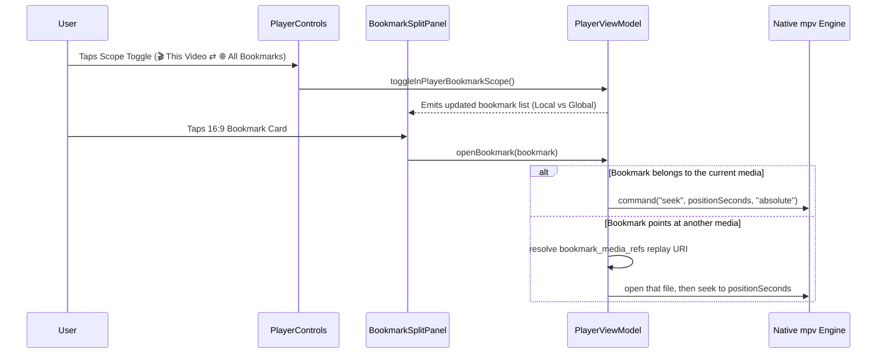
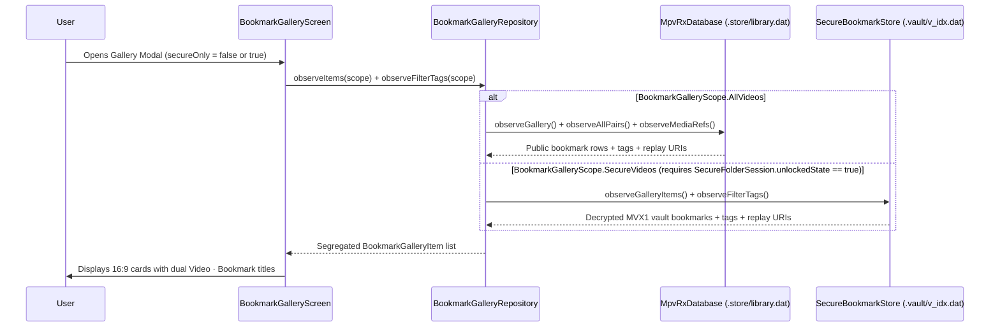
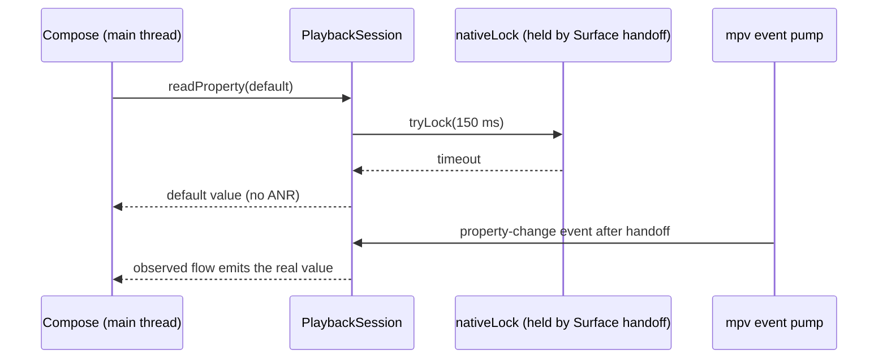
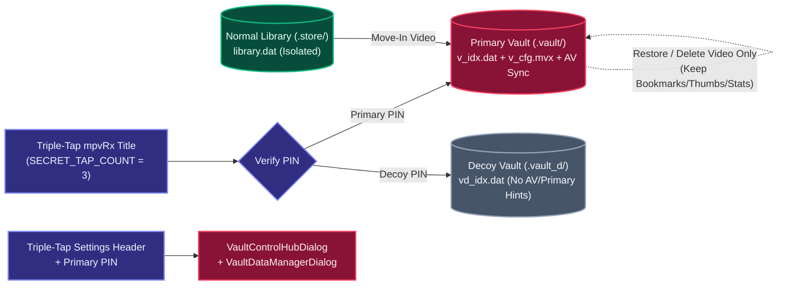
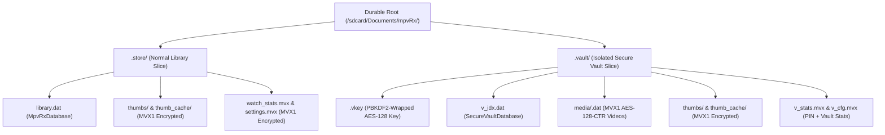
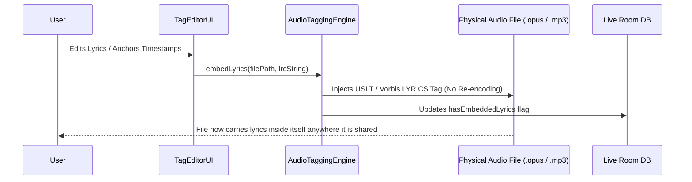
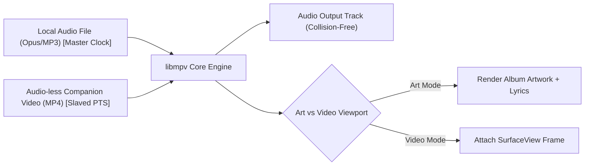
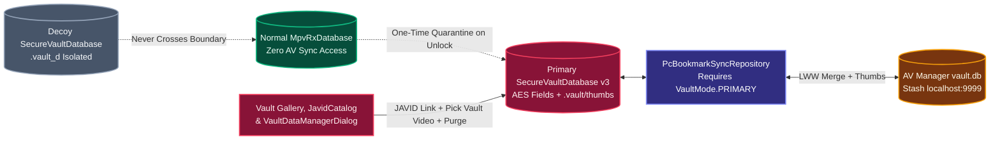

# System Architecture (`ARCHITECTURE.md`)
> **1-Line Summary:** Visual system architecture, subsystem mechanics, and integration recipes for mpvRx Android media player.

## 1. High-Level Visual System Map

---

## 2. Tech Stack & Why We Chose It

| Layer | Tool / Library | Plain-English Reason Why |
| --- | --- | --- |
| Playback Core | `libmpv` (C/C++ via JNI) | Unmatched format compatibility, hardware decoding, subtitle formatting, custom shader pipelines, and audio-video track switching. |
| UI Framework | Android Jetpack Compose + Material 3 | Declarative, reactive UI that effortlessly animates split panels, adaptive grids, and dual-orientation layouts. |
| Dependency Injection | Koin | Lightweight Kotlin-native DI with zero reflection overhead and immediate startup speeds. |
| Persistence | AndroidX Room (SQLite) + AtomicFile | Robust schema migrations for bookmarks/tags/music and atomic file writes for JSON statistics snapshots. |
| Media ID Hash | Java `MessageDigest` (SHA-256) | Generates collision-resistant stable identifiers for media across URI schemes and filesystem paths. |
| Durable Storage | `Documents/mpvRx/` (`.store/` + `.vault/` + `.nomedia`) | Hosts the segregated public (`.store/library.dat`) and `MVX1`-encrypted Secure Vault (`.vault/v_idx.dat`, `.vault/media/`) databases plus bookmark thumbnails outside app-private storage, so uninstalling or clearing the app cannot delete them. |

---

## 3. Core Subsystems & Engineering Tricks

### [SUBSYSTEM: Dynamic-Portrait-Video-And-Bookmark-Drawer] | Aliases: portrait native ratio, dynamic rows, portrait tag filter, portrait control strip, quick seek strip
> **1-Line Summary:** Synchronizes `PlayerActivity` `SurfaceView` and `PlayerControls` to the video's undistorted aspect height (`22%` floor, `36%` cap), docks seekbar + `-5m/-1m/-10s/+10s/+1m/+5m` quick-seek strip + portrait controls in `PortraitSplitControlStrip` below the video, and gives remaining portrait space to `BookmarkSplitPanel` while leaving Landscape Split untouched.
* **How It Works (Plain English):**
  * **Synchronized YouTube-Style Top Box:** Both `PlayerActivity.applySplitBookmarkPlayerBounds` and `PlayerControls` call `computePortraitSplitVideoHeightPx(width, height, effectiveAspect)` so the `SurfaceView` and Compose top video pane align pixel-for-pixel without `80/20` dead black bars.
  * **Dedicated Control Strip Beneath Video:** `PortraitSplitControlStrip` holds `renderPlayerSeekbar`, `PlayerQuickSeekStrip` (`-5m`, `-1m`, `-10s`, `+10s`, `+1m`, `+5m`), and theme-safe `BottomPlayerControlsPortrait` cleanly outside the video bounds, while fullscreen Portrait & Landscape overlays also render `PlayerQuickSeekStrip`.
  * **Expanded Bookmark Panel (`weight(1f)`):** Consumes the freed lower space for 2–3 column cards, tag filters, scrollable toggle chips (`Sync to video`, `2 Cols`/`3 Cols`, `Video`/`Global`, optional `JAVID`), and instant permanent `Delete bookmark` in `BookmarkActionMenuDialog`.
* **Data Flow Diagram:**

> **Legend:** Blue = Top Undistorted Video Pane | Indigo = Docked Control Deck & Quick-Seek Strip | Emerald = Expanded Bookmark Drawer
* **Links:** `[FEATURE: Isolated-Vault-Decoy-Compartment-And-YouTube-Portrait-Split]`, `[DECISION: Dynamic-Portrait-Native-Ratio-Video-And-Dynamic-Rows]`
* **Code Anchors (Grep Targets):**
  * `app/src/main/java/app/gyrolet/mpvrx/ui/player/PlayerActivity.kt` :: `applySplitBookmarkPlayerBounds`, `setupBookmarkSplitPanelObserver`
  * `app/src/main/java/app/gyrolet/mpvrx/ui/player/controls/PlayerControls.kt` :: `PortraitSplitControlStrip`, `PlayerQuickSeekStrip`, `BookmarkSplitPanel`
  * `app/src/main/java/app/gyrolet/mpvrx/ui/player/controls/components/BookmarkListContent.kt` :: `computePortraitSplitVideoHeightPx`, `QUICK_SEEK_STEPS`, `BookmarkActionMenuDialog`, `BookmarkSplitPanel`
  * `app/src/main/java/app/gyrolet/mpvrx/ui/player/controls/components/sheets/ChaptersSheet.kt` :: `PlaybackBookmarkEditor`, `hideImeWindow`

---

### [SUBSYSTEM: Landscape-Sidebar-With-Global-Scope-Toggle] | Aliases: landscape sidebar, 20-35 width, non-overflow toolbar, global scope toggle
> **1-Line Summary:** Landscape bookmark sidebar maintaining 20% to 35% width steps with a non-overflow 2-tier toolbar, floating tag overlay, and a `Video ⇄ Global` scope toggle shared with the Chapters sheet and the full gallery.
* **How It Works (Plain English):**
  * **Width Menu:** Cycles across 20%, 25%, 30%, and 35%.
  * **Non-Overflow 2-Tier Toolbar:**
    * *Tier 1 (Action Icons):* Compact icon buttons with tooltips (`FilterList`, `Bookmarks`, `Add`, `ZoomOutMap`, `Close`).
    * *Tier 2 (Scrollable Toggle & Sync Chips):* Compact chips inside a horizontally scrollable row (`Sync`, `Global`/`Video`, `25%`, card count, optional `JAVID`) so narrow `20%` width never clips or wraps.
  * **Chapter-Style Playhead Sync:** `resolveBookmarkSyncTarget` highlights the playing video's latest bookmark `<= currentPositionMs` without stealing scroll, and **Sync** / **Sync to video** animates Portrait, Landscape, or Overlay `ChaptersSheet` back to it.
  * **In-Player Scope Toggle:** Tapping `🎬 This Video ⇄ 🌐 All Bookmarks` triggers `PlayerViewModel.toggleInPlayerBookmarkScope()`. The state lives in `PlayerViewModel`, so the portrait drawer, Chapters sheet and full-window gallery all show the same slice instead of keeping private copies that reset when a panel leaves composition.
  * **Floating Tag Filter Popup:** Opens a centered translucent overlay over the video without stopping playback.
* **Data Flow Diagram:**

* **Code Anchors (Grep Targets):**
  * `app/src/main/java/app/gyrolet/mpvrx/ui/player/controls/components/BookmarkListContent.kt` :: `BookmarkSplitPanel`, `BookmarkGridCard`, `PanelToggleChip`
  * `app/src/main/java/app/gyrolet/mpvrx/ui/player/controls/components/BookmarkPositionSync.kt` :: `resolveBookmarkSyncTarget`, `resolveBookmarkOrChapterScrollIndex`
  * `app/src/main/java/app/gyrolet/mpvrx/ui/player/controls/components/sheets/ChaptersSheet.kt` :: `ChaptersSheet`
  * `app/src/main/java/app/gyrolet/mpvrx/ui/player/controls/PlayerSheets.kt` :: `ChaptersSheetWithBookmarks`

---

### [SUBSYSTEM: Natural-Scroll-Gallery] | Aliases: bookmark gallery, vertical scroll grid, tag filter
> **1-Line Summary:** Fullscreen modal browsing library bookmarks with natural vertical scrolling (`LazyVerticalGrid`), hard-segregated public (`All videos`) vs vault (`Secure videos`) slices, dual video-and-bookmark card labels, autocomplete tag search, and orientation column caps (max 3 portrait, max 4 landscape).
* **How It Works (Plain English):** Smooth vertical `LazyVerticalGrid`. Top area provides a search bar with clickable autocomplete tag pills directly underneath. Columns are capped at 3 in portrait and 4 in landscape. Cards are 16:9 with gradient labels showing `"<VideoName> · <BookmarkTitle>"` in Global scope.
  * **Hard Segregation:** The public gallery (`secureOnly = false`) offers `This video` and `All videos` only — the `Secure videos` pill is completely removed from the normal browser and normal player so vault bookmarks never appear outside the unlocked Secure Folder. When opened from `SecureFolderScreen` or a Secure Folder video (`secureOnly = true`), the gallery is locked to `Secure videos` (and `This video`) and auto-closes if `SecureFolderSession.unlockedState` transitions to `false`.
  * **Physical Database Separation:** `BookmarkGalleryRepository` reads `BookmarkGalleryScope.AllVideos` strictly from `MpvRxDatabase` (`.store/library.dat`) and `BookmarkGalleryScope.SecureVideos` strictly from `SecureBookmarkStore` (`SecureVaultDatabase` at `.vault/v_idx.dat`, gated on `SecureFolderSession.unlockedState`).
* **Data Flow Diagram:**

* **Code Anchors (Grep Targets):**
  * `app/src/main/java/app/gyrolet/mpvrx/ui/bookmarks/BookmarkGalleryScreen.kt` -> `BookmarkGalleryScreen`, `BookmarkGalleryOverlay`, `BookmarkGalleryContent`, `onlyCurrentVideo`, `initialOnlyCurrentVideo`
  * `app/src/main/java/app/gyrolet/mpvrx/domain/bookmark/BookmarkGalleryRepository.kt` -> `observeItems`, `observeFilterTags`
  * `app/src/main/java/app/gyrolet/mpvrx/domain/bookmark/SecureBookmarkStore.kt` -> `observeGalleryItems`, `migrateMediaToVault`, `migrateMediaToPublic`
  * `app/src/main/java/app/gyrolet/mpvrx/ui/player/controls/components/BookmarkListContent.kt` -> `formatGlobalBookmarkTitle`, `BookmarkSplitPanel`

---

### [SUBSYSTEM: Bounded-UI-Thread-Native-Reads] | Aliases: playback ANR, mpv_get_property freeze, surface handoff lock, 150ms lock timeout
> **1-Line Summary:** Composition may ask libmpv for properties at any moment, so every UI-thread native read gives up after 150 ms and returns its caller's default instead of blocking on the session-wide lock during a Surface handoff.
* **How It Works (Plain English):**
  * `PlaybackSession` guards native mpv calls with a single `ReentrantLock`. A Surface attach/detach can hold that lock inside libmpv for longer than a frame, while Compose re-reads a property during recomposition.
  * All property reads flow through one helper: on the main looper it uses `nativeLock.tryLock(150 ms)`, and on failure returns the supplied default (0/false/empty) rather than waiting. Off the main thread it still takes a blocking lock, because worker correctness matters more than latency there.
  * The default is a *stale-but-safe* value, not an error: the observed-property flows emit the real value as soon as the event pump resumes, so the next recomposition corrects the UI.
  * Registering an observed property never waits at all — a zero-timeout `tryLock` failure is deferred to the pump, which registers it off the UI thread.
  * Surface attachment flags are `@Volatile`, so the UI thread can check them without taking the native lock.
  * Relative double-tap/remote seeks (`PlayerViewModel.seekBy`) and UI-initiated audiobook seeks (`AudiobookPlayback.seek` / `seekBy` / `seekInBook`) run off the Main thread on single-threaded sequential IO dispatchers (`RelativeSeekBatcher` coalesces rapid bursts that arrive while libmpv is mid-seek and skips redundant EOF `100%` exact seeks), keeping native `commandForGeneration` locks off Compose gesture handlers.
* **Data Flow Diagram:**

* **Code Anchors (Grep Targets):**
  * `app/src/main/java/app/gyrolet/mpvrx/ui/player/PlaybackSession.kt` :: `UI_NATIVE_READ_TIMEOUT_MS`, `withReadyCoreRead`, `registerObservedLocked`
  * `app/src/main/java/app/gyrolet/mpvrx/ui/player/PlaybackSession.kt` :: `attachedSurfaceOwner`, `attachedSurfaceWidth` (`@Volatile`)
  * `app/src/main/java/app/gyrolet/mpvrx/ui/player/RelativeSeekBatcher.kt` :: `RelativeSeekBatcher`, `enqueue`, `takeNext`, `cancelPending`
  * `app/src/main/java/app/gyrolet/mpvrx/ui/player/PlayerViewModel.kt` :: `seekBy`, `executeRelativeSeekBatch`, `cancelPendingRelativeSeek`
  * `app/src/main/java/app/gyrolet/mpvrx/ui/player/AudiobookPlayback.kt` :: `seek`, `seekBy`, `seekInBook`, `seekInBookResolved`, `seekImmediate`

---

### [SUBSYSTEM: Music-Player-Lyrics-And-Split-Landscape] | Aliases: 2-line lyrics, 3-line lyrics, landscape 50-50 split, landscape 40-60 split
> **1-Line Summary:** Multi-line synchronized lyrics in portrait (2-line default, 3-line option) with dynamic artwork scaling, and configurable artwork vs lyrics split in landscape (`50/50`, `40/60`, `60/40`).
* **How It Works (Plain English):**
  * **Portrait Mode:** 2-line mode scales album artwork to 144dp; 3-line mode scales artwork to 112dp. Ensures transport controls and seekbars are never clipped or pushed off screen.
  * **Landscape Mode:** A split selector allows the user to allocate screen width between album artwork (or music video) and scrolling lyrics (`50/50` equal balance, `40/60` lyrics priority, `60/40` artwork priority).
  * **Customization Suite:** Details in [`docs/MUSIC_PLAYER_CUSTOMIZATION.md`](file:///c:/Users/kazir/Documents/Agentic Harness/mpvRx/docs/MUSIC_PLAYER_CUSTOMIZATION.md).
* **Code Anchors (Grep Targets):**
  * `app/src/main/java/app/gyrolet/mpvrx/ui/player/controls/AudioPlayerControls.kt` -> `AudioPlayerControls`

---

### [SUBSYSTEM: Zero-Leak-Secure-Sandbox-And-Vault-Persistence] | Aliases: persistent vault, survive uninstall, secure media registry, mvx1 encryption, vault streaming proxy, decoy secret folder, vault data manager
> **1-Line Summary:** Hard-segregates Normal Library (`.store/library.dat`), Primary Secret Vault (`.vault/v_idx.dat` + `v_cfg.mvx`), and Decoy Secret Vault (`.vault_d/vd_idx.dat`) with `MVX1` AES-128-CTR encryption, triple-tap entry (`SECRET_TAP_COUNT = 3`), PIN-gated `VaultControlHubDialog`, non-destructive restore/delete retention, and a 30-second background grace lock.
* **How It Works (Plain English):**
  * **Hardware-Accelerated `MVX1` Encryption (`VaultCrypto`):** Every Primary (`.vault/`) and Decoy (`.vault_d/`) media file, thumbnail, watch-stats snapshot (`v_stats.mvx`), durable settings mirror (`v_cfg.mvx`, which also isolates `bookmark_sync_*` config), and sensitive SQLite text column in `SecureVaultDatabase` (`v_idx.dat` / `vd_idx.dat`) is encrypted with AES-128-CTR (`MVX1`). A 128-bit master key is wrapped with PBKDF2-HMAC-SHA256 + HMAC integrity tag inside `.vault/.vkey`.
  * **Zero-Copy Seekable Playback & Probing:** `libmpv` streams encrypted vault videos via `VaultStreamingProxy` (`127.0.0.1` loopback HTTP range server), gated on `SecureFolderSession.isUnlocked`, while `VaultMode` (`LOCKED`, `PRIMARY`, `DECOY`) selects which database and media compartment is active.
  * **Hard 3-Compartment Segregation & Non-Destructive Vault Retention:** Normal media uses `MpvRxDatabase` (`.store/library.dat`); Primary Vault uses `SecureVaultDatabase` (`.vault/v_idx.dat`) + `SecureBookmarkStore`; Decoy Vault uses an isolated `named("decoy")` `SecureVaultDatabase` (`.vault_d/vd_idx.dat`). Moving files into Primary Vault migrates bookmarks/tags/states/stats/thumbnails into `.vault/`; restoring or deleting a Secret video leaves encrypted Vault bookmarks, JAVID groups, `.vault/thumbs/`, tags, playback states, and stats intact until manually removed in `VaultDataManagerDialog`.
  * **Triple-Tap Gates & Decoy Plausible Deniability:** Tapping `"mpvRx"` title/wordmark 3 times (`SECRET_TAP_COUNT = 3`, cancelling the delayed Light/Dark theme transition) opens `SecureFolderGateScreen`; entering the Primary PIN unlocks `VaultMode.PRIMARY` (and quarantines any legacy public AV Manager rows/thumbs), while entering the Decoy PIN opens `VaultMode.DECOY` with zero biometrics or Primary/AV hints. Triple-tapping the `"Secure Folder Settings"` header prompts for the Primary PIN and opens `VaultControlHubDialog` (Decoy toggle/PIN/wipe, AV Sync settings, JAVID Catalog, and 6-tab `VaultDataManagerDialog`).
* **Data Flow Diagram:**

> **Legend:** Indigo = Triple-Tap / PIN Gates | Rose = Primary Secret Vault & Data Manager | Slate = Isolated Decoy Vault | Emerald = Public Library (Never Sees AV Sync or Vault Items)
* **Links:** `[FEATURE: Isolated-Vault-Decoy-Compartment-And-YouTube-Portrait-Split]`, `[ISSUE: R-11-Secure-And-Public-Bookmarks-Must-Never-Mix]`, `[DECISION: Hard-Database-Segregation-And-MVX1-AES-CTR-Vault-Encryption]`
* **Code Anchors (Grep Targets):**
  * `app/src/main/java/app/gyrolet/mpvrx/domain/secure/VaultCrypto.kt` :: `encryptBytes`, `decryptBytes`, `readDecryptedAt`, `openDecryptedRangeStream`
  * `app/src/main/java/app/gyrolet/mpvrx/domain/secure/VaultStreamingProxy.kt` :: `registerVaultFile`, `revokeAllActiveStreams`
  * `app/src/main/java/app/gyrolet/mpvrx/domain/secure/SecureFolderSession.kt` :: `VaultMode`, `modeState`, `markUnlocked`, `markDecoyUnlocked`, `lockNow`
  * `app/src/main/java/app/gyrolet/mpvrx/domain/storage/DurableStorageManager.kt` :: `isDecoyVaultPath`, `isPrimaryVaultPath`
  * `app/src/main/java/app/gyrolet/mpvrx/domain/storage/DurablePreferencesSync.kt` :: `isVaultKey`, `shouldMirrorPublicKey`
  * `app/src/main/java/app/gyrolet/mpvrx/database/repository/SecureFolderRepository.kt` :: `moveIn`, `restore`, `deleteForever`, `destroyDecoyOnly`
  * `app/src/main/java/app/gyrolet/mpvrx/ui/securefolder/VaultDataManagerDialog.kt` :: `VaultControlHubDialog`, `VaultDataManagerDialog`
  * `app/src/main/java/app/gyrolet/mpvrx/ui/securefolder/SecureFolderSettingsScreen.kt` :: `SecureFolderSettingsScreen`

---

### [SUBSYSTEM: Zero-Bloat-Single-Folder-Direct-Hosting-Engine] | Aliases: single folder storage, zero bloat, live room db external, no duplicate backups, survive clear data
> **1-Line Summary:** Hosts segregated live Room databases (`.store/library.dat` and `.vault/v_idx.dat`), encrypted thumbnails, watch stats, and preferences directly under `Documents/mpvRx/`, pruning internal storage copies so App Data stays tiny and 100% of user state survives Clear Data and Uninstall/Reinstall.
* **How It Works (Plain English):**
  * All durable state is stored under `/storage/emulated/0/Documents/mpvRx/` split into `.store/` (normal library database `library.dat`, encrypted bookmark thumbnails `thumbs/`, encrypted video thumbnail cache `thumb_cache/`, encrypted `watch_stats.mvx`, and non-personal UI/player settings `settings.mvx`) and `.vault/` (wrapped master key `.vkey`, `SecureVaultDatabase` `v_idx.dat`, encrypted vault videos `media/<uuid>.dat`, encrypted thumbnails `thumbs/` & `thumb_cache/`, encrypted `v_stats.mvx`, and Secure Folder PIN/recovery config `v_cfg.mvx`).
  * `DurableVaultMigration.run` performs an idempotent, verify-before-delete migration from v3.2.2 mixed directories and internal `filesDir/secure_media`, `bookmark-thumbnails`, `thumbnails`, and `databases/mpvrx.db*`, deleting internal copies once verified so Android's "App Data" footprint does not bloat with multi-GB vault media.
  * Every mpvRx media scanner (`MediaScanOptions`, `VideoScanUtils`, `HiddenFolderDiscovery`, `FileSystemBrowserViewModel`) excludes `Documents/mpvRx` (`DurableStorageManager.isAppDurablePath`), and `.nomedia` markers are placed in every subdirectory.
  * When launched after Clear Data or Uninstall/Reinstall, granting storage permission in `PermissionDeniedState` detects the existing durable library (`hasPreexistingDurableLibrary`) and rebinds the process to `Documents/mpvRx/`, where `DurablePreferencesSync.restoreIfNeeded` restores all settings and the Secure Folder PIN before Koin and Room open.
* **Data Flow Diagram:**

* **Code Anchors (Grep Targets):**
  * `app/src/main/java/app/gyrolet/mpvrx/domain/storage/DurableStorageManager.kt` -> `prepare`, `normalDatabaseFile`, `secureDatabaseFile`, `isAppDurablePath`, `isVaultPath`, `needsProcessRebindToDurableRoot`
  * `app/src/main/java/app/gyrolet/mpvrx/domain/storage/DurableVaultMigration.kt` -> `run`
  * `app/src/main/java/app/gyrolet/mpvrx/domain/storage/DurablePreferencesSync.kt` -> `restoreIfNeeded`, `startObserving`, `flushNow`
  * `app/src/main/java/app/gyrolet/mpvrx/ui/browser/states/PermissionDeniedState.kt` -> `rebindProcessToDurableRoot`

---

### [SUBSYSTEM: Musicolet-Style-Metadata-And-Lyrics-Tag-Injector] | Aliases: musicolet style, embed lyrics into audio, id3 uslt tag, vorbis comment lyrics
> **1-Line Summary:** Directly injects synchronized LRC and unsynced plain text lyrics into audio container tags (`USLT`, `LYRICS`, `©lyr`) and updates metadata without re-encoding audio bytes.
* **How It Works (Plain English):**
  * Reads the physical audio container structure (MP3 ID3v2 header, FLAC/Vorbis comment block, MP4 atom box).
  * Writes the LRC-formatted text block directly into the audio tag:
    * **MP3:** Injects `USLT` (Unsynchronised Lyric/Text) and `SYLT` (Synchronised Lyric/Text) frames.
    * **FLAC / OGG / Opus:** Injects `LYRICS` and `UNSYNCEDLYRICS` Vorbis comment fields.
    * **M4A / MP4:** Injects `©lyr` atom.
  * Execution takes less than 30ms and touches only header bytes, leaving audio streams unaltered and bit-perfect.
* **Data Flow Diagram:**

* **Code Anchors (Grep Targets):**
  * `app/src/main/java/app/gyrolet/mpvrx/domain/metadata/AudioTaggingEngine.kt` -> `embedLyricsIntoAudioFile`, `extractEmbeddedLyrics`

---

### [SUBSYSTEM: Audio-less-Companion-Video-And-libmpv-Lockstep-Engine] | Aliases: audioless video, collision free sync, libmpv lockstep, video in artwork
> **1-Line Summary:** Synchronizes pure video streams with local high-fidelity audio, attaching/detaching the video surface without audio restart, collision, or timestamp drift.
* **How It Works (Plain English):**
  * When local audio already exists, yt-dlp extracts the video-only stream (`bestvideo[ext=mp4]`), saving ~60% bandwidth.
  * `libmpv` is instructed to mount the audio file as the primary master clock and slaves the companion video stream to the exact audio presentation timestamp (PTS).
  * Toggling between **Art** and **Video** attaches the Android `SurfaceView` to the existing mpv instance without stopping or reloading the audio stream.
  * When downloading a full video with audio, a smart prompt offers to delete redundant old audio files and unify playback.
* **Data Flow Diagram:**

* **Code Anchors (Grep Targets):**
  * `app/src/main/java/app/gyrolet/mpvrx/ui/player/PlayerViewModel.kt` -> `attachCompanionVideo`, `toggleArtworkVideoSurface`
  * `app/src/main/java/app/gyrolet/mpvrx/domain/download/CompanionVideoDownloader.kt` -> `downloadAudiolessStream`

---

### [SUBSYSTEM: Single-Point-Anchor-Lyric-Offset-Calibrator] | Aliases: 1-point lyric sync, anchor line to playhead, uniform offset shift
> **1-Line Summary:** Offsets an entire song's synchronized lyrics in a single tap by anchoring any selected lyric line to the active playhead, persisting changes to both disk and embedded tags.
* **How It Works (Plain English):**
  * Lyric files often have intro delays or slight differences across album/MV versions.
  * User selects a lyric line (e.g. line at timestamp $T_{\text{lyric}}$) and listens to the track.
  * At the exact second the line is vocalized, user taps "Anchor to Current Time" ($T_{\text{current}}$).
  * Calculates $\Delta t = T_{\text{current}} - T_{\text{lyric}}$.
  * Iterates through all lines in the LRC dataset and applies: $T'_{\text{line}} = \max(0, T_{\text{line}} + \Delta t)$.
  * Immediately writes updated lyrics to `<UserRoot>/lyrics/[Title].lrc` and embeds into audio container metadata.
* **Code Anchors (Grep Targets):**
  * `app/src/main/java/app/gyrolet/mpvrx/domain/lyrics/LyricsOffsetCalibrator.kt` -> `anchorLineToPlayhead`, `shiftAllTimestamps`

---

### [SUBSYSTEM: Three-Way-Unified-Bookmark-Sync-And-Oshash-Matcher] | Aliases: oshash matching, preset zip v2, lan bookmark sync, orphan point to video, javid extraction, usb adb sync, delete bookmark, javid catalog, sync progress
> **1-Line Summary:** Bridges unlocked Primary `SecureVaultDatabase` v3 (`oshash`, canonical JAVID `presetCode`, single LWW `sourceUrl` per JAVID, `syncUuid`, `primaryTag`, `endPositionMs`, AES-encrypted fields, `.vault/thumbs/`, tombstones) with `AV Manager` / `Stash` via Wi-Fi/USB discovery, smart LWW delta + single-JAVID selective sync, `SyncProgressBanner`, `JavidCatalogDialog` (with Vault video picker), Echo-2 auto-matching, and instant permanent `Delete bookmark` — while isolating Normal Library (`MpvRxDatabase` v37) and Decoy Vault (`named("decoy")`).
* **How It Works (Plain English):**
  * **Primary Vault Exclusive Isolation (`R-11`):** `PcBookmarkSyncRepository` refuses to sync unless `SecureFolderSession.isPrimaryUnlocked` (`VaultMode.PRIMARY`). On Primary unlock (`App.kt` collector), `migrateLegacyPublicAvDataToPrimaryVault()` automatically quarantines any legacy public `AV Manager` rows + `.store/thumbs/` files out of `MpvRxDatabase` into encrypted Primary `SecureVaultDatabase` v3 and `.vault/thumbs/`. Normal Mode (`MediaServersPreferencesScreen`, `BookmarkGalleryScreen(secureOnly = false)`) and Decoy Vault never expose or write AV Manager data.
  * **Canonical JAVID & Oshash Matching:** `BookmarkMediaMatcher.extractJvidCode` works alongside 64-bit `oshash` so `syncWithPcHub` and `autoMatchOrphanGroupsIfNeeded` match Vault videos cleanly even when filenames lack JAVID tags or arrive later.
  * **Instant Permanent Delete & Portrait IME Cleanliness:** `BookmarkActionMenuDialog` and `BookmarkGalleryScreen` replace `Choose thumbnail` with instant `Delete bookmark` (`BookmarkGalleryRepository.deleteBookmark`), deleting rows, tags, thumbnail files, and recording Vault tombstones immediately.
* **Data Flow Diagram:**

> **Legend:** Rose = Primary Secret Vault (`VaultMode.PRIMARY` Only) | Indigo = Sync Repository | Amber = PC Hub (`AV Manager` + `Stash`) | Emerald = Normal Public Library | Slate = Isolated Decoy Vault
* **Links:** `[FEATURE: Unified-Bookmark-Preset-V2-Oshash-LAN-Sync-And-Orphan-Linker]`, `[FEATURE: Isolated-Vault-Decoy-Compartment-And-YouTube-Portrait-Split]`, `[DECISION: Primary-Vault-Exclusive-AV-Sync-And-Decoy-Compartment]`, `[TRAP: Stale-Rename-Update-Timestamps-And-Loopback-USB-Conflict]`
* **Code Anchors (Grep Targets):**
  * `app/src/main/java/app/gyrolet/mpvrx/domain/bookmark/BookmarkMediaMatcher.kt` :: `extractJvidCode`, `normalizePresetCode`
  * `app/src/main/java/app/gyrolet/mpvrx/domain/bookmark/BookmarkGroupConsolidator.kt` :: `extractCanonicalJavid`, `planDuplicateJvidConsolidation`, `planRollingWindowTimestampMerges`
  * `app/src/main/java/app/gyrolet/mpvrx/domain/bookmark/BookmarkPresetArchive.kt` :: `readArchive`, `parseJsonImport`
  * `app/src/main/java/app/gyrolet/mpvrx/domain/bookmark/OshashCalculator.kt` :: `computeOshash`
  * `app/src/main/java/app/gyrolet/mpvrx/repository/bookmark/PcBookmarkSyncRepository.kt` :: `discoverPcHubOnLan`, `syncWithPcHub`, `syncSingleJavidFromPcHub`, `reconcileRemoteBundle`, `migrateLegacyPublicAvDataToPrimaryVault`, `observeJavidCatalog`, `autoMatchOrphanGroupsWithLocalLibrary`, `autoMatchOrphanGroupsIfNeeded`, `linkOrphanGroupToUri`
  * `app/src/main/java/app/gyrolet/mpvrx/domain/bookmark/BookmarkGalleryRepository.kt` :: `deleteBookmark`, `observePresetSummaries`
  * `app/src/main/java/app/gyrolet/mpvrx/ui/bookmarks/BookmarkGalleryScreen.kt` :: `BookmarkGalleryContent`, `BookmarkGalleryCard`, `ManageBookmarkGroupLinkDialog`
  * `app/src/main/java/app/gyrolet/mpvrx/ui/bookmarks/JavidCatalogDialog.kt` :: `SyncProgressBanner`, `JavidCatalogDialog`
  * `app/src/main/java/app/gyrolet/mpvrx/ui/player/controls/components/BookmarkListContent.kt` :: `BookmarkActionMenuDialog`
  * `app/src/main/java/app/gyrolet/mpvrx/ui/preferences/BookmarkSyncPreferencesSection.kt` :: `BookmarkSyncServerRow`, `BookmarkSyncConfigDialog`
  * `app/src/main/java/app/gyrolet/mpvrx/di/DatabaseModule.kt` :: `MIGRATION_36_37`, `SECURE_MIGRATION_1_2`, `SECURE_MIGRATION_2_3`

---

## 4. Verification & Health Checks

### [VERIFY: Cloud-And-Unit-TestSuite] | Aliases: test commands, gradle check, unit tests
> **1-Line Summary:** GitHub Actions is the only verification path; local Gradle builds and unit tests are not part of this project's workflow.
* **CI Build:** `.github/workflows/build.yml` runs the JVM unit tests and builds the standard release APK on every push to `master`.
* **Tag-Triggered Release Pipeline:** Push annotated git tag `vX.Y.Z` to trigger `.github/workflows/release.yml`, which re-validates the tag against `versionName` and `CHANGELOG.md`, builds and signs the APK, and publishes the GitHub Release asset.
* **Reading results:** `gh` in this checkout defaults to the `upstream` remote (`Riteshp2001/mpvRx`), not `origin`, so always pass `--repo Mostakim2005/mpvRx` to `gh run list` / `gh run view` / `gh release view`.
* **Caveat:** `build.yml` cancels the in-progress run for the same ref, so wait for a run to finish before pushing again; a cancelled run proves nothing.

---

## 5. Recipes: How to Add New Things Safely

* **Dual-Orientation Preview Rule:**
  * When generating UI previews or mocks, ALWAYS generate separate Portrait and Landscape versions with their dedicated proportions and controls.
