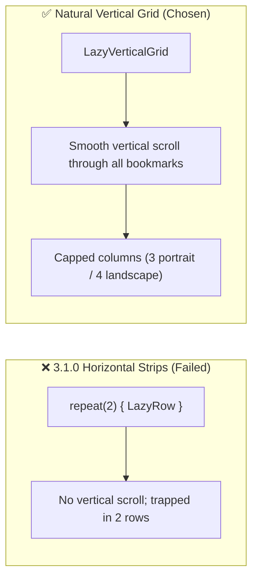
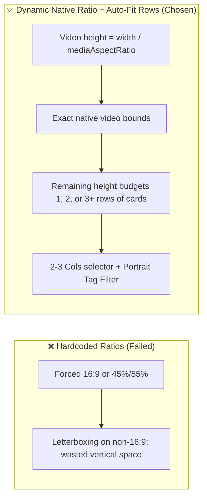

# Architectural Decisions, Pivots & Landmines (`DECISIONS_AND_TRAPS.md`)
> **1-Line Summary:** Records architectural pivots, rationale behind core choices, and critical engineering landmines across mpvRx.

## 1. Architectural Decisions & Pivot History

### [DECISION: Restore-Natural-Vertical-Scroll-Gallery] | Aliases: gallery vertical scroll, reject horizontal strips, gallery column caps
> **1-Line Summary:** Replaced flawed two-row horizontal strip design (`repeat(2) { LazyRow }`) with natural vertically scrollable `LazyVerticalGrid` capped at 3 columns (portrait) and 4 columns (landscape).
* **Decision Maker:** `[DECIDED BY: HUMAN - Confirmed by Agent]`
* **Original User Intention:** Browse all bookmarks smoothly via natural vertical scrolling, with space for a search bar and autocomplete tag suggestions.
* **Options Considered:**
  * **Option A (Rejected in 3.1.0):** `repeat(2) { LazyRow }` with hardcoded 34%/33%/33% height budgets. Failed because it trapped users into two horizontal side-scrollers, completely cutting off vertical access to the library.
  * **Option B (Chosen):** Responsive `LazyVerticalGrid` with infinite vertical scroll. Top area hosts search bar and autocomplete tag pills. Column caps are enforced (max 3 portrait, max 4 landscape).
* **Visual Pivot Map (What Failed vs. What Works):**

* **Code Anchors (Grep Targets):**
  * `app/src/main/java/app/gyrolet/mpvrx/ui/bookmarks/BookmarkGalleryScreen.kt` -> `BookmarkGalleryScreen`, `resolveColumnCount`

---

### [DECISION: Dynamic-Portrait-Native-Ratio-Video-And-Dynamic-Rows] | Aliases: portrait native video, dynamic rows, portrait 2-3 columns, portrait tag filter
> **1-Line Summary:** Portrait mode computes video height dynamically based on native media aspect ratio (no hardcoding), budgets remaining height for bookmark cards (1, 2, or 3+ rows if space permits), caps columns between 2 and 3, and adds a tag filter button in the portrait toolbar.
* **Decision Maker:** `[DECIDED BY: HUMAN - Confirmed by Agent]`
* **Original User Intention:** Video plays natively at its true aspect ratio without artificial black bars. The drawer below adapts to whatever vertical space is left, supporting 1, 2, or 3+ rows of 16:9 cards, 2 or 3 columns only, and direct tag filtering in portrait.
* **Options Considered:**
  * **Option A (Rejected in 3.0.5 & 3.1.0):** Hardcoding 16:9 (`width * 9 / 16`) or hardcoding 45%/55% split. Failed because letterboxing occurred on 21:9 or 4:3 videos, and fixed percentage heights broke on tall phones.
  * **Option B (Chosen):** Dynamic native video aspect ratio (`containerWidth / mediaAspectRatio`). The remaining screen height is dedicated to the drawer, allowing 1, 2, or 3+ rows of cards depending on available height, strictly 2 or 3 columns, with a portrait tag filter button.
* **Visual Pivot Map (What Failed vs. What Works):**

* **Code Anchors (Grep Targets):**
  * `app/src/main/java/app/gyrolet/mpvrx/ui/player/controls/PlayerControls.kt` -> `BookmarkSplitPanel`
  * `app/src/main/java/app/gyrolet/mpvrx/ui/player/controls/components/BookmarkListContent.kt` -> `BookmarkGridCard`, `BookmarkListContent`

---

### [DECISION: Non-Overflow-Compact-2-Tier-Landscape-Toolbar] | Aliases: compact landscape toolbar, prevent overflow, global scope toggle
> **1-Line Summary:** Replaced verbose text buttons in the landscape bookmark toolbar with compact icon buttons (Tier 1) and short toggle chips (Tier 2) to eliminate button collision/overflow at 20%-35% drawer widths.
* **Decision Maker:** `[DECIDED BY: HUMAN - Confirmed by Agent]`
* **Original User Intention:** Access all bookmark actions and scopes within a 20%-35% landscape sidebar without buttons wrapping awkwardly or overlapping each other.
* **Options Considered:**
  * **Option A (Rejected in 3.1.0):** Verbose text buttons (`🎬 This Video (Local)`, `Width: 25%`, `Card Count`). Caused severe text clipping, multi-line wrapping, and layout overflow at 20% width.
  * **Option B (Chosen):** Clean 2-tier design:
    * *Tier 1:* 4 icon buttons with tooltips (`🏷️ Filter`, `⊞ Add`, `↗ Gallery`, `✕ Close`).
    * *Tier 2:* Compact toggle chips (`Scope: 🎬/🌐`, `25%`, `1 Col`). Total width fits comfortably within 20% drawer.
* **Code Anchors (Grep Targets):**
  * `app/src/main/java/app/gyrolet/mpvrx/ui/player/controls/components/BookmarkListContent.kt` -> `BookmarkListContent`

---

### [DECISION: Align-Playback-Authentication-To-Secure-Folder-PIN] | Aliases: secure folder pin, eliminate double password, credential gate
> **1-Line Summary:** Direct playback challenge queries the Secure Folder's own password/PIN instead of the generic device PIN, eliminating double-prompt regressions.
* **Decision Maker:** `[DECIDED BY: HUMAN - Confirmed by Agent]`
* **Original User Intention:** Opening private files or bookmarks should ask for the Secure Folder's credentials, without asking for the device PIN again if the vault is already open.
* **Options Considered:**
  * **Option A (Rejected in 3.1.0):** Routing through system `BiometricPrompt` device credential regardless of Secure Folder state. Caused double password prompts when navigating from the vault to the player.
  * **Option B (Chosen):** Check if `SecureFolderRepository` is already unlocked. If not, challenge with the Secure Folder PIN/pattern directly.
* **Code Anchors (Grep Targets):**
  * `app/src/main/java/app/gyrolet/mpvrx/ui/securefolder/SecureUnlockActivity.kt` -> `launch`
  * `app/src/main/java/app/gyrolet/mpvrx/utils/media/MediaUtils.kt` -> `startGuarded`

---

### [DECISION: Vault-Storage-Persistence-Strategy-Survive-Uninstall] | Aliases: survive uninstall, external app storage, nomedia vault, sdcard documents mpvrx
> **1-Line Summary:** Private vault media, bookmark thumbnails, database backups, settings, and PIN verifiers are relocated to persistent storage (`/sdcard/Documents/mpvRx/` with `.nomedia`) so uninstalling the app never destroys user data.
* **Decision Maker:** `[DECIDED BY: HUMAN - Confirmed by Agent]`
* **Original User Intention:** Prevent catastrophic data loss where deleting or reinstalling the app destroys the private video collection, database bookmarks, and PIN settings.
* **Options Considered:**
  * **Option A (Rejected):** Storing in `context.filesDir` or `context.getExternalFilesDir()`. Android automatically wipes these directories on uninstallation, permanently deleting all user files.
  * **Option B (Chosen):** Persistent directory at `/sdcard/Documents/mpvRx/` with `.nomedia`. Encrypted files, thumbnails, Room DB backups, and salted Argon2id/PBKDF2 PIN verifiers persist permanently. On reinstallation, mpvRx recognizes the vault and prompts the existing PIN.
* **Code Anchors (Grep Targets):**
  * `app/src/main/java/app/gyrolet/mpvrx/database/repository/SecureFolderRepository.kt` -> `SecureFolderRepository`
  * `app/src/main/java/app/gyrolet/mpvrx/domain/bookmark/BookmarkThumbnailStore.kt` -> `BookmarkThumbnailStore`

---

### [DECISION: Configurable-Landscape-Music-Split-And-Multi-Line-Lyrics] | Aliases: music player split, landscape 50-50, 40-60, 2-line lyrics
> **1-Line Summary:** Music player provides 2-line (default) or 3-line lyrics in portrait with dynamic artwork scaling, and configurable split ratios (`50/50`, `40/60`, `60/40`) in landscape.
* **Decision Maker:** `[DECIDED BY: HUMAN - Confirmed by Agent]`
* **Original User Intention:** Prevent transport control clipping in portrait mode, and allow customizable layout priority between artwork/video and scrolling lyrics in landscape mode.
* **Code Anchors (Grep Targets):**
  * `app/src/main/java/app/gyrolet/mpvrx/ui/player/controls/AudioPlayerControls.kt` -> `AudioPlayerControls`

---

## 2. Do-Not-Touch Engineering Landmines (Traps)

### [TRAP: Never-Use-Java-Net-URI-For-Local-Filesystem-Paths] | Aliases: uri npe, runcatching trap, path parsing bug
> **1-Line Summary:** Never use `java.net.URI` for local file path parsing; opaque URIs and non-ASCII characters yield null path, bypassing `runCatching` failure checks.
* **Strict Rule:** **NEVER** instantiate `java.net.URI` to normalize or parse local filesystem paths. Use pure string splitting and segment folding.
* **Protected Code Anchors (Grep Targets):**
  * `app/src/main/java/app/gyrolet/mpvrx/ui/player/PlaybackModels.kt` -> `normalizeLocalPath`

---

### [TRAP: Dual-Orientation-UI-Consistency-Rule] | Aliases: separate orientation preview, dual geometry
> **1-Line Summary:** Never force identical layout logic across portrait and landscape; always implement and preview both orientations separately.
* **Strict Rule:** **NEVER** apply portrait-specific height budgets to landscape or landscape percentage menus to portrait. Every UI change must be configured and visually previewed for both modes.

---

### [TRAP: Prevent-Layout-Overflow-In-Compact-Sidebar-Drawers] | Aliases: toolbar collision, compact buttons, icon tooltips
> **1-Line Summary:** At 20% sidebar width in landscape, horizontal space is under 180dp; never place text-heavy buttons or multi-word chips in the toolbar.
* **Strict Rule:** Use compact icon buttons with accessible content descriptions/tooltips for actions. Keep toggle chips to 2-4 characters (e.g. `20%`, `1C`, `🌐/🎬`).
