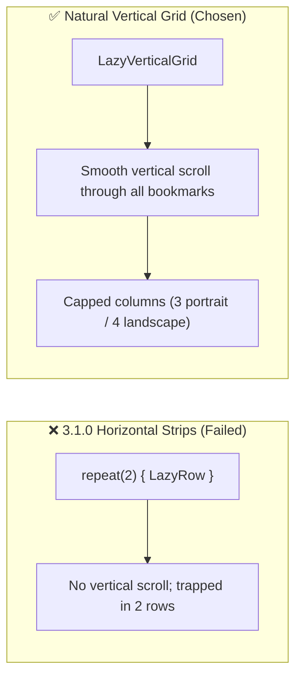
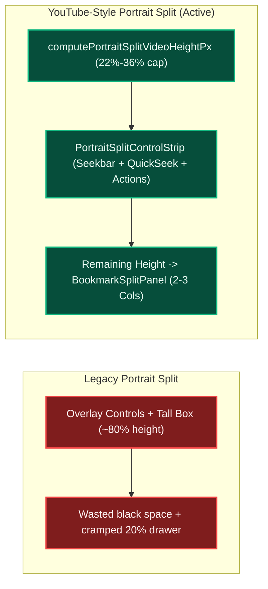
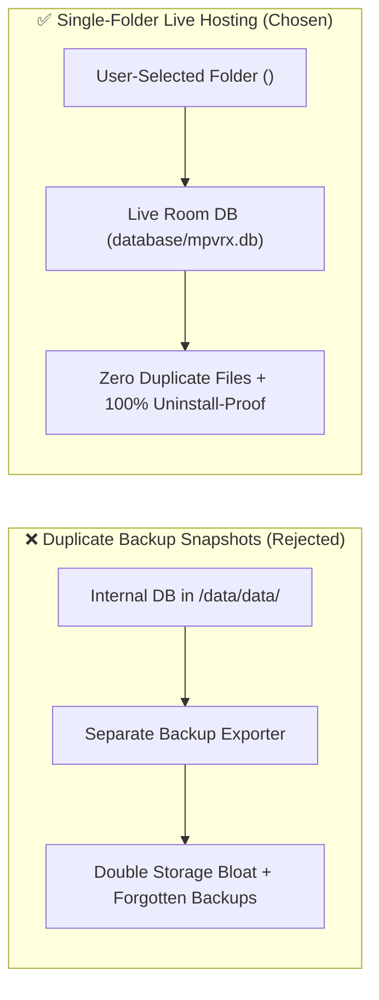
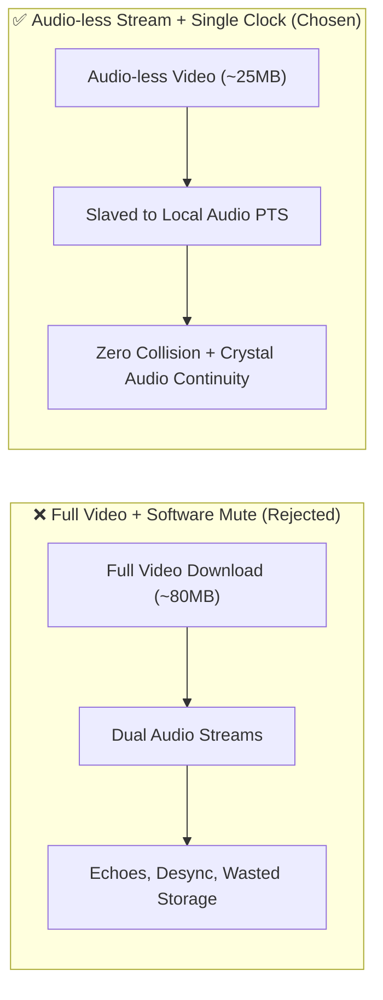
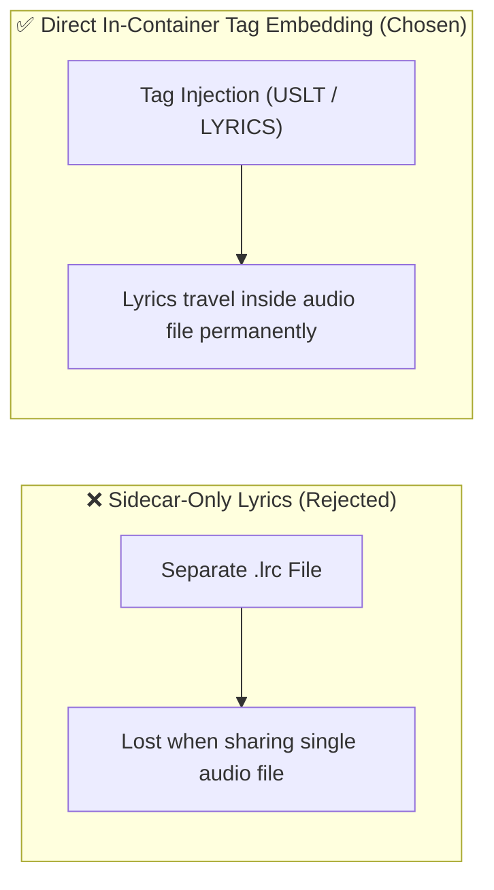

# Architectural Decisions, Pivots & Landmines (`DECISIONS_AND_TRAPS.md`)
> **1-Line Summary:** Records architectural pivots, rationale behind core choices, and critical engineering landmines across mpvRx.

## 1. Architectural Decisions & Pivot History

### [DECISION: Restore-Natural-Vertical-Scroll-Gallery] | Aliases: gallery vertical scroll, reject horizontal strips, gallery column caps
> **1-Line Summary:** Replaced flawed two-row horizontal strip design (`repeat(2) { LazyRow }`) with natural vertically scrollable `LazyVerticalGrid` capped at 3 columns (portrait) and 4 columns (landscape).
* **Decision Maker:** `[DECIDED BY: HUMAN - Confirmed by Agent]`
* **Original User Intention:** Browse all bookmarks smoothly via natural vertical scrolling, with space for a search bar and autocomplete tag suggestions.
* **Options Considered:**
  * **Option A (Rejected in 3.1.0):** `repeat(2) { LazyRow }` with hardcoded 34%/33%/33% height budgets. Failed because it trapped users into two horizontal side-scrollers, completely cutting off vertical access to the library.
  * **Option B (Chosen):** Responsive `LazyVerticalGrid` with infinite vertical scroll. Top area hosts search bar and autocomplete tag pills. Column caps are enforced (max 3 portrait, max 4 landscape).
* **Visual Pivot Map (What Failed vs. What Works):**

* **Code Anchors (Grep Targets):**
  * `app/src/main/java/app/gyrolet/mpvrx/ui/bookmarks/BookmarkGalleryScreen.kt` -> `BookmarkGalleryScreen`, `resolveColumnCount`

---

### [DECISION: Dynamic-Portrait-Native-Ratio-Video-And-Dynamic-Rows] | Aliases: portrait native video, dynamic rows, portrait 2-3 columns, portrait tag filter, portrait control strip, quick seek
> **1-Line Summary:** Portrait Split sizes the top video box dynamically to its undistorted aspect height (22% floor to 36% cap), docks seekbar + `-5m/-1m/-10s/+10s/+1m/+5m` quick-seek strip + action buttons directly beneath the video in `PortraitSplitControlStrip`, and gives the full remaining height to the bookmark drawer while keeping Landscape Split unchanged.
* **Decision Maker:** `[DECIDED BY: HUMAN - Confirmed by Agent]`
* **Original User Intention:** Prevent `80/20` dead black letterbox space in Portrait Split mode: match YouTube's Portrait player layout where the video occupies only the height needed for undistorted playback, controls live cleanly below the video, `-5m / -1m / -10s / +10s / +1m / +5m` quick-seek buttons are available in both Portrait and Landscape, and the freed vertical space goes to the bookmark panel.
* **Options Considered:**
  * **Option A (Rejected in 3.0.5 & 3.1.0):** Hardcoding 16:9, fixed 45%/55% split, or overlay bottom buttons on top of the split video box (`80/20` height waste on tall/square videos).
  * **Option B (Chosen):** `computePortraitSplitVideoHeightPx` clamps natural `width / aspect` between `22%` and `36%` of container height, synced identically between `PlayerActivity.applySplitBookmarkPlayerBounds` (`SurfaceView`) and `PlayerControls` (`Box`), followed vertically by `PortraitSplitControlStrip` and `BookmarkSplitPanel` (`weight(1f)`).
* **Visual Pivot Map (What Failed vs. What Works):**

> **Legend:** Red = Rejected 80/20 overlay waste | Green = Current YouTube-style Portrait Split stack
* **Links:** `[SUBSYSTEM: Dynamic-Portrait-Video-And-Bookmark-Drawer]`, `[FEATURE: Isolated-Vault-Decoy-Compartment-And-YouTube-Portrait-Split]`

---

### [DECISION: Non-Overflow-Compact-2-Tier-Landscape-Toolbar] | Aliases: compact landscape toolbar, prevent overflow, global scope toggle
> **1-Line Summary:** Replaced verbose text buttons in the landscape bookmark toolbar with compact icon buttons (Tier 1) and short toggle chips (Tier 2) to eliminate button collision/overflow at 20%-35% drawer widths.
* **Decision Maker:** `[DECIDED BY: HUMAN - Confirmed by Agent]`
* **Original User Intention:** Access all bookmark actions and scopes within a 20%-35% landscape sidebar without buttons wrapping awkwardly or overlapping each other.
* **Options Considered:**
  * **Option A (Rejected in 3.1.0):** Verbose text buttons (`🎬 This Video (Local)`, `Width: 25%`, `Card Count`). Caused severe text clipping, multi-line wrapping, and layout overflow at 20% width.
  * **Option B (Chosen):** Clean 2-tier design:
    * *Tier 1:* 4 icon buttons with tooltips (`🏷️ Filter`, `⊞ Add`, `↗ Gallery`, `✕ Close`).
    * *Tier 2:* Compact toggle chips (`Scope: 🎬/🌐`, `25%`, `1 Col`). Total width fits comfortably within 20% drawer.
* **Code Anchors (Grep Targets):**
  * `app/src/main/java/app/gyrolet/mpvrx/ui/player/controls/components/BookmarkListContent.kt` -> `BookmarkListContent`

---

### [DECISION: Align-Playback-Authentication-To-Secure-Folder-PIN] | Aliases: secure folder pin, eliminate double password, credential gate
> **1-Line Summary:** Direct playback challenge queries the Secure Folder's own password/PIN instead of the generic device PIN, eliminating double-prompt regressions.
* **Decision Maker:** `[DECIDED BY: HUMAN - Confirmed by Agent]`
* **Original User Intention:** Opening private files or bookmarks should ask for the Secure Folder's credentials, without asking for the device PIN again if the vault is already open.
* **Options Considered:**
  * **Option A (Rejected in 3.1.0):** Routing through system `BiometricPrompt` device credential regardless of Secure Folder state. Caused double password prompts when navigating from the vault to the player.
  * **Option B (Chosen):** Check if `SecureFolderRepository` is already unlocked. If not, challenge with the Secure Folder PIN/pattern directly.
* **Code Anchors (Grep Targets):**
  * `app/src/main/java/app/gyrolet/mpvrx/ui/securefolder/SecureUnlockActivity.kt` -> `launch`
  * `app/src/main/java/app/gyrolet/mpvrx/utils/media/MediaUtils.kt` -> `startGuarded`

---

### [DECISION: Single-Session-Unlock-Token-Vs-Per-Entry-Credential-Gates] | Aliases: secure folder prompts twice, double credential prompt, one prompt per session, session unlock token
> **1-Line Summary:** A process-scoped `SecureFolderSession` token unifies the folder-entry and playback credential gates — one unlock covers the whole session and clears when the app is backgrounded.
* **Decision Maker:** `[DECIDED BY: AGENT]`
* **Original User Intention:** Entering the Secure Folder and then opening a file inside it must never ask for the credential twice in one session (R-05).
* **Options Considered:**
  * **Option A (Rejected):** Keep the two independent gates (`SecureFolderGateScreen` per nav entry, `SecureUnlockActivity` per playback launch) each prompting on its own. This is exactly the reported double-prompt flow, and it contradicted [DECISION: Align-Playback-Authentication-To-Secure-Folder-PIN] Option B, which assumed an "already unlocked" check that never existed in the code.
  * **Option B (Chosen):** `domain/secure/SecureFolderSession.kt` marks the session unlocked on any gate success (folder entry PIN/biometric/setup, or the playback credential); every gate reads the token before prompting; `App.onActivityStopped` clears it when the app goes background (same contract as Secret Mode). Per-action prompts — destroy vault, PIN change, secret stats — intentionally keep asking.
* **Code Anchors (Grep Targets):**
  * `app/src/main/java/app/gyrolet/mpvrx/domain/secure/SecureFolderSession.kt` -> `SecureFolderSession`
  * `app/src/main/java/app/gyrolet/mpvrx/ui/securefolder/SecureUnlockActivity.kt` -> `SecurePinPrompt`, `continueToTarget`
  * `app/src/main/java/app/gyrolet/mpvrx/ui/securefolder/SecureFolderGateScreen.kt` -> `Content`, `showBiometricPrompt`
  * `app/src/main/java/app/gyrolet/mpvrx/App.kt` -> `onActivityStopped`
  * **3.2.2 extension:** the playback gate verifies `SecureFolderPreferences.verifyPin()` and never calls `BiometricPrompt` with `DEVICE_CREDENTIAL`, so the phone lock screen cannot appear on the way from the vault to the player. Biometric entry in the folder gate is `BIOMETRIC_STRONG` only; its negative button returns to the app PIN.

---

### [DECISION: Drawer-Scope-State-Lives-In-PlayerViewModel] | Aliases: scope toggle reset, video global toggle, bookmark drawer scope, chip survives reopen
> **1-Line Summary:** The bookmark drawer's `Video ⇄ Global` scope lives in `PlayerViewModel.inPlayerBookmarkScope` (`toggleInPlayerBookmarkScope()`), never in composable-local state, and both orientations carry the chip.
* **Decision Maker:** `[DECIDED BY: AGENT]`
* **Original User Intention:** The scope choice must survive drawer close/reopen and be togglable in the portrait drawer as well as the landscape sidebar (R-07).
* **Options Considered:**
  * **Option A (Rejected):** `rememberSaveable` inside `BookmarkSplitPanel`. The panel leaves composition whenever the drawer closes, so the toggle silently reset to `Video` on reopen, and the portrait header shipped without any scope chip at all — "toggling" in portrait was impossible.
  * **Option B (Chosen):** Scope state and `toggleInPlayerBookmarkScope()` live in `PlayerViewModel` (matching the `ARCHITECTURE.md` data-flow for this subsystem); `currentMediaId` comes from `bookmarkMediaId` so bookmark-less videos still classify rows correctly; a global row with no replay ref shows a toast instead of seeking the current file to a foreign timestamp.
  * **3.2.2 extension:** every surface shares that state. The Chapters sheet renders the same `Video ⇄ Global` chip and the full-window gallery accepts `currentMediaId`, so `This video` joins `All videos` / `Secure videos`. `PlayerViewModel.openBookmark()` owns foreign playback, so the drawer, sheet and gallery all launch the target video at its timestamp instead of duplicating the logic.
* **Code Anchors (Grep Targets):**
  * `app/src/main/java/app/gyrolet/mpvrx/ui/player/PlayerViewModel.kt` -> `toggleInPlayerBookmarkScope`, `inPlayerBookmarkScope`, `bookmarkMediaId`, `openBookmark`
  * `app/src/main/java/app/gyrolet/mpvrx/ui/player/controls/components/BookmarkListContent.kt` -> `isGlobalScope`, `onCardClick`, `currentMediaId`, `galleryScope`
  * `app/src/main/java/app/gyrolet/mpvrx/ui/player/controls/PlayerSheets.kt` -> `ChaptersSheetWithBookmarks`, `isGlobalScope`
  * `app/src/main/java/app/gyrolet/mpvrx/ui/bookmarks/BookmarkGalleryScreen.kt` -> `onlyCurrentVideo`, `currentMediaId`

---

### [DECISION: Download-Discoverability-Vs-Companion-Downloader-Sheet] | Aliases: download button music, yt-dlp affordance, companion video downloader, attach to track
> **1-Line Summary:** R-06 ships the download *affordances* (action-row ⬇, overflow entry, install messaging) on the existing engine; the companion-video sheet, `MusicCompanionDao` attach-binding and audio-replacement prompt stay a separate feature.
* **Decision Maker:** `[DECIDED BY: AGENT]`
* **Original User Intention:** A download action must be reachable from the video and music players when the build ships `ENABLE_YTDLP`, with install/status messaging when the engine is missing and no dead UI otherwise (R-06).
* **Options Considered:**
  * **Option A (Rejected):** Build the full [FEATURE: Granular-Quality-Downloader-And-Configurable-Presets] surface (`CompanionVideoDownloaderSheet`, `ResolutionOptionGrid`, `AudioReplacementConfirmDialog`, `MusicCompanionDao.companionVideoPath` binding). None of those components exist yet, and the R-06 item spec scoped the repair to discoverability ("no downloader logic changes").
  * **Option B (Chosen):** Route the new entries into the existing download path — the VideoQuality sheet's per-quality download buttons (presets + enqueue) — and into `YtdlpInstallPromptDialog` / `YtdlpInstallProgressDialog` when `YtdlpManager.isInstalled` is false. `ENABLE_YTDLP=false` builds render no download UI at all.
* **Code Anchors (Grep Targets):**
  * `app/src/main/java/app/gyrolet/mpvrx/ui/player/controls/AudioPlayerControls.kt` -> `MusicActionRowButton.DOWNLOAD`, `showYtdlpInstallPrompt`
  * `app/src/main/java/app/gyrolet/mpvrx/ui/player/controls/components/sheets/MoreSheet.kt` -> `onDownloadClick`
  * `app/src/main/java/app/gyrolet/mpvrx/ui/player/controls/PlayerSheets.kt` -> `Sheets.More`, `YtdlpManager.isInstalled`

---

### [DECISION: Vault-Storage-Persistence-Strategy-Survive-Uninstall] | Aliases: survive uninstall, external app storage, nomedia vault, sdcard documents mpvrx
> **1-Line Summary:** Private vault media, bookmark thumbnails and the live Room database are hosted in persistent storage (`/sdcard/Documents/mpvRx/` with `.nomedia`) so uninstalling the app never destroys the collection or its bookmarks.
* **Decision Maker:** `[DECIDED BY: HUMAN - Confirmed by Agent]`
* **Original User Intention:** Prevent catastrophic data loss where deleting or reinstalling the app destroys the private video collection, database bookmarks and thumbnails.
* **Options Considered:**
  * **Option A (Rejected):** Storing in `context.filesDir` or `context.getExternalFilesDir()`. Android automatically wipes these directories on uninstallation, permanently deleting all user files.
  * **Option B (Chosen):** `DurableStorageManager` resolves `Documents/mpvRx/` on standard builds. Room opens `database/mpvrx.db` there, the Secure Vault uses `vault/`, and bookmark thumbnails use `thumbnails/`, all behind a `.nomedia` marker. Existing internal files are copied once at startup and their Room paths are rebased before new writes switch over. The app-private PIN hash deliberately stays private: after reinstall the user sets a new PIN and the surviving database, vault and thumbnails appear. Play Store scoped-storage builds keep internal storage and add Auto Backup rules for the same paths.
* **Code Anchors (Grep Targets):**
  * `app/src/main/java/app/gyrolet/mpvrx/domain/storage/DurableStorageManager.kt` -> `prepare`, `databaseFile`, `vaultDirectory`, `thumbnailsDirectory`, `copyMediaDirectories`
  * `app/src/main/java/app/gyrolet/mpvrx/App.kt` -> `migrateDurableStorage`
  * `app/src/main/java/app/gyrolet/mpvrx/di/DatabaseModule.kt` -> `databaseBuilder`
  * `app/src/main/java/app/gyrolet/mpvrx/database/repository/SecureFolderRepository.kt` -> `secureDir`
  * `app/src/main/java/app/gyrolet/mpvrx/domain/bookmark/BookmarkThumbnailStore.kt` -> `privateDirectory`

---

### [DECISION: Bounded-UI-Thread-Native-Reads-Instead-Of-Blocking-The-Main-Thread] | Aliases: playback ANR, mpv property lock, surface handoff freeze, 150ms timeout
> **1-Line Summary:** Compose property reads take the session-wide native lock with a 150 ms `tryLock` and fall back to a default, because a Surface handoff can hold that lock inside libmpv indefinitely.
* **Decision Maker:** `[DECIDED BY: HUMAN - Confirmed by Agent]`
* **Original User Intention:** Stop the player from freezing and triggering "mpvRx isn't responding" while a video is starting, changing Surface, or entering picture-in-picture.
* **Options Considered:**
  * **Option A (Rejected):** Keep `nativeLock.lock()` for all reads. Correct values, but the UI thread blocks behind `mpv_get_property` for the whole handoff, which is the ANR itself.
  * **Option B (Chosen):** One helper for every property read. On the main looper it attempts `tryLock(150 ms)` and returns the caller's default on timeout; off the main thread it keeps a blocking lock. Observed-property registration never waits (zero-timeout attempt, deferred to the pump), and Surface/attachment flags are `@Volatile` so composition can read them without the lock.
* **Trade-off accepted:** A timed-out read briefly renders a stale/default value. That is safe because the observed flows re-emit once the lock is free, and it is strictly better than a frozen UI. Do not "fix" a default by re-introducing an unbounded UI-thread lock.
* **Extension (Tap & Audiobook Seeking Off Main Thread):** Even with `150 ms` read timeouts, executing `PlaybackSession.command("seek", ...)` directly on the Main thread inside `GestureHandler` still blocks unboundedly on `nativeLock.withLock` during Surface handoffs or slow network demuxing, and repeating `100` `absolute-percent+exact` past EOF stalls rapid taps. Tap seeks (`PlayerViewModel.seekBy`) now coalesce through `RelativeSeekBatcher` onto a single-thread IO dispatcher via `commandForGeneration`, and UI audiobook seeks run on a sequential `AudiobookPlayback` IO dispatcher (while internal `onPauseRequested` keeps synchronous `seekImmediate` inside its existing `nativeLock` scope).
* **Verified By:** `app/src/test/java/app/gyrolet/mpvrx/ui/player/RelativeSeekBatcherTest.kt :: rapidTapsPastSixtySecondsCoalesceSingleFlightPerWorker`, `RelativeSeekBatcherTest.kt :: oppositeTapsCancelingToZeroRetireWithoutExtraSeek`, `RelativeSeekBatcherTest.kt :: generationChangeAndCancelPendingDiscardStaleOffsetsWithoutBreakingFutureWorkers`, `RelativeSeekBatcherTest.kt :: accumulatesLargeOffsetsWithSaturationInsteadOfIntOverflow`
* **Code Anchors (Grep Targets):**
  * `app/src/main/java/app/gyrolet/mpvrx/ui/player/PlaybackSession.kt` :: `UI_NATIVE_READ_TIMEOUT_MS`, `withReadyCoreRead`, `registerObservedLocked`
  * `app/src/main/java/app/gyrolet/mpvrx/ui/player/RelativeSeekBatcher.kt` :: `RelativeSeekBatcher`
  * `app/src/main/java/app/gyrolet/mpvrx/ui/player/PlayerViewModel.kt` :: `seekBy`, `executeRelativeSeekBatch`
  * `app/src/main/java/app/gyrolet/mpvrx/ui/player/AudiobookPlayback.kt` :: `seek`, `seekBy`, `seekInBook`, `seekImmediate`

---

### [DECISION: Hard-Database-Segregation-And-MVX1-AES-CTR-Vault-Encryption] | Aliases: secure bookmark leaks into global, hard segregation, mvx1 aes ctr, vault streaming proxy, secure vault database
> **1-Line Summary:** Physically separates public and Secure Folder databases (`.store/library.dat` vs `.vault/v_idx.dat`) and encrypts vault media, thumbnails, stats, and config with hardware-accelerated AES-128-CTR (`MVX1`).
* **Decision Maker:** `[DECIDED BY: HUMAN - Confirmed by Agent]`
* **Original User Intention:** Secure Folder videos, bookmarks, thumbnails, playback states, watch stats, and metadata must never share tables or folders with normal videos, must not sit unencrypted in `Documents/mpvRx/` where other apps can browse them, must not strain the Helio G90T CPU/battery, and must survive Clear Data or app uninstall without bloating internal App Data.
* **Options Considered:**
  * **Option A (Rejected, v3.2.2 initial):** Keep all bookmarks in `MpvRxDatabase` and filter by `bookmark_media_links` in memory, while leaving copied vault files unencrypted in `Documents/mpvRx/vault/` and keeping internal `filesDir/secure_media` duplicates. Rejected because unlinked/legacy rows still leaked across scopes, files in `Documents/mpvRx/` were world-readable by any storage-permission app, and internal storage retained multi-GB duplicate copies.
  * **Option B (Chosen):** Hard physical segregation with `SecureVaultDatabase` (`.vault/v_idx.dat`) + `SecureBookmarkStore` and `MVX1` AES-128-CTR encryption (`VaultCrypto`) backed by a PBKDF2-wrapped `.vault/.vkey`. `libmpv` streams encrypted vault files through `VaultStreamingProxy` (`127.0.0.1` loopback HTTP range server) and Android media extractors use `VaultMediaDataSource`, giving $O(1)$ random-access seeking via `baseIv + blockIndex` with hardware ARMv8 Cryptography Extension acceleration.
* **Consequence:** Moving a file into or out of the Secure Folder (`SecureFolderRepository.moveIn` / `restore`) or running `DurableVaultMigration.run` on startup migrates rows and re-encrypts thumbnails between `.store/` and `.vault/`, then deletes verified internal storage copies.
* **Code Anchors (Grep Targets):**
  * `app/src/main/java/app/gyrolet/mpvrx/domain/secure/VaultCrypto.kt` -> `encryptStream`, `readDecryptedAt`, `openDecryptedRangeStream`
  * `app/src/main/java/app/gyrolet/mpvrx/domain/secure/VaultStreamingProxy.kt` -> `registerVaultFile`, `revokeAllActiveStreams`
  * `app/src/main/java/app/gyrolet/mpvrx/domain/bookmark/SecureBookmarkStore.kt` -> `migrateMediaToVault`, `migrateMediaToPublic`
  * `app/src/main/java/app/gyrolet/mpvrx/domain/storage/DurableVaultMigration.kt` -> `run`

---

### [DECISION: Configurable-Landscape-Music-Split-And-Multi-Line-Lyrics] | Aliases: music player split, landscape 50-50, 40-60, 2-line lyrics
> **1-Line Summary:** Music player provides 2-line (default) or 3-line lyrics in portrait with dynamic artwork scaling, and configurable split ratios (`50/50`, `40/60`, `60/40`) in landscape.
* **Decision Maker:** `[DECIDED BY: HUMAN - Confirmed by Agent]`
* **Original User Intention:** Prevent transport control clipping in portrait mode, and allow customizable layout priority between artwork/video and scrolling lyrics in landscape mode.
* **Code Anchors (Grep Targets):**
  * `app/src/main/java/app/gyrolet/mpvrx/ui/player/controls/AudioPlayerControls.kt` -> `AudioPlayerControls`

### [DECISION: Single-Folder-Live-Hosting-Vs-Duplicate-Backup-Files] | Aliases: single folder storage, zero bloat, live room db external, no duplicate backups
> **1-Line Summary:** Live Room SQLite database and all media/vault assets are hosted directly in a single user-selected root folder, completely eliminating redundant backup files and storage bloat.
* **Decision Maker:** `[DECIDED BY: HUMAN]`
* **Original User Intention:** Avoid having a separate manual/scheduled backup file that can be forgotten, doubles storage space, or leads to desync. A single user-selected folder in basic storage must host everything directly, permanently surviving app uninstallation, updates, or wipes.
* **Options Considered:**
  * **Option A (Rejected):** Storing the live database in `/data/data/...` and periodically exporting snapshot copies to `/sdcard/Documents/mpvRx/backups/`. Rejected because users can forget to trigger backups, snapshot files double storage footprint, and background backup tasks cause overhead.
  * **Option B (Chosen):** Instantiating the live Room SQLite database directly inside `<UserRoot>/database/mpvrx.db` via custom path builder. Vault files, thumbnails, configurations, music, companion videos, and lyrics live directly in subfolders under this single root. No duplicate backup file is needed.
* **Visual Pivot Map (What Failed vs. What Works):**

* **Code Anchors (Grep Targets):**
  * `app/src/main/java/app/gyrolet/mpvrx/di/DatabaseModule.kt` -> `databaseBuilder(... databasePath.absolutePath)`
  * `app/src/main/java/app/gyrolet/mpvrx/domain/storage/DurableStorageManager.kt` -> `durableRoot`, `databaseFile`

---

### [DECISION: Audio-less-Companion-Video-Vs-Remuxed-Audio-Collision] | Aliases: audioless video download, collision free sync, companion video
> **1-Line Summary:** Download audio-less video streams (`bestvideo[ext=mp4]`) when local audio exists to prevent dual-audio collisions and reduce download size by up to 60%.
* **Decision Maker:** `[DECIDED BY: HUMAN]`
* **Original User Intention:** Watch companion music videos while listening to pristine local audio without audio desync, phase cancellation, or echo.
* **Options Considered:**
  * **Option A (Rejected):** Downloading full video with audio and muting in software or playing both streams simultaneously. Rejected because it wastes bandwidth/storage, risks audio collisions, and causes timeline drift.
  * **Option B (Chosen):** Downloading audio-less video streams via yt-dlp. When downloading full videos without existing audio, an intelligent confirmation prompt offers to replace old standalone audio to avoid duplicate file bloat.
* **Visual Pivot Map (What Failed vs. What Works):**

* **Code Anchors (Grep Targets):**
  * `app/src/main/java/app/gyrolet/mpvrx/domain/download/CompanionVideoDownloader.kt` -> `downloadAudiolessStream`
  * `app/src/main/java/app/gyrolet/mpvrx/ui/player/PlayerViewModel.kt` -> `attachCompanionVideo`

---

### [DECISION: Musicolet-Style-Direct-Tag-Embedding-Vs-Sidecar-Only] | Aliases: musicolet lyrics, embed in audio file, uslt tag, vorbis comments
> **1-Line Summary:** Embeds synchronized and unsynchronized lyrics directly into audio container metadata tags (`USLT`, `LYRICS`, `©lyr`) alongside `.lrc` sidecars for universal player portability.
* **Decision Maker:** `[DECIDED BY: HUMAN]`
* **Original User Intention:** Match Musicolet's capability where lyrics travel permanently inside the audio file itself so they are never lost when sharing or transferring files.
* **Options Considered:**
  * **Option A (Rejected):** Storing lyrics exclusively in external `.lrc` files. Rejected because moving files or copying them to cars/external devices loses the lyric association.
  * **Option B (Chosen):** Dual-layer persistence: update both the external `.lrc` file and embed the lyrics directly into the physical audio file container tags without re-encoding audio bytes.
* **Visual Pivot Map (What Failed vs. What Works):**

* **Code Anchors (Grep Targets):**
  * `app/src/main/java/app/gyrolet/mpvrx/domain/metadata/AudioTaggingEngine.kt` -> `embedLyricsIntoAudioFile`

---

### [DECISION: Single-Point-Anchor-Alignment-Vs-Full-Manual-Lyric-Editing] | Aliases: 1-point lyric sync, anchor line, uniform shift
> **1-Line Summary:** Replaces tedious line-by-line manual timestamp editing with 1-point anchor calibration that uniformly shifts all lines by the calculated playhead delta $\Delta t$.
* **Decision Maker:** `[DECIDED BY: HUMAN]`
* **Original User Intention:** Quickly fix song lyric offsets caused by intro dialogues or music video delays in one simple tap.
* **Options Considered:**
  * **Option A (Rejected):** Forcing the user to manually adjust timestamps on 50+ lines individually. Extremely tedious and error-prone.
  * **Option B (Chosen):** User taps "Anchor to Current Time" on any single line as it plays. The app calculates $\Delta t = T_{\text{current}} - T_{\text{lyric}}$ and instantly shifts all lines across the song, saving changes permanently.
* **Code Anchors (Grep Targets):**
  * `app/src/main/java/app/gyrolet/mpvrx/domain/lyrics/LyricsOffsetCalibrator.kt` -> `anchorLineToPlayhead`

---

## 2. Do-Not-Touch Engineering Landmines (Traps)

### [TRAP: Never-Use-Java-Net-URI-For-Local-Filesystem-Paths] | Aliases: uri npe, runcatching trap, path parsing bug
> **1-Line Summary:** Never use `java.net.URI` for local file path parsing; opaque URIs and non-ASCII characters yield null path, bypassing `runCatching` failure checks.
* **Strict Rule:** **NEVER** instantiate `java.net.URI` to normalize or parse local filesystem paths. Use pure string splitting and segment folding.
* **Protected Code Anchors (Grep Targets):**
  * `app/src/main/java/app/gyrolet/mpvrx/ui/player/PlaybackModels.kt` -> `normalizeLocalPath`

---

### [TRAP: Dual-Orientation-UI-Consistency-Rule] | Aliases: separate orientation preview, dual geometry
> **1-Line Summary:** Never force identical layout logic across portrait and landscape; always implement and preview both orientations separately.
* **Strict Rule:** **NEVER** apply portrait-specific height budgets to landscape or landscape percentage menus to portrait. Every UI change must be configured and visually previewed for both modes.

---

### [TRAP: Prevent-Layout-Overflow-In-Compact-Sidebar-Drawers] | Aliases: toolbar collision, compact buttons, icon tooltips
> **1-Line Summary:** At 20% sidebar width in landscape, horizontal space is under 180dp; never place text-heavy buttons or multi-word chips in the toolbar.
* **Strict Rule:** Use compact icon buttons with accessible content descriptions/tooltips for actions. Keep toggle chips to 2-4 characters (e.g. `20%`, `1C`, `🌐/🎬`).

---

### [TRAP: Android-Scoped-Storage-Direct-Database-Path] | Aliases: external database wal, scoped storage sqlite, direct db path
> **1-Line Summary:** On Android 11+ (API 30+), SQLite WAL mode requires direct filesystem access (`MANAGE_EXTERNAL_STORAGE` or direct POSIX `File` access), never content URI streams.
* **Strict Rule:** **NEVER** attempt to run an active Room SQLite database through `ContentResolver` / `DocumentFile` stream wrappers. SQLite requires direct file descriptor locking (`fcntl` / flock) and SHM memory mapping. The user-selected directory must be located in standard external storage (`/sdcard/Documents/mpvRx/`) using direct `File` paths.
* **Protected Code Anchors (Grep Targets):**
  * `app/src/main/java/app/gyrolet/mpvrx/di/DatabaseModule.kt` -> `databaseBuilder(... databasePath.absolutePath)`
  * `app/src/main/java/app/gyrolet/mpvrx/domain/storage/DurableStorageManager.kt` -> `durableRoot`, `databaseFile`

---

### [TRAP: Landscape-Top-Gesture-Strip-Has-No-Status-Bar-Inset] | Aliases: dead top buttons, buttons under clock, gallery auto unreachable, status bar overlap
> **1-Line Summary:** In landscape the status bar lies over the top edge of the app; any control row that skips `WindowInsets.statusBars` is visually present but hit-tested under the system UI.
* **Strict Rule:** Every top-anchored horizontal row in landscape (player action bar, chip row, bookmark gallery header, sheet title bars) **MUST** consume `WindowInsets.statusBars` plus horizontal cutout insets. Never assume a landscape window starts below the status bar: the app is edge-to-edge, and a row that looks fine in a screenshot can still be untappable because the system consumes those pixels.
* **Verification:** On a notched landscape device, tap the first and last control of each top row. "Visible but inert" means the inset is missing, not that the click handler is broken.
* **Protected Code Anchors (Grep Targets):**
  * `app/src/main/java/app/gyrolet/mpvrx/ui/player/controls/PlayerControls.kt` -> `windowInsetsPadding(WindowInsets.statusBars)`
  * `app/src/main/java/app/gyrolet/mpvrx/ui/bookmarks/BookmarkGalleryScreen.kt` -> gallery header row

---

### [TRAP: Portrait-Only-Editors-Must-Restore-The-Players-Orientation] | Aliases: bookmark editor portrait, keyboard covers landscape editor, lost landscape after edit, orientation restore, sticky keyboard
> **1-Line Summary:** Text-heavy editors (bookmark editor, metadata editor) force portrait on phones while open, actively hide the IME across both the Dialog window and Activity decorView on dismiss/save/cancel/scrim tap, and then restore the exact orientation the player had — preventing both trapped orientation and sticky keyboard overlays after rotating back to landscape.
* **Strict Rule:** On phone-sized displays (`smallestScreenWidthDp < 600`), keyboard-driven editors request `SCREEN_ORIENTATION_PORTRAIT` on open, run `hideImeWindow` (`WindowInsetsControllerCompat.hide(WindowInsetsCompat.Type.ime())` + `InputMethodManager.hideSoftInputFromWindow`) immediately, inside `DisposableEffect.onDispose`, and after a `+140ms` post-rotation delay so the IME never persists over landscape video, and restore the saved orientation on close.
* **Verification:** Landscape phone player → open editor → editor is portrait with the focused field above the IME → save/cancel/back/empty-space tap → IME disappears cleanly, player is landscape again with the same position and a live surface.
* **Links:** `[FEATURE: Isolated-Vault-Decoy-Compartment-And-YouTube-Portrait-Split]`
* **Protected Code Anchors (Grep Targets):**
  * `app/src/main/java/app/gyrolet/mpvrx/ui/player/PlayerActivity.kt` :: `setRequestedOrientation`, `setOrientation`
  * `app/src/main/java/app/gyrolet/mpvrx/ui/player/controls/PlayerSheets.kt` :: `Sheets`
  * `app/src/main/java/app/gyrolet/mpvrx/ui/player/controls/components/sheets/ChaptersSheet.kt` :: `PlaybackBookmarkEditor`, `hideImeWindow`

---

### [DECISION: ContentScale-Fit-For-Bookmark-Thumbnails] | Aliases: fit bookmarks, uncropped thumbnails, prevent video cropping
> **1-Line Summary:** Replaced `ContentScale.Crop` with `ContentScale.Fit` across all bookmark cards to prevent losing video subtitles and vertical composition.
* **Decision Maker:** `[DECIDED BY: HUMAN - Confirmed by Agent]`
* **Original User Intention:** A bookmark thumbnail should depict the exact visual scene captured, including subtitles or wide framing.
* **Options Considered:**
  * **Option A (Rejected):** `ContentScale.Crop`. Crops top/bottom or sides on 4:3, 21:9, or mobile portrait clips, cutting out burnt-in subtitles or critical actions.
  * **Option B (Chosen):** `ContentScale.Fit` paired with an increased landscape sidebar height limit (`220.dp`). The entire video frame is visible without unwanted clipping.

---

### [DECISION: Parallel-Bitmap-Memory-Cache-For-Fast-Bookmark-Creation] | Aliases: fast bookmarks, non-blocking thumbnail capture, lru bitmap cache
> **1-Line Summary:** Separated thumbnail bitmap capture and immediate UI display from background AES-encrypted disk persistence and Room writes.
* **Decision Maker:** `[DECIDED BY: HUMAN - Confirmed by Agent]`
* **Original User Intention:** Tapping quick-bookmark must capture without dropping video playback frames or lagging the controls overlay.
* **Options Considered:**
  * **Option A (Rejected):** Synchronous disk write and encryption on the same coroutine path before notifying the UI. Caused visible 100-300ms UI pauses on high-bitrate video.
  * **Option B (Chosen):** Populate `BitmapMemoryCache` immediately upon bitmap grab, parallelize Room insertion and background AES encrypted disk writing via `Dispatchers.IO`, keeping the playback thread completely unblocked.

---

### [DECISION: Primary-Vault-Exclusive-AV-Sync-And-Decoy-Compartment] | Aliases: unified bookmark hub, vault separation r-11, oshash cross-device match, av manager secret isolation, decoy secret folder, vault retention, triple tap
> **1-Line Summary:** Moves all `AV Manager` / `Stash` sync state, `bookmark_sync_*` config, JAVID groups, and thumbnails exclusively into encrypted Primary Secret Vault (`SecureVaultDatabase` v3 + `.vault/v_cfg.mvx`), keeps Vault metadata intact across video restore/delete until manually purged in `VaultDataManagerDialog`, and adds a triple-tap-gated `.vault_d/` Decoy compartment.
* **Decision Maker:** `[DECIDED BY: HUMAN]`
* **Rationale:** Supersedes the earlier public-sync split that leaked AV Manager / Stash items and `.nomedia`/vault bookmarks into Normal Mode. Auto-quarantines legacy public AV Manager rows + `.store/thumbs/` into `.vault/` upon Primary unlock (`VaultMode.PRIMARY`), keeps Decoy mode (`VaultMode.DECOY`) cleanly isolated on `.vault_d/`, and ensures deleting/restoring a Secret video leaves its bookmarks/JAVID/tags/thumbnails reusable in Primary Vault until deleted from `VaultDataManagerDialog`.
* **Links:** `[SUBSYSTEM: Three-Way-Unified-Bookmark-Sync-And-Oshash-Matcher]`, `[ISSUE: R-11-Secure-And-Public-Bookmarks-Must-Never-Mix]`

---

### [TRAP: BookmarkTagRules-Normalize-Returns-String-And-EncodeToString-Import] | Aliases: tag normalize return type, kotlinx serialization encodeToString, bookmark tag entity
> **1-Line Summary:** `BookmarkTagRules.normalize(raw)` returns a `String` (public `BookmarkTagEntity` has no `nameHash`), and `Json.encodeToString(obj)` requires `import kotlinx.serialization.encodeToString`.
* **Protected Code Anchors (Grep Targets):**
  * `app/src/main/java/app/gyrolet/mpvrx/domain/bookmark/BookmarkPresetArchive.kt` -> `readArchive`
  * `app/src/main/java/app/gyrolet/mpvrx/domain/bookmark/PlaybackBookmarkOps.kt` -> `importArchiveIntoCurrent`
  * `app/src/main/java/app/gyrolet/mpvrx/repository/bookmark/PcBookmarkSyncRepository.kt`

---

### [TRAP: Android-Loopback-Hub-URL-And-Short-Sync-Timeouts] | Aliases: 127.0.0.1 on phone, syncClient readTimeout 90s, friendlyNetworkError
> **1-Line Summary:** Default `SharedHttpClient` (`30s` read timeout) can time out during cold Cryptomator/Stash syncs and `127.0.0.1` refers to the Android device itself unless USB `adb reverse` is active; `PcBookmarkSyncRepository` uses a `90s` read / `120s` call `syncClient`, cleared the hardcoded `192.168.1.100` default, adds `/api/sync/ping` Wi-Fi auto-discovery + `usbModeEnabled` toggle, and uses `java.net.URI` + `java.util.Base64` inside pure-JVM-tested helpers.
* **Protected Code Anchors (Grep Targets):**
  * `app/src/main/java/app/gyrolet/mpvrx/repository/bookmark/PcBookmarkSyncRepository.kt` :: `syncClient`, `discoverPcHubOnLan`, `friendlyNetworkError`, `isLoopbackUrl`
  * `app/src/main/java/app/gyrolet/mpvrx/preferences/BookmarkSyncPreferences.kt` :: `hubUrl`, `usbModeEnabled`
  * `app/src/main/java/app/gyrolet/mpvrx/ui/preferences/BookmarkSyncPreferencesSection.kt` :: `BookmarkSyncConfigDialog`

---

### [TRAP: Stale-Rename-Update-Timestamps-And-Loopback-USB-Conflict] | Aliases: updatedat missing on rename, pull timestamp overwrite, secure replaceTags updatedAt, sourceurl lww
> **1-Line Summary:** Room `rename` / `updateThumbnail` queries originally omitted `updatedAt` (preventing phone edits from winning LWW merge against `AV Manager`), `reconcileRemoteBundle` previously let old non-empty `matched.sourceUrl` shadow newer server `sourceUrl`, and calling `System.currentTimeMillis()` unconditionally during pulls would falsely overwrite timestamps; bump `updatedAt` in DAOs on local edits, resolve `sourceUrl` via `remoteGrpUpd > localGrpUpd` LWW, always pass `remoteUpdMs` explicitly during pulls, and keep pure-JVM helpers (`BookmarkMediaMatcher`, `BookmarkPresetArchive`) free of `android.net.Uri` / `android.util.Base64`.
* **Protected Code Anchors (Grep Targets):**
  * `app/src/main/java/app/gyrolet/mpvrx/database/dao/PlaybackBookmarkDao.kt` :: `rename`, `updateThumbnail`, `touchBookmarkUpdatedAt`, `updateGroupSourceUrl`
  * `app/src/main/java/app/gyrolet/mpvrx/repository/bookmark/PcBookmarkSyncRepository.kt` :: `reconcileRemoteBundle`
  * `app/src/main/java/app/gyrolet/mpvrx/database/dao/SecureVaultDaos.kt` :: `rename`, `updateThumbnail`, `touchUpdatedAt`
  * `app/src/main/java/app/gyrolet/mpvrx/domain/bookmark/BookmarkMediaMatcher.kt` :: `extractJvidCode`
  * `app/src/main/java/app/gyrolet/mpvrx/domain/bookmark/BookmarkPresetArchive.kt` :: `parseJsonImport`

