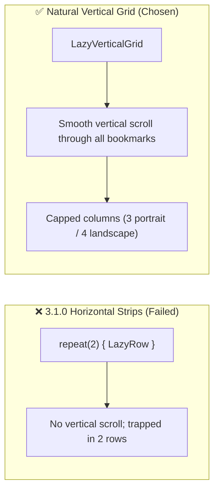
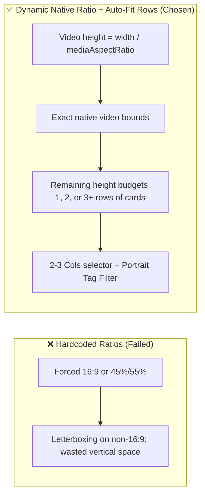
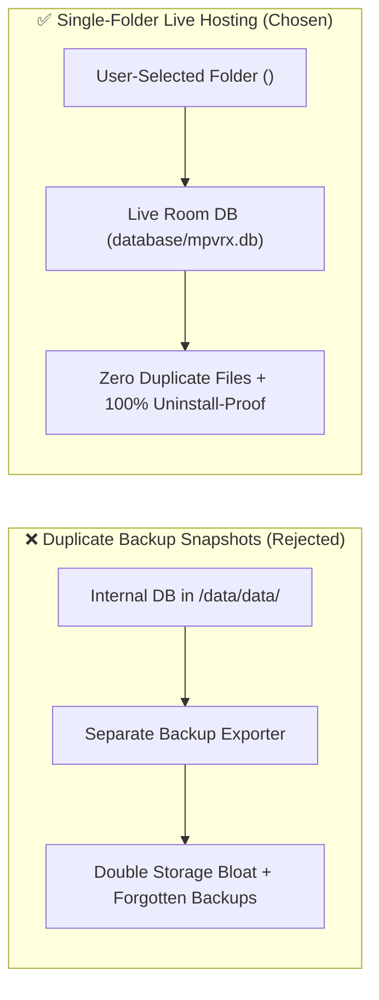
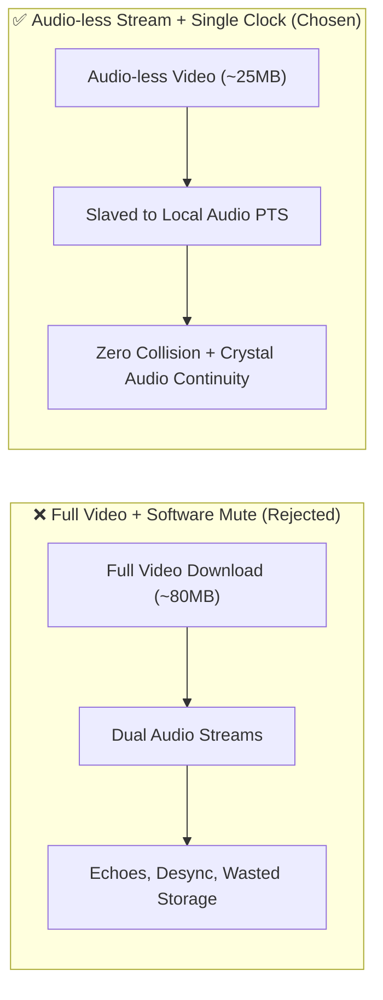
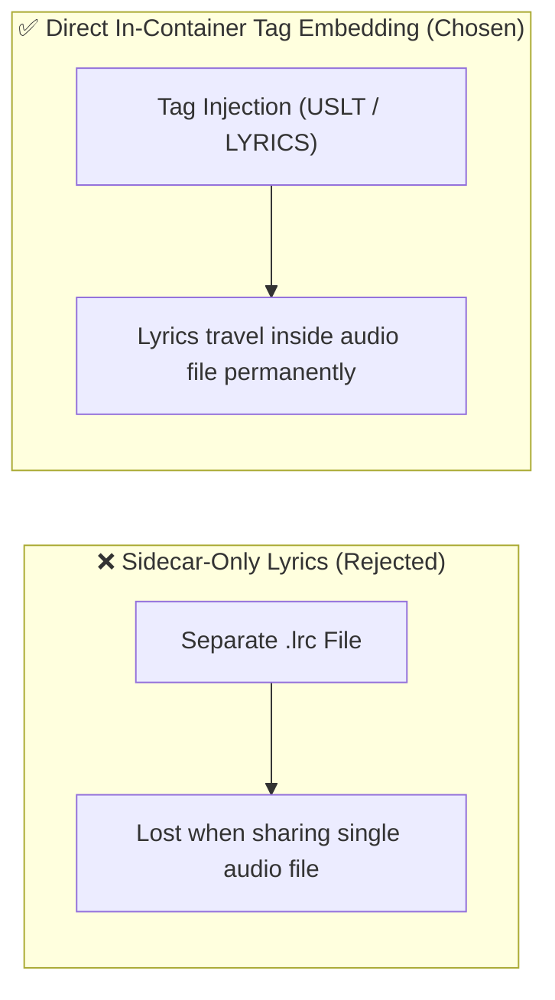

# Architectural Decisions, Pivots & Landmines (`DECISIONS_AND_TRAPS.md`)
> **1-Line Summary:** Records architectural pivots, rationale behind core choices, and critical engineering landmines across mpvRx.

## 1. Architectural Decisions & Pivot History

### [DECISION: Restore-Natural-Vertical-Scroll-Gallery] | Aliases: gallery vertical scroll, reject horizontal strips, gallery column caps
> **1-Line Summary:** Replaced flawed two-row horizontal strip design (`repeat(2) { LazyRow }`) with natural vertically scrollable `LazyVerticalGrid` capped at 3 columns (portrait) and 4 columns (landscape).
* **Decision Maker:** `[DECIDED BY: HUMAN - Confirmed by Agent]`
* **Original User Intention:** Browse all bookmarks smoothly via natural vertical scrolling, with space for a search bar and autocomplete tag suggestions.
* **Options Considered:**
  * **Option A (Rejected in 3.1.0):** `repeat(2) { LazyRow }` with hardcoded 34%/33%/33% height budgets. Failed because it trapped users into two horizontal side-scrollers, completely cutting off vertical access to the library.
  * **Option B (Chosen):** Responsive `LazyVerticalGrid` with infinite vertical scroll. Top area hosts search bar and autocomplete tag pills. Column caps are enforced (max 3 portrait, max 4 landscape).
* **Visual Pivot Map (What Failed vs. What Works):**

* **Code Anchors (Grep Targets):**
  * `app/src/main/java/app/gyrolet/mpvrx/ui/bookmarks/BookmarkGalleryScreen.kt` -> `BookmarkGalleryScreen`, `resolveColumnCount`

---

### [DECISION: Dynamic-Portrait-Native-Ratio-Video-And-Dynamic-Rows] | Aliases: portrait native video, dynamic rows, portrait 2-3 columns, portrait tag filter
> **1-Line Summary:** Portrait mode computes video height dynamically based on native media aspect ratio (no hardcoding), budgets remaining height for bookmark cards (1, 2, or 3+ rows if space permits), caps columns between 2 and 3, and adds a tag filter button in the portrait toolbar.
* **Decision Maker:** `[DECIDED BY: HUMAN - Confirmed by Agent]`
* **Original User Intention:** Video plays natively at its true aspect ratio without artificial black bars. The drawer below adapts to whatever vertical space is left, supporting 1, 2, or 3+ rows of 16:9 cards, 2 or 3 columns only, and direct tag filtering in portrait.
* **Options Considered:**
  * **Option A (Rejected in 3.0.5 & 3.1.0):** Hardcoding 16:9 (`width * 9 / 16`) or hardcoding 45%/55% split. Failed because letterboxing occurred on 21:9 or 4:3 videos, and fixed percentage heights broke on tall phones.
  * **Option B (Chosen):** Dynamic native video aspect ratio (`containerWidth / mediaAspectRatio`). The remaining screen height is dedicated to the drawer, allowing 1, 2, or 3+ rows of cards depending on available height, strictly 2 or 3 columns, with a portrait tag filter button.
* **Visual Pivot Map (What Failed vs. What Works):**

* **Code Anchors (Grep Targets):**
  * `app/src/main/java/app/gyrolet/mpvrx/ui/player/controls/PlayerControls.kt` -> `BookmarkSplitPanel`
  * `app/src/main/java/app/gyrolet/mpvrx/ui/player/controls/components/BookmarkListContent.kt` -> `BookmarkGridCard`, `BookmarkListContent`

---

### [DECISION: Non-Overflow-Compact-2-Tier-Landscape-Toolbar] | Aliases: compact landscape toolbar, prevent overflow, global scope toggle
> **1-Line Summary:** Replaced verbose text buttons in the landscape bookmark toolbar with compact icon buttons (Tier 1) and short toggle chips (Tier 2) to eliminate button collision/overflow at 20%-35% drawer widths.
* **Decision Maker:** `[DECIDED BY: HUMAN - Confirmed by Agent]`
* **Original User Intention:** Access all bookmark actions and scopes within a 20%-35% landscape sidebar without buttons wrapping awkwardly or overlapping each other.
* **Options Considered:**
  * **Option A (Rejected in 3.1.0):** Verbose text buttons (`🎬 This Video (Local)`, `Width: 25%`, `Card Count`). Caused severe text clipping, multi-line wrapping, and layout overflow at 20% width.
  * **Option B (Chosen):** Clean 2-tier design:
    * *Tier 1:* 4 icon buttons with tooltips (`🏷️ Filter`, `⊞ Add`, `↗ Gallery`, `✕ Close`).
    * *Tier 2:* Compact toggle chips (`Scope: 🎬/🌐`, `25%`, `1 Col`). Total width fits comfortably within 20% drawer.
* **Code Anchors (Grep Targets):**
  * `app/src/main/java/app/gyrolet/mpvrx/ui/player/controls/components/BookmarkListContent.kt` -> `BookmarkListContent`

---

### [DECISION: Align-Playback-Authentication-To-Secure-Folder-PIN] | Aliases: secure folder pin, eliminate double password, credential gate
> **1-Line Summary:** Direct playback challenge queries the Secure Folder's own password/PIN instead of the generic device PIN, eliminating double-prompt regressions.
* **Decision Maker:** `[DECIDED BY: HUMAN - Confirmed by Agent]`
* **Original User Intention:** Opening private files or bookmarks should ask for the Secure Folder's credentials, without asking for the device PIN again if the vault is already open.
* **Options Considered:**
  * **Option A (Rejected in 3.1.0):** Routing through system `BiometricPrompt` device credential regardless of Secure Folder state. Caused double password prompts when navigating from the vault to the player.
  * **Option B (Chosen):** Check if `SecureFolderRepository` is already unlocked. If not, challenge with the Secure Folder PIN/pattern directly.
* **Code Anchors (Grep Targets):**
  * `app/src/main/java/app/gyrolet/mpvrx/ui/securefolder/SecureUnlockActivity.kt` -> `launch`
  * `app/src/main/java/app/gyrolet/mpvrx/utils/media/MediaUtils.kt` -> `startGuarded`

---

### [DECISION: Single-Session-Unlock-Token-Vs-Per-Entry-Credential-Gates] | Aliases: secure folder prompts twice, double credential prompt, one prompt per session, session unlock token
> **1-Line Summary:** A process-scoped `SecureFolderSession` token unifies the folder-entry and playback credential gates — one unlock covers the whole session and clears when the app is backgrounded.
* **Decision Maker:** `[DECIDED BY: AGENT]`
* **Original User Intention:** Entering the Secure Folder and then opening a file inside it must never ask for the credential twice in one session (R-05).
* **Options Considered:**
  * **Option A (Rejected):** Keep the two independent gates (`SecureFolderGateScreen` per nav entry, `SecureUnlockActivity` per playback launch) each prompting on its own. This is exactly the reported double-prompt flow, and it contradicted [DECISION: Align-Playback-Authentication-To-Secure-Folder-PIN] Option B, which assumed an "already unlocked" check that never existed in the code.
  * **Option B (Chosen):** `domain/secure/SecureFolderSession.kt` marks the session unlocked on any gate success (folder entry PIN/biometric/setup, or the playback credential); every gate reads the token before prompting; `App.onActivityStopped` clears it when the app goes background (same contract as Secret Mode). Per-action prompts — destroy vault, PIN change, secret stats — intentionally keep asking.
* **Code Anchors (Grep Targets):**
  * `app/src/main/java/app/gyrolet/mpvrx/domain/secure/SecureFolderSession.kt` -> `SecureFolderSession`
  * `app/src/main/java/app/gyrolet/mpvrx/ui/securefolder/SecureUnlockActivity.kt` -> `authenticate`, `continueToTarget`
  * `app/src/main/java/app/gyrolet/mpvrx/ui/securefolder/SecureFolderGateScreen.kt` -> `Content`, `onAuthenticationSucceeded`
  * `app/src/main/java/app/gyrolet/mpvrx/App.kt` -> `onActivityStopped`

---

### [DECISION: Drawer-Scope-State-Lives-In-PlayerViewModel] | Aliases: scope toggle reset, video global toggle, bookmark drawer scope, chip survives reopen
> **1-Line Summary:** The bookmark drawer's `Video ⇄ Global` scope lives in `PlayerViewModel.inPlayerBookmarkScope` (`toggleInPlayerBookmarkScope()`), never in composable-local state, and both orientations carry the chip.
* **Decision Maker:** `[DECIDED BY: AGENT]`
* **Original User Intention:** The scope choice must survive drawer close/reopen and be togglable in the portrait drawer as well as the landscape sidebar (R-07).
* **Options Considered:**
  * **Option A (Rejected):** `rememberSaveable` inside `BookmarkSplitPanel`. The panel leaves composition whenever the drawer closes, so the toggle silently reset to `Video` on reopen, and the portrait header shipped without any scope chip at all — "toggling" in portrait was impossible.
  * **Option B (Chosen):** Scope state and `toggleInPlayerBookmarkScope()` live in `PlayerViewModel` (matching the `ARCHITECTURE.md` data-flow for this subsystem); `currentMediaId` comes from `bookmarkMediaId` so bookmark-less videos still classify rows correctly; a global row with no replay ref shows a toast instead of seeking the current file to a foreign timestamp.
* **Code Anchors (Grep Targets):**
  * `app/src/main/java/app/gyrolet/mpvrx/ui/player/PlayerViewModel.kt` -> `toggleInPlayerBookmarkScope`, `inPlayerBookmarkScope`, `bookmarkMediaId`
  * `app/src/main/java/app/gyrolet/mpvrx/ui/player/controls/components/BookmarkListContent.kt` -> `isGlobalScope`, `onCardClick`, `currentMediaId`

---

### [DECISION: Download-Discoverability-Vs-Companion-Downloader-Sheet] | Aliases: download button music, yt-dlp affordance, companion video downloader, attach to track
> **1-Line Summary:** R-06 ships the download *affordances* (action-row ⬇, overflow entry, install messaging) on the existing engine; the companion-video sheet, `MusicCompanionDao` attach-binding and audio-replacement prompt stay a separate feature.
* **Decision Maker:** `[DECIDED BY: AGENT]`
* **Original User Intention:** A download action must be reachable from the video and music players when the build ships `ENABLE_YTDLP`, with install/status messaging when the engine is missing and no dead UI otherwise (R-06).
* **Options Considered:**
  * **Option A (Rejected):** Build the full [FEATURE: Granular-Quality-Downloader-And-Configurable-Presets] surface (`CompanionVideoDownloaderSheet`, `ResolutionOptionGrid`, `AudioReplacementConfirmDialog`, `MusicCompanionDao.companionVideoPath` binding). None of those components exist yet, and the R-06 item spec scoped the repair to discoverability ("no downloader logic changes").
  * **Option B (Chosen):** Route the new entries into the existing download path — the VideoQuality sheet's per-quality download buttons (presets + enqueue) — and into `YtdlpInstallPromptDialog` / `YtdlpInstallProgressDialog` when `YtdlpManager.isInstalled` is false. `ENABLE_YTDLP=false` builds render no download UI at all.
* **Code Anchors (Grep Targets):**
  * `app/src/main/java/app/gyrolet/mpvrx/ui/player/controls/AudioPlayerControls.kt` -> `MusicActionRowButton.DOWNLOAD`, `showYtdlpInstallPrompt`
  * `app/src/main/java/app/gyrolet/mpvrx/ui/player/controls/components/sheets/MoreSheet.kt` -> `onDownloadClick`
  * `app/src/main/java/app/gyrolet/mpvrx/ui/player/controls/PlayerSheets.kt` -> `Sheets.More`, `YtdlpManager.isInstalled`

---

### [DECISION: Vault-Storage-Persistence-Strategy-Survive-Uninstall] | Aliases: survive uninstall, external app storage, nomedia vault, sdcard documents mpvrx
> **1-Line Summary:** Private vault media, bookmark thumbnails, database backups, settings, and PIN verifiers are relocated to persistent storage (`/sdcard/Documents/mpvRx/` with `.nomedia`) so uninstalling the app never destroys user data.
* **Decision Maker:** `[DECIDED BY: HUMAN - Confirmed by Agent]`
* **Original User Intention:** Prevent catastrophic data loss where deleting or reinstalling the app destroys the private video collection, database bookmarks, and PIN settings.
* **Options Considered:**
  * **Option A (Rejected):** Storing in `context.filesDir` or `context.getExternalFilesDir()`. Android automatically wipes these directories on uninstallation, permanently deleting all user files.
  * **Option B (Chosen):** Persistent directory at `/sdcard/Documents/mpvRx/` with `.nomedia`. Encrypted files, thumbnails, Room DB backups, and salted Argon2id/PBKDF2 PIN verifiers persist permanently. On reinstallation, mpvRx recognizes the vault and prompts the existing PIN.
* **Code Anchors (Grep Targets):**
  * `app/src/main/java/app/gyrolet/mpvrx/database/repository/SecureFolderRepository.kt` -> `SecureFolderRepository`
  * `app/src/main/java/app/gyrolet/mpvrx/domain/bookmark/BookmarkThumbnailStore.kt` -> `BookmarkThumbnailStore`

---

### [DECISION: Configurable-Landscape-Music-Split-And-Multi-Line-Lyrics] | Aliases: music player split, landscape 50-50, 40-60, 2-line lyrics
> **1-Line Summary:** Music player provides 2-line (default) or 3-line lyrics in portrait with dynamic artwork scaling, and configurable split ratios (`50/50`, `40/60`, `60/40`) in landscape.
* **Decision Maker:** `[DECIDED BY: HUMAN - Confirmed by Agent]`
* **Original User Intention:** Prevent transport control clipping in portrait mode, and allow customizable layout priority between artwork/video and scrolling lyrics in landscape mode.
* **Code Anchors (Grep Targets):**
  * `app/src/main/java/app/gyrolet/mpvrx/ui/player/controls/AudioPlayerControls.kt` -> `AudioPlayerControls`

### [DECISION: Single-Folder-Live-Hosting-Vs-Duplicate-Backup-Files] | Aliases: single folder storage, zero bloat, live room db external, no duplicate backups
> **1-Line Summary:** Live Room SQLite database and all media/vault assets are hosted directly in a single user-selected root folder, completely eliminating redundant backup files and storage bloat.
* **Decision Maker:** `[DECIDED BY: HUMAN]`
* **Original User Intention:** Avoid having a separate manual/scheduled backup file that can be forgotten, doubles storage space, or leads to desync. A single user-selected folder in basic storage must host everything directly, permanently surviving app uninstallation, updates, or wipes.
* **Options Considered:**
  * **Option A (Rejected):** Storing the live database in `/data/data/...` and periodically exporting snapshot copies to `/sdcard/Documents/mpvRx/backups/`. Rejected because users can forget to trigger backups, snapshot files double storage footprint, and background backup tasks cause overhead.
  * **Option B (Chosen):** Instantiating the live Room SQLite database directly inside `<UserRoot>/database/mpvrx.db` via custom path builder. Vault files, thumbnails, configurations, music, companion videos, and lyrics live directly in subfolders under this single root. No duplicate backup file is needed.
* **Visual Pivot Map (What Failed vs. What Works):**

* **Code Anchors (Grep Targets):**
  * `app/src/main/java/app/gyrolet/mpvrx/database/AppDatabase.kt` -> `buildExternalDatabase`
  * `app/src/main/java/app/gyrolet/mpvrx/domain/storage/DurableStorageManager.kt` -> `resolveRootDirectory`

---

### [DECISION: Audio-less-Companion-Video-Vs-Remuxed-Audio-Collision] | Aliases: audioless video download, collision free sync, companion video
> **1-Line Summary:** Download audio-less video streams (`bestvideo[ext=mp4]`) when local audio exists to prevent dual-audio collisions and reduce download size by up to 60%.
* **Decision Maker:** `[DECIDED BY: HUMAN]`
* **Original User Intention:** Watch companion music videos while listening to pristine local audio without audio desync, phase cancellation, or echo.
* **Options Considered:**
  * **Option A (Rejected):** Downloading full video with audio and muting in software or playing both streams simultaneously. Rejected because it wastes bandwidth/storage, risks audio collisions, and causes timeline drift.
  * **Option B (Chosen):** Downloading audio-less video streams via yt-dlp. When downloading full videos without existing audio, an intelligent confirmation prompt offers to replace old standalone audio to avoid duplicate file bloat.
* **Visual Pivot Map (What Failed vs. What Works):**

* **Code Anchors (Grep Targets):**
  * `app/src/main/java/app/gyrolet/mpvrx/domain/download/CompanionVideoDownloader.kt` -> `downloadAudiolessStream`
  * `app/src/main/java/app/gyrolet/mpvrx/ui/player/PlayerViewModel.kt` -> `attachCompanionVideo`

---

### [DECISION: Musicolet-Style-Direct-Tag-Embedding-Vs-Sidecar-Only] | Aliases: musicolet lyrics, embed in audio file, uslt tag, vorbis comments
> **1-Line Summary:** Embeds synchronized and unsynchronized lyrics directly into audio container metadata tags (`USLT`, `LYRICS`, `©lyr`) alongside `.lrc` sidecars for universal player portability.
* **Decision Maker:** `[DECIDED BY: HUMAN]`
* **Original User Intention:** Match Musicolet's capability where lyrics travel permanently inside the audio file itself so they are never lost when sharing or transferring files.
* **Options Considered:**
  * **Option A (Rejected):** Storing lyrics exclusively in external `.lrc` files. Rejected because moving files or copying them to cars/external devices loses the lyric association.
  * **Option B (Chosen):** Dual-layer persistence: update both the external `.lrc` file and embed the lyrics directly into the physical audio file container tags without re-encoding audio bytes.
* **Visual Pivot Map (What Failed vs. What Works):**

* **Code Anchors (Grep Targets):**
  * `app/src/main/java/app/gyrolet/mpvrx/domain/metadata/AudioTaggingEngine.kt` -> `embedLyricsIntoAudioFile`

---

### [DECISION: Single-Point-Anchor-Alignment-Vs-Full-Manual-Lyric-Editing] | Aliases: 1-point lyric sync, anchor line, uniform shift
> **1-Line Summary:** Replaces tedious line-by-line manual timestamp editing with 1-point anchor calibration that uniformly shifts all lines by the calculated playhead delta $\Delta t$.
* **Decision Maker:** `[DECIDED BY: HUMAN]`
* **Original User Intention:** Quickly fix song lyric offsets caused by intro dialogues or music video delays in one simple tap.
* **Options Considered:**
  * **Option A (Rejected):** Forcing the user to manually adjust timestamps on 50+ lines individually. Extremely tedious and error-prone.
  * **Option B (Chosen):** User taps "Anchor to Current Time" on any single line as it plays. The app calculates $\Delta t = T_{\text{current}} - T_{\text{lyric}}$ and instantly shifts all lines across the song, saving changes permanently.
* **Code Anchors (Grep Targets):**
  * `app/src/main/java/app/gyrolet/mpvrx/domain/lyrics/LyricsOffsetCalibrator.kt` -> `anchorLineToPlayhead`

---

## 2. Do-Not-Touch Engineering Landmines (Traps)

### [TRAP: Never-Use-Java-Net-URI-For-Local-Filesystem-Paths] | Aliases: uri npe, runcatching trap, path parsing bug
> **1-Line Summary:** Never use `java.net.URI` for local file path parsing; opaque URIs and non-ASCII characters yield null path, bypassing `runCatching` failure checks.
* **Strict Rule:** **NEVER** instantiate `java.net.URI` to normalize or parse local filesystem paths. Use pure string splitting and segment folding.
* **Protected Code Anchors (Grep Targets):**
  * `app/src/main/java/app/gyrolet/mpvrx/ui/player/PlaybackModels.kt` -> `normalizeLocalPath`

---

### [TRAP: Dual-Orientation-UI-Consistency-Rule] | Aliases: separate orientation preview, dual geometry
> **1-Line Summary:** Never force identical layout logic across portrait and landscape; always implement and preview both orientations separately.
* **Strict Rule:** **NEVER** apply portrait-specific height budgets to landscape or landscape percentage menus to portrait. Every UI change must be configured and visually previewed for both modes.

---

### [TRAP: Prevent-Layout-Overflow-In-Compact-Sidebar-Drawers] | Aliases: toolbar collision, compact buttons, icon tooltips
> **1-Line Summary:** At 20% sidebar width in landscape, horizontal space is under 180dp; never place text-heavy buttons or multi-word chips in the toolbar.
* **Strict Rule:** Use compact icon buttons with accessible content descriptions/tooltips for actions. Keep toggle chips to 2-4 characters (e.g. `20%`, `1C`, `🌐/🎬`).

---

### [TRAP: Android-Scoped-Storage-Direct-Database-Path] | Aliases: external database wal, scoped storage sqlite, direct db path
> **1-Line Summary:** On Android 11+ (API 30+), SQLite WAL mode requires direct filesystem access (`MANAGE_EXTERNAL_STORAGE` or direct POSIX `File` access), never content URI streams.
* **Strict Rule:** **NEVER** attempt to run an active Room SQLite database through `ContentResolver` / `DocumentFile` stream wrappers. SQLite requires direct file descriptor locking (`fcntl` / flock) and SHM memory mapping. The user-selected directory must be located in standard external storage (`/sdcard/Documents/mpvRx/`) using direct `File` paths.
* **Protected Code Anchors (Grep Targets):**
  * `app/src/main/java/app/gyrolet/mpvrx/database/AppDatabase.kt` -> `buildExternalDatabase`

---

### [TRAP: Landscape-Top-Gesture-Strip-Has-No-Status-Bar-Inset] | Aliases: dead top buttons, buttons under clock, gallery auto unreachable, status bar overlap
> **1-Line Summary:** In landscape the status bar lies over the top edge of the app; any control row that skips `WindowInsets.statusBars` is visually present but hit-tested under the system UI.
* **Strict Rule:** Every top-anchored horizontal row in landscape (player action bar, chip row, bookmark gallery header, sheet title bars) **MUST** consume `WindowInsets.statusBars` plus horizontal cutout insets. Never assume a landscape window starts below the status bar: the app is edge-to-edge, and a row that looks fine in a screenshot can still be untappable because the system consumes those pixels.
* **Verification:** On a notched landscape device, tap the first and last control of each top row. "Visible but inert" means the inset is missing, not that the click handler is broken.
* **Protected Code Anchors (Grep Targets):**
  * `app/src/main/java/app/gyrolet/mpvrx/ui/player/controls/PlayerControls.kt` -> `windowInsetsPadding(WindowInsets.statusBars)`
  * `app/src/main/java/app/gyrolet/mpvrx/ui/bookmarks/BookmarkGalleryScreen.kt` -> gallery header row

---

### [TRAP: Portrait-Only-Editors-Must-Restore-The-Players-Orientation] | Aliases: bookmark editor portrait, keyboard covers landscape editor, lost landscape after edit, orientation restore
> **1-Line Summary:** Text-heavy editors (bookmark editor, metadata editor) must be forced to portrait while open, then restore the exact orientation the player had — a forced rotation that is not undone strands the user in portrait.
* **Strict Rule:** Keyboard-driven editors request `SCREEN_ORIENTATION_PORTRAIT` on open and **must** restore the saved orientation on close (save, cancel, back, and process-death restore). The restore target is the one the player was using before the editor opened: a manual rotation-button choice outranks the media preference, and split-screen/freeform still hands orientation to the system. Never let the editor's request leak into normal playback.
* **Verification:** Landscape player → open editor → editor is portrait with the focused field above the IME → save/cancel/back → player is landscape again with the same position and a live surface.
* **Protected Code Anchors (Grep Targets):**
  * `app/src/main/java/app/gyrolet/mpvrx/ui/player/PlayerActivity.kt` -> `setRequestedOrientation`, `setOrientation`, `PlayerOrientationPolicy.manualOrientation`
  * `app/src/main/java/app/gyrolet/mpvrx/ui/player/controls/PlayerSheets.kt` -> `Sheets.BookmarkEditor`
