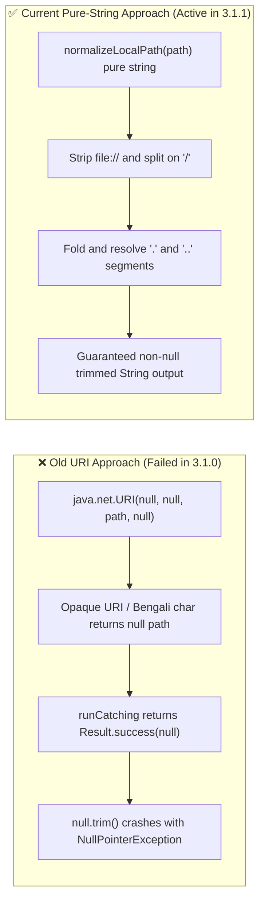
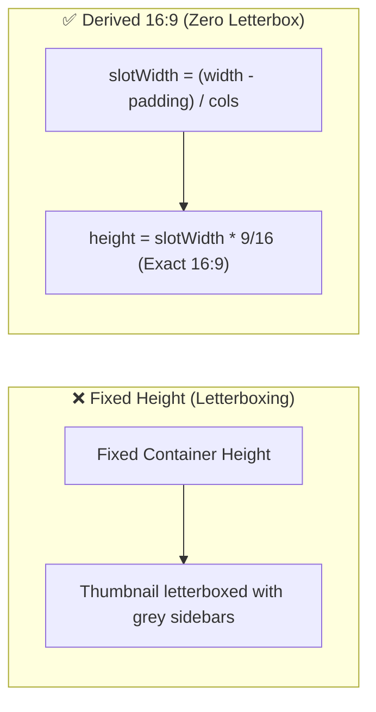

# Architectural Decisions, Pivots & Landmines (`DECISIONS_AND_TRAPS.md`)
> **1-Line Summary:** Records architectural pivots, rationale behind core choices, and critical engineering landmines across mpvRx.

## 1. Architectural Decisions & Pivot History

### [DECISION: Pure-String-Local-Path-Normalization] | Aliases: uri normalization fix, npe crash, unicode bengali filenames
> **1-Line Summary:** Replaced `java.net.URI`-based path normalization with pure-string segment traversal to prevent NullPointerException crashes on non-ASCII filenames and content URIs.
* **Decision Maker:** `[DECIDED BY: AGENT - Approved by Human]`
* **Original User Intention:** Allow bookmarking, playback history, and watch statistics tracking on all video files without crashing regardless of language or URI scheme.
* **Options Considered:**
  * **Option A (Rejected):** Use `java.net.URI(null, null, path, null).normalize().path`. Failed because `URI` parses colons as schemes, treating strings like `media:v2:...` or non-ASCII Bengali paths as opaque URIs. For opaque URIs, `normalize().path` returns Java `null`. Kotlin's `runCatching` treats `null` as success, and `.trim()` on `null` crashes with `NullPointerException` on Room Flow threads.
  * **Option B (Chosen):** Pure string segment normalization in `PlaybackIdentity.normalizeLocalPath` that strips `file://` prefixes, splits on `/`, resolves `.` and `..`, unifies backslashes, and preserves non-file URIs as trimmed strings.
* **Visual Pivot Map (What Failed vs. What Works):**

* **Code Anchors (Grep Targets):**
  * `app/src/main/java/app/gyrolet/mpvrx/ui/player/PlaybackModels.kt` -> `PlaybackIdentity`, `normalizeLocalPath`

---

### [DECISION: Height-Budget-Derived-Card-Dimensions] | Aliases: 16:9 bookmark cards, eliminate letterboxing, split layout budget
> **1-Line Summary:** Derives card height dynamically from slot width times 9/16 instead of stretching to fixed container heights.
* **Decision Maker:** `[DECIDED BY: AGENT - Approved by Human]`
* **Original User Intention:** Display crisp, non-distorted bookmark thumbnails without letterbox flanks or cut-off timestamps.
* **Options Considered:**
  * **Option A (Rejected):** Fixed slot height or aspect ratio modifiers applied to card wrappers. Caused black or grey letterboxing bars on left and right sides of 16:9 frames.
  * **Option B (Chosen):** Calculate `slotWidth` from `(maxWidth - padding) / columns` and set `cardHeight = (slotWidth * 9 / 16).coerceIn(...)`. Cards fit their content with zero letterboxing.
* **Visual Pivot Map (What Failed vs. What Works):**

* **Code Anchors (Grep Targets):**
  * `app/src/main/java/app/gyrolet/mpvrx/ui/player/controls/components/BookmarkListContent.kt` -> `BookmarkGridCard`, `rowHeight`

---

### [DECISION: Synchronous-In-Memory-Security-Registry] | Aliases: secure media registry, synchronous private check
> **1-Line Summary:** Caches private file paths and identities in an in-memory `SecureMediaRegistry` snapshot rather than querying asynchronous Room flows during UI intent dispatch.
* **Decision Maker:** `[DECIDED BY: AGENT - Approved by Human]`
* **Original User Intention:** Prevent private media from launching unauthenticated when initiated via external view intents or gallery clicks.
* **Options Considered:**
  * **Option A (Rejected):** Querying `SecureFolderRepository.observeAll()` asynchronously during click handlers. Failed because intent dispatch is synchronous; asynchronous delays allowed unauthenticated frames to render before the check completed.
  * **Option B (Chosen):** `SecureMediaRegistry` provides synchronous `isProtectedReference()` checks backed by volatile memory snapshots updated whenever the database changes.
* **Code Anchors (Grep Targets):**
  * `app/src/main/java/app/gyrolet/mpvrx/domain/secure/SecureMediaRegistry.kt` -> `SecureMediaRegistry`, `isProtectedReference`

---

## 2. Do-Not-Touch Engineering Landmines (Traps)

### [TRAP: Never-Use-Java-Net-URI-For-Local-Filesystem-Paths] | Aliases: uri npe, runcatching trap, path parsing bug
> **1-Line Summary:** Never use `java.net.URI` for local file path parsing; opaque URIs and non-ASCII characters yield null path, bypassing `runCatching` failure checks.
* **Strict Rule:** **NEVER** instantiate `java.net.URI` to normalize or parse local filesystem paths. Use pure string splitting and segment folding.
* **Why This Trap Exists (Plain English):** In Kotlin, `runCatching { URI(null, null, path, null).normalize().path }.getOrDefault(fallback)` is broken by design when the lambda evaluates to `null`. `Result.success(null)` is returned because `null` is a valid nullable result. `getOrDefault` only uses the fallback when `isFailure` is true. Subsequent non-null assertions or virtual calls like `.trim()` blow up with `NullPointerException`.
* **Protected Code Anchors (Grep Targets):**
  * `app/src/main/java/app/gyrolet/mpvrx/ui/player/PlaybackModels.kt` -> `normalizeLocalPath`

---

### [TRAP: Release-Workflow-Subject-And-Version-Constraint] | Aliases: release yml regex, release push rejection
> **1-Line Summary:** GitHub Actions release workflow strictly requires commit subject matching `chore(release): vX.Y.Z` and identical version strings in `app/build.gradle.kts` and `CHANGELOG.md`.
* **Strict Rule:** **NEVER** push a release commit with an arbitrary commit message. The commit subject MUST be `chore(release): vX.Y.Z` and `versionName` in `app/build.gradle.kts` must exactly match the header in `CHANGELOG.md`.
* **Why This Trap Exists (Plain English):** `.github/workflows/release.yml` runs a Python regex validation step during `prepare`. If `versionName != version` or `CHANGELOG.md` lacks `^##\s+X.Y.Z`, the workflow throws `SystemExit` and cancels the release build.
* **Protected Code Anchors (Grep Targets):**
  * `.github/workflows/release.yml` -> `Validate the exact source that all build and publish jobs will check out`
  * `app/build.gradle.kts` -> `versionName`
  * `CHANGELOG.md` -> `## X.Y.Z`
