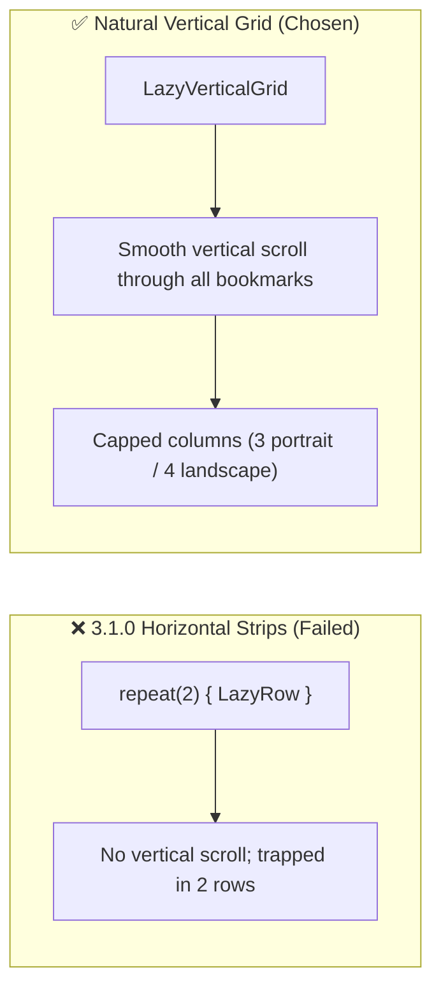
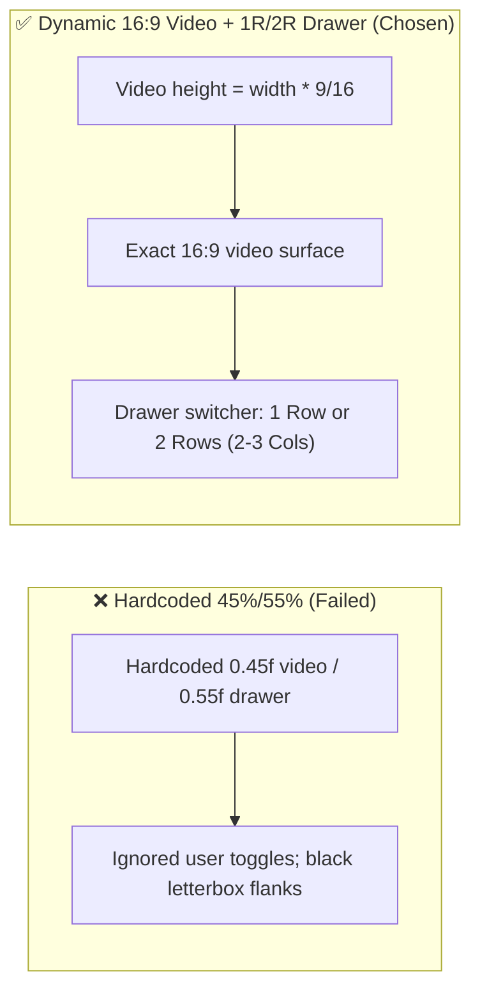

# Architectural Decisions, Pivots & Landmines (`DECISIONS_AND_TRAPS.md`)
> **1-Line Summary:** Records architectural pivots, rationale behind core choices, and critical engineering landmines across mpvRx.

## 1. Architectural Decisions & Pivot History

### [DECISION: Restore-Natural-Vertical-Scroll-Gallery] | Aliases: gallery vertical scroll, reject horizontal strips, gallery column caps
> **1-Line Summary:** Replaced flawed two-row horizontal strip design (`repeat(2) { LazyRow }`) with natural vertically scrollable `LazyVerticalGrid` capped at 3 columns (portrait) and 4 columns (landscape).
* **Decision Maker:** `[DECIDED BY: HUMAN - Confirmed by Agent]`
* **Original User Intention:** Browse all bookmarks smoothly via natural vertical scrolling, with space for a search bar and autocomplete tag suggestions.
* **Options Considered:**
  * **Option A (Rejected in 3.1.0):** `repeat(2) { LazyRow }` with hardcoded 34%/33%/33% height budgets. Failed because it trapped users into two horizontal side-scrollers, completely cutting off vertical access to the library.
  * **Option B (Chosen):** Responsive `LazyVerticalGrid` with infinite vertical scroll. Top area hosts search bar and autocomplete tag pills. Column caps are enforced (max 3 portrait, max 4 landscape).
* **Visual Pivot Map (What Failed vs. What Works):**

* **Code Anchors (Grep Targets):**
  * `app/src/main/java/app/gyrolet/mpvrx/ui/bookmarks/BookmarkGalleryScreen.kt` -> `BookmarkGalleryScreen`, `resolveColumnCount`

---

### [DECISION: Dynamic-Portrait-16-9-Video-And-Row-Switcher] | Aliases: portrait 16:9 video, 1-row 2-row switcher, portrait 2-3 columns
> **1-Line Summary:** Portrait mode uses a dedicated layout with dynamic 16:9 video surface and a 1-row or 2-row bookmark drawer switcher with 2 or 3 columns only.
* **Decision Maker:** `[DECIDED BY: HUMAN - Confirmed by Agent]`
* **Original User Intention:** Video plays natively at 16:9 without letterboxing, and the drawer below displays 16:9 bookmark cards with options for 1 or 2 rows visible.
* **Options Considered:**
  * **Option A (Rejected in 3.0.5 & 3.1.0):** Applying the landscape 20%-35% percentage menu to portrait, or hardcoding 45%/55% with forced 2 columns. Failed because percentages don't match 16:9 geometry, and hardcoded weights broke user controls.
  * **Option B (Chosen):** Dedicated portrait geometry: Video takes exact 16:9 height (`width * 9 / 16`). Drawer uses the remaining height and provides a 1-row vs 2-row visible switcher and 2 vs 3 columns selector.
* **Visual Pivot Map (What Failed vs. What Works):**

* **Code Anchors (Grep Targets):**
  * `app/src/main/java/app/gyrolet/mpvrx/ui/player/controls/PlayerControls.kt` -> `BookmarkSplitPanel`
  * `app/src/main/java/app/gyrolet/mpvrx/ui/player/controls/components/BookmarkListContent.kt` -> `BookmarkGridCard`

---

### [DECISION: In-Player-Global-Bookmark-Scope-Toggle] | Aliases: in-player scope toggle, this video vs all bookmarks
> **1-Line Summary:** Added a dedicated toggle in the landscape bookmark toolbar to switch between displaying bookmarks from This Video and All Videos (Global) directly in the player drawer.
* **Decision Maker:** `[DECIDED BY: HUMAN - Confirmed by Agent]`
* **Original User Intention:** Browse scenes and tagged moments from across the entire video library without leaving the player or opening full-screen modals.
* **Options Considered:**
  * **Option A (Rejected):** Only allowing cross-video bookmarks in the full-screen `BookmarkGalleryScreen` modal. Failed because it disrupted the active playback experience.
  * **Option B (Chosen):** In-drawer scope toggle button (`🎬 This Video` ⇄ `🌐 All Bookmarks`) allowing instant filtering right in the split panel.
* **Code Anchors (Grep Targets):**
  * `app/src/main/java/app/gyrolet/mpvrx/ui/player/controls/components/BookmarkListContent.kt` -> `BookmarkListContent`

---

### [DECISION: Align-Playback-Authentication-To-Secure-Folder-PIN] | Aliases: secure folder pin, eliminate double password, credential gate
> **1-Line Summary:** Direct playback challenge queries the Secure Folder's own password/PIN instead of the generic device PIN, eliminating double-prompt regressions.
* **Decision Maker:** `[DECIDED BY: HUMAN - Confirmed by Agent]`
* **Original User Intention:** Opening private files or bookmarks should ask for the Secure Folder's credentials, without asking for the device PIN again if the vault is already open.
* **Options Considered:**
  * **Option A (Rejected in 3.1.0):** Routing through system `BiometricPrompt` device credential regardless of Secure Folder state. Caused double password prompts when navigating from the vault to the player.
  * **Option B (Chosen):** Check if `SecureFolderRepository` is already unlocked. If not, challenge with the Secure Folder PIN/pattern directly.
* **Code Anchors (Grep Targets):**
  * `app/src/main/java/app/gyrolet/mpvrx/ui/securefolder/SecureUnlockActivity.kt` -> `launch`
  * `app/src/main/java/app/gyrolet/mpvrx/utils/media/MediaUtils.kt` -> `startGuarded`

---

### [DECISION: Vault-Storage-Persistence-Strategy] | Aliases: survive uninstall, external app storage, nomedia vault
> **1-Line Summary:** Private vault media, bookmark thumbnails, and settings are relocated to durable persistent app-external storage with `.nomedia` so uninstalling the app never destroys user data.
* **Decision Maker:** `[DECIDED BY: HUMAN - Confirmed by Agent]`
* **Original User Intention:** Prevent catastrophic data loss where deleting or updating the app deletes the user's private media library or bookmarks.
* **Code Anchors (Grep Targets):**
  * `app/src/main/java/app/gyrolet/mpvrx/database/repository/SecureFolderRepository.kt` -> `SecureFolderRepository`

---

## 2. Do-Not-Touch Engineering Landmines (Traps)

### [TRAP: Never-Use-Java-Net-URI-For-Local-Filesystem-Paths] | Aliases: uri npe, runcatching trap, path parsing bug
> **1-Line Summary:** Never use `java.net.URI` for local file path parsing; opaque URIs and non-ASCII characters yield null path, bypassing `runCatching` failure checks.
* **Strict Rule:** **NEVER** instantiate `java.net.URI` to normalize or parse local filesystem paths. Use pure string splitting and segment folding.
* **Protected Code Anchors (Grep Targets):**
  * `app/src/main/java/app/gyrolet/mpvrx/ui/player/PlaybackModels.kt` -> `normalizeLocalPath`

---

### [TRAP: Dual-Orientation-UI-Consistency-Rule] | Aliases: separate orientation preview, dual geometry
> **1-Line Summary:** Never force identical layout logic across portrait and landscape; always implement and preview both orientations separately.
* **Strict Rule:** **NEVER** apply portrait-specific height budgets to landscape or landscape percentage menus to portrait. Every UI change must be configured and visually previewed for both modes.
