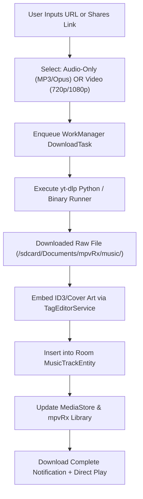

# Music Player Customization & Enhancement Suite (`MUSIC_PLAYER_CUSTOMIZATION.md`)
> **1-Line Summary:** Comprehensive engineering analysis, UI architecture, and implementation blueprint for music player customization: metadata/tag editing, multi-source lyrics syncing, video-in-artwork playback, and integrated media downloading.

## 1. Overview & Capabilities Matrix

The mpvRx Music Player combines the native audio decoding engine of `libmpv` with a lightweight, customizable Jetpack Compose audio interface. This document details the 5 core customization subsystems requested by the user, providing both the functional specifications and the underlying Android/Kotlin architecture.

| Subsystem | What It Does (User-Facing) | Underlying Tech & Libraries | Orientation Affordance |
| --- | --- | --- | --- |
| **[A] Metadata & Tag Editor** | Edit Title, Artist, Album, Genre, Track No, and Album Artwork directly in audio files. | `jaudiotagger` (or Android `MediaMetadataRetriever` + FFmpeg tagger) | Modal sheet in Portrait; Split editor in Landscape |
| **[B] Multi-Source Lyrics & Timing** | Search lyrics from LRCLIB, Musixmatch, local `.lrc`; edit timestamps with ±200ms offsets. | REST API clients + Room `LyricsCache` + Compose synced highlighting | 2-Line / 3-Line in Portrait; Full scroll list in Landscape |
| **[C] Video-in-Artwork Toggle** | Play the music video inside the album art viewport if downloaded; toggle between art and video. | `libmpv` video track enable/disable (`vid=1` vs `vid=no`) | Square/16:9 view in Portrait; Dedicated left panel in Landscape |
| **[D] Integrated Media Downloader** | Download audio (MP3/Opus) or video (720p/1080p), auto-tag with metadata, and register in DB. | `yt-dlp` Android binary runner + `DownloadManager` + WorkManager | Queue sheet in Portrait; Side-panel drawer in Landscape |
| **[E] Music Room Database** | Persistent indexing for downloaded tracks, playlists, playback counts, and lyrics caches. | AndroidX Room (`music_tracks`, `download_jobs`, `lyrics_entries`) | Dual-Orientation adaptive list & grid queries |

---

## 2. Core Customization Subsystems

### [CUSTOM: Metadata-And-Tag-Editor] | Aliases: id3 tag editor, music metadata, edit album art, song tags
> **1-Line Summary:** In-place audio file metadata editor allowing users to modify ID3v2, Vorbis Comments, and MP4 atoms with live artwork embedding.
* **User Intention:** Fix incorrect song titles, artist names, album titles, track numbers, and missing album art directly from the now-playing screen.
* **Fields Supported:**
  * Song Title (`TIT2` / `TITLE`)
  * Artist / Album Artist (`TPE1` / `TPE2` / `ARTIST`)
  * Album Name (`TALB` / `ALBUM`)
  * Track Number & Total Tracks (`TRCK` / `TRACKNUMBER`)
  * Release Year / Date (`TDRC` / `DATE`)
  * Genre (`TCON` / `GENRE`)
  * Album Art Cover (`APIC` / `METADATA_BLOCK_PICTURE` - square PNG/JPEG injection)
* **Architecture & Mechanics:**
  * Uses pure Kotlin/Java tagging engine (`org.jaudiotagger`) avoiding external process overhead.
  * Atomic save writes to a temporary file (`.temp_tag.mp3`), verifies file integrity, then renames back.
  * Automatically notifies `android.media.MediaScannerConnection` and updates the internal mpvRx Room database.
* **Code Anchors (Grep Targets):**
  * `app/src/main/java/app/gyrolet/mpvrx/domain/music/TagEditorService.kt` -> `TagEditorService`, `writeTags`
  * `app/src/main/java/app/gyrolet/mpvrx/ui/player/music/TagEditorDialog.kt` -> `TagEditorSheet`

---

### [CUSTOM: Multi-Source-Lyrics-And-Sync-Offset] | Aliases: search lyrics, lrclib, musixmatch, sync lyrics, offset lrc
> **1-Line Summary:** Multi-provider lyrics engine that searches LRCLIB, Musixmatch, and Genius, caches synchronized LRC timestamps, and provides ±100ms offset tuning.
* **User Intention:** Automatically locate synchronized line-by-line lyrics. If lyrics are slightly early or late, tap a quick offset button (`+100ms` / `-100ms`) to align perfectly.
* **How It Works:**
  1. **Provider Cascade:**
     * Provider 1: Local embedded lyrics (USLT / SYLT frames from audio file).
     * Provider 2: Local `.lrc` sidecar file (same filename in music folder).
     * Provider 3: LRCLIB public API (zero-auth, accurate crowd-sourced timestamped LRC).
     * Provider 4: Fallback search via Musixmatch / Genius (plain text).
  2. **Offset Calibration:**
     * A persistent per-track `lyrics_offset_ms` setting stored in Room DB.
     * When user taps `[+100ms]` or `[-100ms]`, time offset updates instantly in memory and persists.
  3. **Visual Rendering:**
     * **Portrait:** Defaults to 2-line display (toggleable to 3 lines). Current singing line highlighted in accent gold, upcoming line in soft purple.
     * **Landscape:** Left panel displays artwork/video; right panel displays 3 to 5 lines of flowing lyrics with auto-scroll.
* **Code Anchors (Grep Targets):**
  * `app/src/main/java/app/gyrolet/mpvrx/domain/music/LyricsProvider.kt` -> `fetchLyrics`, `syncWithPlayback`
  * `app/src/main/java/app/gyrolet/mpvrx/ui/player/controls/AudioPlayerControls.kt` -> `SyncedLyricsView`

---

### [CUSTOM: Audio-Video-Artwork-Toggle] | Aliases: music video toggle, video in artwork, play music video
> **1-Line Summary:** Toggles the artwork viewport between static album cover art and live mpv video playback when a music video file or stream is present.
* **User Intention:** When playing a song that has an accompanying music video, tap a single button (`🖼️ Art` ⇄ `🎬 Video`) to watch the video directly in the music player without switching activities.
* **How It Works:**
  * When `mediaFile` contains both audio and video tracks, or when an associated `.mp4` is found in the video storage folder:
    * `libmpv` is instructed via `setPropertyString("vid", "auto")` vs `setPropertyString("vid", "no")`.
    * In **Art Mode (`vid=no`):** `libmpv` decodes only audio, saving GPU power. The UI renders the album cover art with vinyl spin effect and blurred backdrop.
    * In **Video Mode (`vid=auto`):** The album art frame transforms into a Compose AndroidView rendering mpv's `SurfaceView`. Audio continues uninterrupted with zero latency or re-buffering.
  * In **Portrait:** Video occupies the 144dp–176dp square/16:9 viewport centered on the screen.
  * In **Landscape:** Video plays cleanly in the left 50% or 40% panel, while lyrics continue scrolling on the right.
* **Code Anchors (Grep Targets):**
  * `app/src/main/java/app/gyrolet/mpvrx/ui/player/controls/AudioPlayerControls.kt` -> `ArtworkOrVideoSurface`
  * `app/src/main/java/app/gyrolet/mpvrx/ui/player/PlayerViewModel.kt` -> `toggleMusicVideoMode`

---

### [CUSTOM: Integrated-Media-Downloader-And-Databasing] | Aliases: download music, yt-dlp android, database downloaded music, download queue
> **1-Line Summary:** Background downloader powered by `yt-dlp` allowing one-tap download of high-quality audio or video, automatic ID3 tag injection, and registration in the local Room library.
* **User Intention:** Paste a video or music link (or share to mpvRx), select Audio (Opus 160k / MP3 320k) or Video (720p / 1080p), and have it downloaded and organized into the music library automatically.
* **Download Pipeline Diagram:**

* **Storage Location (Survives Uninstall):**
  * Audio files: `/sdcard/Documents/mpvRx/music/`
  * Music videos: `/sdcard/Documents/mpvRx/music_videos/`
  * Thumbnails: `/sdcard/Documents/mpvRx/thumbnails/`
  * Database: `/sdcard/Documents/mpvRx/backups/mpvrx_database.db`
* **Room Database Schema:**
```kotlin
@Entity(tableName = "music_tracks")
data class MusicTrackEntity(
    @PrimaryKey val id: String, // SHA-256 hash of file path / URL
    val filePath: String,
    val title: String,
    val artist: String,
    val album: String,
    val genre: String?,
    val durationSeconds: Long,
    val hasVideoTrack: Boolean,
    val associatedVideoPath: String?,
    val lyricsPath: String?,
    val lyricsOffsetMs: Int = 0,
    val bitRateKbps: Int,
    val format: String, // "mp3", "flac", "opus", "mp4"
    val addedTimestamp: Long = System.currentTimeMillis()
)
```

---

### [CUSTOM: Music-Layout-Visibility-Menu] | Aliases: hide music regions, show music layout, music layout editor, compact music player
> **1-Line Summary:** Gives the music player the same per-region visibility menu the video player already has, so artwork, lyrics, seek/time, transport, and the utility bar can each be hidden per orientation.
* **User Intention:** Match the video player's layout customization: users who want a wall-of-lyrics view hide the artwork; users who want a compact dock hide the lyrics and utility bar. Every region toggle is independent, remembered separately for portrait and landscape, and applies without restarting playback.
* **Visual / UI Behavior:**
  * **Menu Entry:** A `Layout` action in the music player's overflow opens a region checklist, mirroring `ControlRegion` in the video editor.
  * **Regions:** Album artwork / embedded video, synced lyrics block, seekbar + time row, transport controls, bottom utility bar.
  * **Orientation Split:** Portrait keeps its own region set (region rows stack vertically); landscape keeps its own set (regions map to the left artwork panel and the right lyrics/transport panel).
  * **Safety Floor:** The transport and seek regions cannot both be hidden; at least one play/pause affordance always remains reachable.
* **Persistence:** One preference key per region per orientation, read at composition so rotation never flashes an unstyled frame.
* **Code Anchors (Grep Targets):**
  * `app/src/main/java/app/gyrolet/mpvrx/ui/preferences/ControlLayoutEditorScreen.kt` -> `ControlLayoutEditorScreen`, `ControlRegion`
  * `app/src/main/java/app/gyrolet/mpvrx/ui/player/controls/AudioPlayerControls.kt` -> `AudioPlayerControls`
  * `app/src/main/java/app/gyrolet/mpvrx/preferences/AppearancePreferences.kt` -> preference store pattern

---

## 3. Dual-Orientation Layout Specifications

### Portrait Mode Specifications
* **Vertical Layout Budget:**
  * Top Bar (60dp): Back arrow, "Now Playing", Tag Editor icon (`✏️`), Video Toggle (`🎬`), Overflow (`⋮`).
  * Artwork / Video Viewport (144dp x 144dp default in 2-line mode; 112dp in 3-line mode):
    * Shows square album art or plays music video embedded within the frame.
  * Title & Artist Block (44dp): Bold title, scrolling marquee if truncated.
  * Synchronized Lyrics Block (60dp for 2-line, 76dp for 3-line):
    * Line 1: Previous or upcoming line in muted purple (`12sp`).
    * Line 2: Active singing line in bright gold (`14sp-16sp` bold).
    * (Optional Line 3): Next line in muted gray (`12sp`).
  * Seekbar & Time Row (32dp): Scrubber with elapsed & remaining time.
  * Transport Controls (56dp): Shuffle, Previous, Large Play/Pause (48dp circle), Next, Repeat.
  * Bottom Utility Bar (36dp): Lyrics source chip, ±100ms offset button, Volume/Equalizer shortcut.

### Landscape Mode Specifications
* **Horizontal Split Budget (Toggleable Ratios):**
  * **Option 1: 50% / 50% Equal Split (Default)**
    * Left Panel (50%): Centered Album Art (160dp x 160dp) or 16:9 Music Video + Title/Artist + Tag Editor / Video Toggle buttons.
    * Right Panel (50%): Full 4-line synchronized scrolling lyrics, seekbar, and transport controls.
  * **Option 2: 40% / 60% Lyrics-Focused Split**
    * Left Panel (40%): Compact 120dp artwork + track info.
    * Right Panel (60%): Expansive 6-line synchronized lyrics display with auto-scroll.
  * **Option 3: 60% / 40% Video/Art-Focused Split**
    * Left Panel (60%): Large 16:9 embedded music video display.
    * Right Panel (40%): Compact 2-line lyrics + transport buttons.

---

## 4. Visual Preview Reference
For the complete interactive HTML/CSS preview of all 5 music customization subsystems across both Portrait and Landscape orientations, open:
[`docs/music_customization_preview.html`](file:///c:/Users/kazir/Documents/Agentic Harness/mpvRx/docs/music_customization_preview.html)
